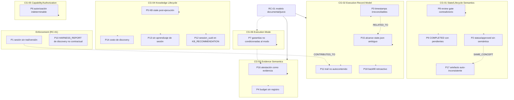
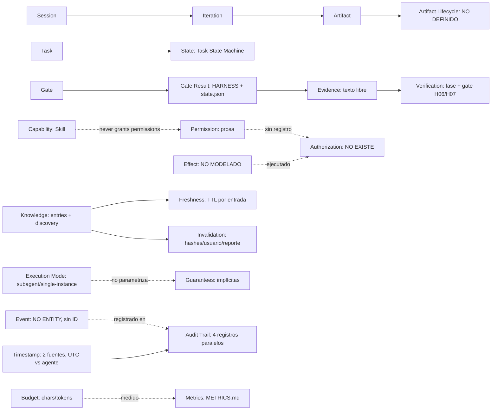

# Architectural Problem Model

> Modelo formal de problemas, causas conceptuales y dependencias arquitectónicas de ARgentOS,
> construido a partir de las dos auditorías previas (BeaconRBX + ARgentOS) y de una re-verificación
> de las afirmaciones contra las fuentes reales.
>
> **Estado:** análisis y diagnóstico. No se modifica ningún archivo de ARgentOS ni de BeaconRBX.
> No se redactan RFCs. Este documento es la base previa para decidir cambios y límites de RFC.
>
> **Regla de honestidad:** cuando una sección no tiene evidencia suficiente para una conclusión,
> se marca `NOT ENOUGH EVIDENCE` y se indica exactamente qué evidencia la resolvería.

---

## 1. Executive Summary

ARgentOS es un protocolo documental cuyo modelo de ejecución se apoya en cuatro registros paralelos
(`state.json`, `HARNESS_REPORT.md`, `SESSION_LOG.md`, `METRICS.md`), un harness evaluado por juicio
del agente y una capa mecánica mínima (scripts stdlib + validador estructural). BeaconRBX, usado
como caso real bajo la versión publicada 3.25.0, muestra que el modelo documental produce trazas
ricas pero no autoconsistentes.

Este modelo concluye:

- **18 problemas inventariados** (P1–P18), de los cuales **9 se confirman** como gaps verificables,
  **6 se degradan o rechazan** como falsos positivos de las auditorías previas, y **3 quedan como
  preguntas abiertas** o con evidencia insuficiente.
- **6 candidatos a Conceptual Gap** (CG-01…CG-06) que agrupan los problemas por carencia conceptual,
  no por tema.
- **1 causa raíz estructural** (RC-01): la decisión de diseño "documentos + juicio del agente" como
  modelo de ejecución. Los demás candidatos de causa raíz son en parte síntomas de RC-01 y en parte
  gaps conceptuales independientes (semántica de estado, conocimiento, autorización).
- **6 límites de RFC candidatos** (CR-1…CR-6), derivados de decisiones arquitectónicas distintas,
  no de agrupaciones temáticas.
- **El orden de evolución** es por dependencias conceptuales: primero semántica de estado/lifecycle,
  luego modelo de registro de ejecución, luego semántica de evidencia; autorización en paralelo;
  knowledge y modo de ejecución después.

La conclusión más importante: **la mayoría de los problemas confirmados son de enforcement y de
semántica no definida, no de ausencia de reglas**. Las reglas existen; lo que falta es que sean
verificables o que su significado sea unívoco. Por lo tanto, una parte de la remediación puede ser
enforcement mecánico sin tocar el modelo conceptual, y otra parte requiere decisiones
arquitectónicas previas.

---

## 2. Methodology

### 2.1 Base de evidencia

- Artefactos reales de BeaconRBX: `reference/.project/` (107 archivos: 5 sesiones, knowledge base,
  logs, briefs, harness reports, métricas, `state.json`, artefactos de iteración).
- Payload ARgentOS actual: `protocol/.agents/` (versión 3.26.0 en `dev`).
- Payload publicado 3.25.0 (la versión que declaran las sesiones 03–05): verificado vía
  `git show master:...` (máquina de estados, workflow 07, harness INDEX).
- Policies H01/H04, contratos (SESSION_LOG, METRICS, HARNESS_REPORT, EXECUTION_PLAN,
  CONTEXT_ARTIFACT, KB_RECOMMENDATION), estándares (INTENT_CONFIDENCE, NO_ASSUMPTIONS,
  BUDGET_MATERIALIZATION, PROTOCOL_BOUNDARIES, PROTOCOL_HEALTH, DISCOVERY_STATE_MACHINE,
  PROTOCOL_METRICS), taxonomía, `SKILLS.md`.
- Herramientas dev-only ejecutadas sobre la copia: `check_session_artifacts.py`,
  `audit_gates.py`, `aggregate_metrics.py --per-session --audit`, `gate_validator.py`,
  más una comparación mecánica de timestamps state.json ↔ HARNESS_REPORT.

### 2.2 Re-verificaciones específicas de esta tarea

1. La tabla de Task Profiles de la máquina de estados **3.25.0 publicada** (master) declara para
   `complex`: "The full cycle plus `REVIEW_REPORT.md`, and the discovery cycle when it applies" y
   "The full cycle plus the review gate". El workflow 07 de 3.25.0 **no menciona** `REVIEW_REPORT`
   ni el reviewer. → P8 es contradicción interna, no solo incumplimiento de sesión.
2. `harness/INDEX.md` (3.25.0) define `state.json` como "canonical source" del "protocol state of
   each iteration" con "gates passed with timestamps", **sin excluir** D*/H10/H15; el tool dev
   `aggregate_metrics.py` declara en su docstring que la dirección inversa no se marca porque
   "entries for non-state gates (e.g. H15) legitimately lack a state.json record". → P15 es una
   ambigüedad real del payload (¿qué gates entran en state.json?).
3. H01 items 16–17 permiten suposiciones con `user_confirmed = false` mientras ningún criterio de
   aceptación derive de ellas. → P6 como "violación de NO_ASSUMPTIONS" es falso positivo; el gap
   real es la ausencia de un registro de autorización (CG-05).
4. `audit_gates.py` sobre la copia movida a `reference/` reporta 11 violaciones; en el repo
   original las citas a `docs/...` y a archivos de tests resolverían. → P11 como evidencia de
   incumplimiento es un artefacto de método; el problema real es la no autocontención del trail
   (pregunta abierta, no defecto).
5. `aggregate_metrics.py --audit` valida una sola dirección (state ⊆ harness) y no compara
   timestamps. → P3 confirmado como gap de reconciliación, con la causa precisa identificada.
6. Taxonomía: no contiene entidades `capability` ni `authorization`; `skills/README.md` declara
   "A skill … never grants permissions". → CG-05 confirmado como ausencia formal.
7. 3.26.0 agrega el cierre "What we learned" (orchestrator §Closing Feedback) y el consentimiento
   de discovery (`discovery_require_consent`). → P13 y parte de P14 ya tienen respuesta parcial de
   diseño en la versión actual.

### 2.3 Convenciones

- **O = observación** demostrable por archivo/código/salida de herramienta.
- **I = inferencia** interpretativa sobre la observación.
- **Arq = interpretación arquitectónica** (juicio de diseño).
- **R = recomendación** de cambio.
- `NOT ENOUGH EVIDENCE` = la evidencia disponible no permite concluir; se indica qué falta.

### 2.4 Escalas

- Confianza: HIGH / MEDIUM / LOW.
- Estado de la conclusión: CONFIRMED / PLAUSIBLE / DEGRADED / REJECTED / OPEN_QUESTION /
  NOT_ENOUGH_EVIDENCE.
- Severidad: Alta / Media / Baja (informativa; no se usa como criterio de dependencia).

---

## 3. Problem Inventory

| ID | Problem | Type (primario) | Evidence (corta) | Confidence | Status |
|---|---|---|---|---|---|
| P1 | Sesión 246d4da2 sin trail de sesión ni versión de protocolo | MISSING_ENFORCEMENT | `246d4da2/` sin HARNESS/METRICS/state.json/SESSION_BRIEF; SESSION_LOG sin `protocol_version`; contrato SESSION_LOG exige versión y registro de gates | HIGH | CONFIRMED (observación); causa NOT_ENOUGH_EVIDENCE |
| P2 | Campos `status`/`approved`/`validation.complete` sin semántica; artefactos "draft"/`approved=false` con gates PASS | MISSING_LIFECYCLE (+ AMBIGUOUS_SEMANTICS) | `6bd97320/1/03-TASK_SPECIFICATION.md` (`status="draft"`, `state=TASK_READY`); `1/07-EXECUTION_PLAN.md` (`approved=false` con H04 PASS); contratos con `status=""` sin enum | HIGH | CONFIRMED (gap de semántica); "contradicción" DEGRADED |
| P3 | Timestamps irreconciliables entre state.json y HARNESS_REPORT | MISSING_INVARIANT | Comparación mecánica: 100 % de gates con doble registro difieren; b21e3a56 +3 h sistemático; 6bd97320 admite tiempos estimados; `--audit` no compara tiempos | HIGH | CONFIRMED |
| P4 | Eventos `context_budget` nunca registrados pese a 3.25.0 ("measured") | MISSING_ENFORCEMENT | `aggregate_metrics`: `budget_declared=0`, `consumed=0` en todo el proyecto; H15 afirma `budget_coherent PASS` | HIGH | CONFIRMED (enforcement) |
| P5 | KB de discovery stale dentro de la sesión que la invalida | STALE_KNOWLEDGE | Discovery 574bdb2f 03:25 publica "one-way pending"; plan 04 la invalida 04:30; b21e3a56 consume la KB; sin revalidación | HIGH (hecho) / MEDIUM (como defecto) | CONFIRMED (observación); PLAUSIBLE (deficiencia) |
| P6 | Acciones de red con suposición `user_confirmed=false`; autorización indeterminable | AUTHORIZATION_GAP | `246d4da2/2/03-TASK_SPECIFICATION.md` (`user_confirmed=false`); `2/07-EXECUTION_SUMMARY.md` (5 fuentes MIT, shallow clones); taxonomía sin entidad authorization | HIGH (gap formal) | CONFIRMED (gap); "violación" REJECTED |
| P7 | Modo single-instance dominante; verificación con rol nominalmente separado | ARCHITECTURAL_CONCERN | F1 en 2 sesiones; 3/4 sesiones core single-instance; plan 49 documenta mitigaciones; `orchestrator.md §5` "mode never changes the authority model" | MEDIUM | DEGRADED (como defecto); concern válido |
| P8 | "Review gate" obligatorio para complex pero sin trigger, sin check, y ausente en 2 sesiones | CONTRACT_CONTRADICTION | `AGENT_STATE_MACHINE.md` (3.25.0 y actual) vs `orchestrator.md §4.1` (MAY) vs workflow 07 sin mención; `gate_validator.py` sin check; 6bd97320/246d4da2 sin REVIEW_REPORT | HIGH | CONFIRMED |
| P9 | COMPLETED/Executed con gates humanos pendientes | ARCHITECTURAL_CONCERN (dimensiones de estado) | 246d4da2 cierra COMPLETED y declara "el gate de cierre de Fase 2 no puede declararse formal"; planes 03/05 Executed con smoke pendiente | HIGH (hecho) | DEGRADED (como defecto de ARgentOS en este caso); concern de diseño válido |
| P10 | HARNESS_REPORT de discovery (6707ffaa) sin estructura contractual (sin ENTRY/Summary/Metrics) | MISSING_ENFORCEMENT | `6707ffaa/HARNESS_REPORT.md` sin `<!-- ENTRY: -->`; `check_session_artifacts.py` solo valida comentarios existentes; `aggregate_metrics` cuenta 0 invocations | HIGH | CONFIRMED |
| P11 | Trail no autocontenido; auditoría post-hoc depende del estado del proyecto | OBSERVABILITY_GAP | `audit_gates.py` sobre copia movida reporta 11 violaciones que en el repo original resolverían | HIGH (limitación) | REJECTED (como defecto); OPEN_QUESTION (requisito) |
| P12 | `session_uuid` en KB_RECOMMENDATION sin semántica de ubicación | MISSING_CONTRACT | `574bdb2f/1/04-KB_RECOMMENDATION.md` usa `session_uuid` para entradas de discovery y `"legacy"` para curadas; contrato define el campo sin kind/path | HIGH | CONFIRMED |
| P13 | Cero entradas curadas de sesiones; KB solo legacy | MISSING_LIFECYCLE | kb-001…005 ingestados 08-17; ninguna sesión 03–05/09 escribe entradas; 3.25.0 no tenía cierre "What we learned" | HIGH (hecho) | REJECTED (como defecto bajo 3.25.0); residual OPEN_QUESTION |
| P14 | Costo de discovery full por TTL | NOT_ENOUGH_EVIDENCE | 2 discoveries full en 48 h; la de 08-19 estaba justificada por TTL **y** cambio de hashes (Plan 03) | MEDIUM | REJECTED (como defecto); medición pendiente |
| P15 | Alcance de `state.json` ambiguo; H07 faltante en 6bd97320 | AMBIGUOUS_SEMANTICS (+ MISSING_ENFORCEMENT) | `harness/INDEX.md` "gates passed" sin exclusión vs tool dev unidireccional; `6bd97320/1/state.json` sin H07 con HARNESS PASS | HIGH | CONFIRMED |
| P16 | Atestación de proceso aceptada como evidencia; sin clase observada/atestada | UNVERIFIABLE_CLAIM | `246d4da2/2/08-VERIFICATION_REPORT.md` (anti-copia: "escritos sin abrir sources/", atestación); H06 evidence check solo resuelve paths | HIGH | CONFIRMED |
| P17 | 01-TASK_ANALYSIS de 6bd97320 se contradice internamente | MISSING_INVARIANT | `6bd97320/1/01-TASK_ANALYSIS.md`: cuerpo "none is confirmed" vs header/sufficiency "resolved" | HIGH (hecho) / MEDIUM (como gap) | CONFIRMED (menor) |
| P18 | Entrada H15 pre-delegación reconstruida retroactivamente en 6bd97320 | NOT_ENOUGH_EVIDENCE | `6bd97320/SESSION_LOG.md` ("HARNESS_REPORT.md backfill … reconstructed from this log"); contrato METRICS prohíbe reconstrucción retroactiva; contrato HARNESS no lo prohíbe explícitamente | MEDIUM | OPEN_QUESTION |

---

## 4. Confirmed Problems

Para cada problema confirmado se separan las cinco capas pedidas. `O`/`I`/`Arq`/`R` según §2.3.

### P1 — Sesión sin trail y sin versión de protocolo

- **Observation (O):** `reference/.project/246d4da2-4789-40ab-80e3-c4b32a24d060/` contiene solo
  `SESSION_LOG.md` y 2 iteraciones de 8 artefactos; no hay `HARNESS_REPORT.md`, `METRICS.md`,
  `state.json`, `SESSION_BRIEF.md`. El `SESSION_LOG.md` no declara `protocol_version` ni registra
  invocaciones de harness. Los artefactos usan un score de intent 65/100 (escala ajena al estándar
  −3…+8 de `INTENT_CONFIDENCE.md`).
- **Problem (I/Arq):** bajo la versión 3.25.0, el contrato SESSION_LOG exige versión y el modelo
  exige HARNESS/METRICS/state.json por sesión; sin ellos la sesión es inauditable y los claims de
  "verificado por el orquestador" (08-VERIFICATION_REPORT) no tienen trail.
- **Inference (I):** que la sesión corrió bajo 3.25.0/3.26.0 y debía producir esos artefactos.
  **No es demostrable**: la sesión pudo correr bajo otro runtime/materialización.
- **Root Cause Candidate (Arq):** enforcement ausente de reglas ya declaradas (el contrato existe;
  nada detecta su violación en el proyecto adoptante).
- **Recommendation (R):** invariant "toda sesión declara protocol_version y produce artefactos
  raíz" con chequeo mecánico dev-only y, si se decide, items de policy para el orquestador.

**Causa específica: NOT ENOUGH EVIDENCE.** Para resolverla se necesita: identificar el runtime que
produjo la sesión (logs del CLI, `.sessions.json`, config de hooks), o confirmar que corrió con el
payload 3.25.0 y entonces es un caso de enforcement.

### P2 — Semántica de `status`/`approved`/`validation.complete` no definida

- **Observation (O):** en 6bd97320, `03-TASK_SPECIFICATION.md` declara `status="draft"` con
  `state=TASK_READY`; `07-EXECUTION_PLAN.md` declara `approved=false` ("pending H04 gate
  validation") con H04 PASS registrado; `05-CONTEXT_ARTIFACT.md` declara `validation.complete=false`
  con H02/H03 PASS. Los contratos dejan `status = ""` sin enum ni regla de actualización; el
  validador no los chequea.
- **Problem (Arq):** los campos existen en artefactos que otros agentes consumen; sin semántica,
  su lectura induce conclusiones erróneas (un lector del plan concluiría que no fue aprobado).
- **Inference (I):** "el artefacto contradice el gate" es una interpretación; el hecho es que el
  campo no tiene significado definido.
- **Root Cause Candidate (Arq):** lifecycle de artefactos submodelado (CG-01): no existe un
  concepto "estado del artefacto" derivado de los gates.
- **Recommendation (R):** decisión previa (¿status derivado del registro de gates o propiedad del
  escritor?); no un parche de sincronización.

### P3 — Timestamps irreconciliables

- **Observation (O):** comparación mecánica: en 574bdb2f, 6bd97320 y b21e3a56, todos los gates con
  doble registro tienen timestamps distintos entre `state.json` (escrito por `runner_state.py`,
  UTC mecánico) y `HARNESS_REPORT.md` (escrito por el agente). b21e3a56: +3 h sistemático;
  574bdb2f: H05 en state.json (03:40) anterior a la ejecución que gatea (log 04:00–04:30);
  6bd97320: log con "tiempos estimados adelantados al reloj" corregidos después.
- **Problem (Arq):** la causalidad de la traza no es reconstruible y el bypass scan post-H04 usa
  el timestamp de state.json como ventana, con lo cual la ventana es incorrecta.
- **Inference (I):** b21e3a56 mezcló hora local con sufijo Z; 574bdb2f usó tiempos estimados.
  Es la interpretación más económica; no está demostrada caso por caso.
- **Root Cause Candidate (Arq):** no hay una fuente canónica de eventos ni reconciliación (CG-02).
- **Recommendation (R):** definir reloj canónico UTC y un invariante de reconciliación
  bidireccional con comparación de tiempos.

### P4 — Eventos de budget nunca registrados

- **Observation (O):** `aggregate_metrics.py` reporta `context.budget_declared=0` y
  `context.budget_consumed=0` en todo el proyecto, mientras los H15 registran
  `budget_coherent: PASS` con valores 1500/1000.
- **Problem (Arq):** la afirmación "Budget respetado" del estándar es falsable solo contra el par
  declared/consumed; sin el par, no es falsable (3.25.0 lo declara "measured").
- **Inference (I):** los agentes no registraron los eventos. No hay evidencia de otra causa.
- **Root Cause Candidate (Arq):** enforcement ausente de un mecanismo ya formalizado (CG-02, lado
  eventos).
- **Recommendation (R):** registro mecánico o verificación en H15; sin cambio conceptual.

### P8 — Contradicción interna del "review gate"

- **Observation (O):** máquina de estados (3.25.0 en master y actual): complex ⇒ "the full cycle
  plus `REVIEW_REPORT.md` … plus the review gate". Orchestrator §4.1: invocación del reviewer
  "MAY". Workflow 07 (3.25.0): no menciona REVIEW_REPORT. `gate_validator.py`: no exige el
  artifact. Sesiones complex 6bd97320 y 246d4da2: sin REVIEW_REPORT.
- **Problem (Arq):** dos documentos normativos del payload imponen obligaciones incompatibles
  (obligatorio vs opcional) y ninguna es verificable; misma versión produce trazas distintas.
- **Inference (I):** "6bd97320 incumplió" es probable pero no demostrable sin decidir cuál fuente
  gana.
- **Root Cause Candidate (Arq):** dimensiones de estado mezcladas (CG-01): la "revisión" es una
  dimensión (verificación/aprobación) sin lugar propio en el modelo.
- **Recommendation (R):** decisión conceptual (gate vs rol vs artifact) antes de cualquier check.

### P10 — HARNESS_REPORT de discovery sin estructura contractual

- **Observation (O):** `6707ffaa/HARNESS_REPORT.md` no tiene `## Summary`, `## Metrics`,
  `## Final Decision` ni comentarios `<!-- ENTRY: ... -->`; el contrato HARNESS_REPORT los exige
  desde 2.0.0. `aggregate_metrics.py` cuenta 0 invocations para esa sesión; `check_session_artifacts.py`
  pasa porque solo valida comentarios existentes.
- **Problem (Arq):** la sesión de discovery es invisible para métricas y su trail de gates no es
  legible por herramientas.
- **Inference (I):** incumplimiento del agente o versión intermedia; indistinguible sin versión
  registrada (relacionado con P1).
- **Root Cause Candidate (Arq):** enforcement ausente de la presencia de estructura (CG-02).
- **Recommendation (R):** exigir presencia de ENTRY/METRIC y de secciones en los checkers.

### P12 — `session_uuid` en KB_RECOMMENDATION sin semántica de ubicación

- **Observation (O):** el JSON embebido usa `session_uuid` para entradas de discovery (que no son
  artefactos de sesión) y `"legacy"` para entradas curadas.
- **Problem (Arq):** un consumidor no puede resolver dónde vive la entrada recomendada.
- **Inference (I):** el agente completó un campo sin semántica definida con valores plausibles.
- **Root Cause Candidate (Arq):** identidad de entradas de conocimiento sin modelo (CG-04, lado
  identidad).
- **Recommendation (R):** campo `kind`/`path` en el contrato (Clase B); puede esperar a CG-04.

### P15 — Alcance de `state.json` ambiguo y registro incompleto

- **Observation (O):** `harness/INDEX.md` (3.25.0): state.json = "protocol state" con "gates passed
  with timestamps", sin excluir D*/H10/H15. En la práctica ninguna sesión registra D00/D01/H10/H15
  en state.json (el tool dev declara esa exclusión en su docstring). 6bd97320 no registra H07 pese
  al PASS en HARNESS_REPORT.
- **Problem (Arq):** "fuente de verdad" con alcance indefinido; el procedimiento de reanudación y
  los hooks leen un registro que puede estar incompleto sin detección.
- **Inference (I):** la exclusión de D*/H10/H15 es intencional (gates no-transición); el payload no
  lo declara. H07 faltante es no-registro del agente.
- **Root Cause Candidate (Arq):** modelo de registro de ejecución sin especificación de cobertura
  (CG-02).
- **Recommendation (R):** decisión sobre qué gates entran en state.json + chequeo bidireccional.

### P16 — Atestación aceptada como evidencia sin clase

- **Observation (O):** el criterio "kit desde cero" se verifica con evidencia "escritos sin abrir
  sources/ (regla declarada al worker; atestación en kits/hitbox/README.md)". El checker de H06
  resuelve `evidence` a archivos existentes o comandos en SESSION_LOG; no distingue atestación de
  observación.
- **Problem (Arq):** un gate PASS puede sustentarse en la afirmación del mismo agente sobre su
  propio proceso, sin clase que lo marque como atestación; la confianza asignable es distinta.
- **Inference (I):** la atestación probablemente es verdadera; el punto es que el modelo no puede
  distinguirla de una observación.
- **Root Cause Candidate (Arq):** semántica de evidencia sin clases ni asociación (CG-03).
- **Recommendation (R):** definir clases de evidencia (observada/medida/atestada) y asociación
  evidencia→criterio.

### P17 — Artefacto auto-inconsistente sin detección

- **Observation (O):** `6bd97320/1/01-TASK_ANALYSIS.md`: la sección Detected Ambiguities afirma
  "none is confirmed by the user in this session", mientras el header (Resolved Decisions) y
  Sufficiency afirman lo contrario.
- **Problem (Arq):** un mismo artefacto afirma dos estados incompatibles; ningún invariante lo
  detecta.
- **Inference (I):** el cuerpo no se actualizó tras la resolución; es un problema de escritura,
  pero sin invariante de consistencia interna es recurrente.
- **Root Cause Candidate (Arq):** lifecycle de artefactos sin consistencia interna (CG-01).
- **Recommendation (R):** incluir en CG-01 la auto-consistencia de secciones como invariante.

### P5 — KB stale dentro de la sesión que la invalida (observación confirmada)

- **Observation (O):** discovery de 574bdb2f publica a las 03:25 "project_sync_one_way_only /
  two-way in progress"; el plan 04 ejecuta el two-way y cierra a las 04:30; las entradas
  (`technical_debt.md`, `executive_summary.md`, `business_rules.md`, `project_flow.md`) no se
  revalidan; b21e3a56 consume la misma KB.
- **Problem (Arq):** la regla de frescura es de consumo (TTL/hash/usuario/reporte de
  inconsistencia); no hay disparador para "la sesión actual cambió los hechos descubiertos".
- **Inference (I):** el executor debía reportar la inconsistencia (trigger 6) y no lo hizo. La
  deficiencia real es que nada lo obliga a detectar que su propio cambio invalida claims.
- **Root Cause Candidate (Arq):** lifecycle de conocimiento sin transición de invalidación
  post-ejecución (CG-04).
- **Recommendation (R):** invalidación automática post-ejecución o check obligatorio del executor.

---

## 5. Architectural Concerns

### P6 — Separación capability/authorization ausente (como pregunta)

- **Observation (O):** 246d4da2 iter 2: `user_confirmed=false` para acceso a Internet; se
  ejecutaron búsquedas web y shallow clones. H01 items 16–17 permiten suposiciones no confirmadas
  si los AC no derivan de ellas. La taxonomía no tiene entidad de authorization; `skills/README.md`
  declara que una skill "never grants permissions"; PROTOCOL_BOUNDARIES prohíbe llamadas externas
  "unless explicitly instructed".
- **Problem (Arq):** no existe un registro formal que distinga capability disponible, permitida,
  solicitada, autorizada y ejecutada; la autorización del plan aprobado sobre efectos externos es
  indeterminable.
- **Inference (I):** no se puede afirmar que hubo una violación (la aprobación del plan podría
  constituir la instrucción); tampoco se puede afirmar que fue autorizada.
- **Root Cause Candidate (Arq):** CG-05.
- **Recommendation (R):** decisión conceptual sobre el registro de autorización; no un parche de
  wording.

### P7 — Garantías no condicionadas al modo de ejecución

- **Observation (O):** F1 en 6bd97320 y 574bdb2f; b21e3a56 entra preventivamente en single-instance;
  el protocolo documenta el modo y sus mitigaciones; "the mode never changes the authority model".
- **Problem (Arq):** no hay una declaración formal de qué garantías degradan en cada modo (p. ej.
  independencia de verificación) ni una marca de modo en los reportes.
- **Inference (I):** la "separación de roles" en single-instance es nominal. Es una interpretación;
  el protocolo nunca prometió independencia de instancia en ese modo.
- **Root Cause Candidate (Arq):** CG-06.
- **Recommendation (R):** decisión sobre garantías por modo.

### P9 — Estado terminal y aprobaciones humanas (como pregunta de diseño)

- **Observation (O):** las sesiones cierran COMPLETED/Executed con pendientes humanos
  explícitamente fuera de alcance; 246d4da2 dice que el gate de cierre no puede declararse formal.
- **Problem (Arq):** no hay representación de "cierre técnico con pendientes de gobernanza"; la
  semántica de COMPLETED (¿relativa al alcance?) no está definida.
- **Inference (I):** en BeaconRBX el comportamiento fue consistente con el alcance confirmado por
  el usuario; la crítica a "Executed" de los planes del proyecto aplicó convenciones de ARgentOS a
  gobernanza externa (overreach).
- **Root Cause Candidate (Arq):** dimensiones de estado mezcladas (CG-01).
- **Recommendation (R):** decisión de separación de dimensiones; no agregar estados.

### P11 — Autocontención del trail (pregunta, no defecto)

- **Observation (O):** `audit_gates.py` sobre la copia movida reporta 11 PASS no reproducibles;
  en el repo original las rutas citadas existirían.
- **Problem (Arq):** si el requisito es "auditar sin el proyecto original", el trail actual no lo
  cumple; el requisito no está declarado.
- **Inference (I):** ninguna; es una pregunta de requisito (¿debe ser autocontenido?).
- **Root Cause Candidate (Arq):** CG-02 (el registro no especifica qué incluye para ser
  reproducible).
- **Recommendation (R):** responder la pregunta antes de tocar herramientas.

### P13 — Aprendizaje de sesiones (residual)

- **Observation (O):** 0 entradas curadas de sesiones en BeaconRBX; 3.25.0 no tenía la vía;
  3.26.0 agrega el cierre "What we learned" (orchestrator decide y persiste).
- **Problem (Arq):** el workflow de creación de entradas sigue subespecificado (¿quién verifica que
  la entrada se escribió? ¿qué filtro se aplica?). Sin evidencia de fallo en 3.26.0.
- **Inference (I):** ninguna adicional.
- **Root Cause Candidate (Arq):** CG-04.
- **Recommendation (R):** investigar el flujo 3.26.0 antes de proponer cambios.

### P18 — Reconstrucción retroactiva de una entrada de harness (pregunta)

- **Observation (O):** 6bd97320 reconstruye la entrada H15 pre-delegación tras la interrupción
  ("backfill … reconstructed from this log").
- **Problem (Arq):** METRICS prohíbe reconstrucción retroactiva de eventos; HARNESS_REPORT no lo
  prohíbe explícitamente; el procedimiento de reanudación (3.24.0) manda re-ejecutar el gate
  pendiente, pero H15 no es un gate de salida de estado.
- **Inference (I):** en tensión con la regla de no-reconstrucción, pero etiquetado y transparente.
- **Root Cause Candidate (Arq):** modelo de registro sin regla de cobertura/completitud (CG-02).
- **Recommendation (R):** decidir si la reconstrucción etiquetada es admisible; requiere evidencia
  del procedimiento aplicado.

**Severidad y prioridad de confirmados:** P8 (contradicción normativa) y P3 (causalidad de traza)
son los de mayor impacto; P1/P10/P15/P16 afectan auditabilidad; P2/P17/P12 son de menor impacto
pero baratos de resolver.

---

## 6. False Positives / Rejected Conclusions

| Conclusión previa | Por qué se rechaza | Interpretación alternativa compatible | Evidencia que la favorece | Evidencia que falta | Confianza del rechazo |
|---|---|---|---|---|---|
| P7: "verificación nominalmente independiente" es un defecto | El protocolo define single-instance y sus mitigaciones; nunca prometió independencia de instancia en ese modo | La mitigación "separate explicit judgment pass" es lo prometido y se cumplió | `orchestrator.md §5`, SESSION_LOG de las sesiones | Ninguna | ALTA |
| P9: COMPLETED con pendientes es defecto de ARgentOS en BeaconRBX | Los pendientes fueron excluidos del alcance por el usuario; COMPLETED es relativo al alcance confirmado | El comportamiento fue consistente con el alcance; la cuestión es de semántica, no de incumplimiento | SESSION_BRIEF/INTENT_REFLECTION de las sesiones | La convención de estados de plan del repo BeaconRBX (no auditado) | ALTA |
| P11: 11 "violaciones" de gates | Artefacto de método: la copia movida a `reference/` no tiene las rutas citadas; en el repo original resolverían | El tool audita dentro del proyecto; mover `.project` rompe las citas por diseño | `audit_gates.py` usa el root derivado del path; las rutas existen en BeaconRBX | Reproducción en el repo original | ALTA |
| P13: "la memoria no se materializó" como defecto | 3.25.0 no tenía la vía sesión→entrada; las sesiones cumplieron el diseño vigente; 3.26.0 agrega la vía | El defecto no existía en la versión usada; queda un workflow subespecificado, no una violación | CHANGELOG 3.26.0 ("What we learned"); KB de BeaconRBX | Ejercicio del flujo 3.26.0 | ALTA |
| P14: costo de discovery como defecto | La rediscovery de 08-19 estaba justificada por TTL **y** cambio de hashes; el diseño ya evita rediscovery sin cambio y 3.26.0 agrega consentimiento | Es un tradeoff de escala, no un defecto | `invalidation_report.json` (08-19), features.toml 3.26.0 | Medición de costo real | ALTA |
| P6: "violación de NO_ASSUMPTIONS" | H01 items 16–17 permiten suposiciones no confirmadas si los AC no derivan de ellas; los AC de 246d4da2 tienen fallback | La spec era conforme a la letra; el gap es la autorización, no la suposición | H01 policy items 16–17; TASK_SPECIFICATION iter 2 | Decisión de si el plan aprobado autoriza efectos externos | ALTA |
| P2: "el artefacto contradice el gate" como contradicción | El campo no tiene semántica definida; no puede haber contradicción con algo indefinido | Los campos son metadata del escritor; el resultado del gate vive en HARNESS/state.json | Contratos con `status=""`; validador sin check | Decisión de semántica del campo | MEDIA (el gap de lifecycle se mantiene) |

**No se rechaza:** P5 como observación (la staleness es un hecho), P16 como gap de evidencia, P3,
P8, P15 como gaps verificables.

---

## 7. Conceptual Gaps

### CG-01 — State / Lifecycle Semantics

- **Name:** Semántica de estado y lifecycle de artefactos incompletamente definida.
- **Description:** ARgentOS usa "estado" en al menos cinco sentidos (estado de tarea, estado de
  artefacto, resultado de gate, aprobación humana, estado de plan) sin un modelo explícito que los
  separe. Los campos `status`, `approved`, `validation.complete`, `state` conviven en los
  artefactos sin dominio de valores ni reglas de actualización.
- **Evidence:** contratos con `status = ""`; `approved = false` en Plan Decision sin regla de
  quién lo actualiza; máquina de estados con "review gate" sin trigger; artefactos "draft" con
  gates PASS (P2); auto-contradicción de P17; terminal COMPLETED con pendientes (P9).
- **Problems explained:** P2, P8, P9, P17.
- **Arguments against:** podría argumentarse que el diseño es deliberadamente documental y que el
  estado "real" es el registrado en HARNESS/state.json, siendo los campos de los artefactos
  irrelevantes. Eso convertiría a P2 en un falso positivo, pero dejaría el problema de que los
  campos existen y se leen; la semántica sigue sin definirse. **La refutación no elimina el gap.**
- **Confidence:** HIGH (que el gap existe); MEDIUM (sobre la solución).
- **Affected concepts:** Artifact, Artifact Lifecycle, Task State, Verification, Approval, Plan.
- **Open questions:** ¿el status del artefacto es derivado del gate? ¿COMPLETED es relativo al
  alcance? ¿el review gate es gate, rol o artifact?

### CG-02 — Execution Record Model

- **Name:** Modelo de registro de ejecución sin fuente canónica.
- **Description:** cuatro registros (state.json, HARNESS_REPORT, SESSION_LOG, METRICS) representan
  partes superpuestas de la ejecución; no son proyecciones de una fuente única; pueden divergir y
  no hay regla de reconciliación. No hay identidad de evento, ni reloj canónico para los registros
  escritos por el agente, ni especificación de cobertura (qué gates entran en state.json).
- **Evidence:** P3 (timestamps), P15 (alcance state.json), P18 (backfill), P10/P1 (artefactos
  ausentes no detectados), P11 (auditoría dependiente del proyecto), docstring de
  `aggregate_metrics.py`.
- **Problems explained:** P3, P15, P18, P10, P1, P11 (pregunta).
- **Arguments against:** los problemas podrían ser independientes: P3 = reglas de timestamp;
  P11 = requisito de auditoría; P15 = definición de cobertura. **Evaluado:** aunque son
  resolubles por separado, todos responden a la misma pregunta "¿qué registra la ejecución y con
  qué identidad/tiempo?"; la independencia total no se sostiene porque P3 y P15 se manifiestan en
  el mismo par de registros. Se mantiene el gap con confianza MEDIA-ALTA y se documenta la
  descomposición alternativa.
- **Confidence:** MEDIUM-HIGH.
- **Affected concepts:** Session, Event, State, Timestamp, Audit Trail, Metrics, state.json.
- **Open questions:** ¿un log único renderizado o tres artefactos + invariantes? ¿Event Sourcing o
  reconciliación? ¿qué gates entran en state.json?

### CG-03 — Evidence Semantics

- **Name:** Semántica de evidencia sin clases ni asociación.
- **Description:** no se distingue observación, medición, atestación, claim, salida de comando,
  afirmación de agente o afirmación de usuario; `evidence` es texto libre; un gate PASS puede
  sustentarse en la atestación del mismo agente sin marcarla.
- **Evidence:** P16 (anti-copia atestada como evidencia); P4 (claims de budget sin par); H06
  evidence check (solo resuelve paths/comandos); P1 (claims de verificación sin trail).
- **Problems explained:** P16, P4, parte de P1.
- **Arguments against:** el modelo de tres capas (enforced/reviewed/verified) ya declara que la
  revisión es juicio auto-reportado; podría decirse que la clase está implícita en los ítems
  `[gate]` vs `[agent]`. **Parcial:** la distinción existe por ítem, no por evidencia; un ítem
  `[agent]` puede citar atestación u observación indistintamente. El gap se mantiene.
- **Confidence:** HIGH.
- **Affected concepts:** Evidence, Verification, Gate Result, Claim, Attestation, Observation.
- **Open questions:** ¿qué confianza asigna cada clase? ¿una atestación del ejecutor puede
  justificar un PASS sin verificación independiente?

### CG-04 — Knowledge Lifecycle

- **Name:** Lifecycle de conocimiento sin invalidación post-ejecución ni granularidad.
- **Description:** la KB tiene discovery, entries, TTL, hashes y revalidación por pipeline, pero:
  la frescura es por entrada (no por claim); no hay disparador para invalidar lo que la sesión
  actual cambia; el aprendizaje sesión→entrada recién existe en 3.26.0 y su workflow está
  subespecificado; la identidad de entradas recomendadas es ambigua.
- **Evidence:** P5 (staleness post-ejecución), P12 (session_uuid), P13 (sin entradas de sesión),
  P14 (costo de refresh), `DISCOVERY_STATE_MACHINE.md` (invocación por TTL/hash/usuario/reporte).
- **Problems explained:** P5, P12, P13, P14 (tradeoff).
- **Arguments against:** P14 es costo, no lifecycle; P12 es identidad de schema, no lifecycle;
  P13 fue resuelto parcialmente en 3.26.0. **Evaluado:** las tres tocan la misma carencia de
  fondo (el conocimiento no tiene transiciones formales de observación→claim→validación→uso→
  invalidación→aprendizaje); la objeción reduce el alcance pero no elimina el gap.
- **Confidence:** MEDIUM.
- **Affected concepts:** Knowledge, Discovery, Claim, Freshness, Invalidation, Revalidation.
- **Open questions:** ¿frescura por entrada o por claim? ¿qué dispara invalidación además de
  TTL/hash/usuario/reporte?

### CG-05 — Capability / Authorization

- **Name:** Separación capability/authorization ausente a nivel formal.
- **Description:** el modelo distingue capability (skill) de permission ("never grants
  permissions"), pero no tiene entidad de autorización ni registro que distinga capability
  disponible/permitida/solicitada/autorizada/ejecutada; la frontera de efectos externos es prosa.
- **Evidence:** P6; taxonomía sin entidades capability/authorization; `skills/README.md`;
  PROTOCOL_BOUNDARIES (regla de red); H01/H04 sin verificación de autorización de efectos.
- **Problems explained:** P6.
- **Arguments against:** podría argumentarse que el diseño quiere autorización solo por
  instrucción del usuario y que agregar un modelo la burocratiza. **No refuta el gap de
  determinabilidad**: hoy no se puede responder "¿estaba autorizado?" a partir de la traza.
- **Confidence:** HIGH (ausencia formal); MEDIUM (sobre la solución).
- **Affected concepts:** Capability, Permission, Authorization, Effect.
- **Open questions:** ¿el plan aprobado autoriza sus efectos implícitos? ¿dónde se registra?

### CG-06 — Execution Mode / Guarantees

- **Name:** Garantías no condicionadas al modo de ejecución.
- **Description:** subagent y single-instance están documentados, pero las garantías de
  verificación/independencia no están parametrizadas por modo ni marcadas en los reportes.
- **Evidence:** P7; P16 (lado atestación); `orchestrator.md §5` ("mode never changes the authority
  model"); METRICS con "session risk" para single-instance.
- **Problems explained:** P7, parte de P16.
- **Arguments against:** "the authority model is identical" es una posición de diseño coherente;
  la garantía declarada es la misma en ambos modos. **Parcial:** la coherencia formal no responde
  qué confianza puede asignar un lector a una verificación del mismo instancia.
- **Confidence:** MEDIUM.
- **Affected concepts:** Execution Mode, Verification, Guarantee, Attestation.
- **Open questions:** ¿qué garantiza cada modo? ¿cómo se auto-describe el reporte?

---

## 8. Root Cause Candidates

### RC-01 — Modelo de ejecución documental con enforcement por juicio (causa estructural)

- **Descripción:** ARgentOS adoptó deliberadamente "documentos + juicio del agente" con una capa
  mecánica mínima (modo declarativo sin requisito de Python; hooks fail-open; gates por juicio).
- **Problemas que explica:** P1, P3, P4, P10, P15 (lado enforcement), P18, P11, y habilita P16.
- **¿Es causa raíz o síntoma?** Es una **decisión de diseño**, no un accidente; por eso no es un
  defecto sino una restricción dentro de la cual deben tomarse las demás decisiones.
- **Argumentos en contra de tratarla como defecto:** el modo declarativo es un requisito de
  adopción; mecanizar todo rompería la portabilidad.
- **Decisión que abre:** ¿se mantiene "juicio + trails auto-reportados" como garantía máxima, o se
  introduce un núcleo mecánico mínimo (registro de eventos, checks de presencia) dentro del
  requisito de stdlib-only?

### RC-02 — Semántica de estado emergente (→ CG-01)

El estado no es un concepto modelado sino un campo de texto distribuido (state machine + campos de
artefactos + HARNESS + state.json + plan status). Los problemas P2/P8/P9/P17 son consecuencias de
que nadie definió qué es un estado de artefacto ni qué dimensiones existen.

### RC-03 — Sin registro canónico de eventos (→ CG-02)

P3/P15/P18/P11/P1/P10 son consecuencias de que la unidad "ocurrió algo" no tiene identidad ni
fuente temporal única. **Evaluación de la hipótesis alternativa:** podría ser que sean problemas
independientes (timestamp vs cobertura vs completitud); la evidencia (mismo par de registros,
mismo mecanismo de reanudación) favorece una abstracción común, pero **no la demuestra**; se
mantiene como candidato con confianza MEDIA-ALTA.

### RC-04 — Evidencia como texto libre (→ CG-03)

P16/P4/P1(claims) son consecuencias de que la evidencia no tiene tipo ni asociación. Es
parcialmente síntoma de RC-01 (sin kernel no hay medición mecánica) y parcialmente gap conceptual
independiente (aun con kernel, debe definirse qué es una atestación).

### RC-05 — Knowledge como snapshot (→ CG-04)

P5/P13/P14/P12 son consecuencias de que el conocimiento no tiene ciclo formal. **Independiente de
RC-01**: el gap existe aunque existiera un kernel.

### RC-06 — Permission como prosa (→ CG-05)

P6 es consecuencia de que la autorización no es un registro. **Independiente de RC-01.**

### RC-07 — Garantías sin parámetro de modo (→ CG-06)

P7/P16(modo) son consecuencia de que las garantías no dependen formalmente del modo. **Síntoma
parcial de RC-01** (sin runtime multi-agente no hay independencia real que modelar).

---

## 9. Problem Dependency Graph

Relaciones textuales:

| Origen | Relación | Destino | Evidencia |
|---|---|---|---|
| CG-01 | explains | P2, P8, P9, P17 | campos sin semántica + contradicción normativa + terminal |
| CG-02 | explains | P3, P15, P18 | mismo par de registros, misma ausencia de identidad/reloj |
| CG-02 | related | P11 | auditoría depende del proyecto (registro no autocontenido) |
| CG-03 | explains | P16, P4 | evidencia sin clase; claims sin par verificable |
| CG-04 | explains | P5, P12, P13 | conocimiento sin transiciones de invalidación/aprendizaje |
| CG-04 | related | P14 | costo de refresh (no demostrado como defecto) |
| CG-05 | explains | P6 | autorización indeterminable |
| CG-06 | explains | P7 | garantías no parametrizadas por modo |
| RC-01 | causes | CG-02, CG-03 (y vía ellos P1/P3/P4/P10/P15/P16/P18) | diseño documental + enforcement por juicio |
| P3 | related_to | P15 | divergencia en el mismo par state.json/HARNESS |
| P2 | same_concept | P17 | ambos son campos sin semántica / consistencia interna |
| P1 | contributes_to | P11 | sin artefactos raíz, la auditoría no puede reconstruir |

**Problemas independientes:** P12 (schema de KB_RECOMMENDATION) es independiente de CG-02/CG-03;
P14 es independiente de los demás salvo CG-04; P7 es independiente de P3/P15 salvo por CG-06.
**No se asume causalidad entre problemas que solo co-ocurren** (p. ej., P1 y P10 co-ocurren en
sesiones distintas; su causa común es RC-01, no causalidad mutua).

---

## 10. Concept Dependency Graph

### Inventario de conceptos

| Concepto | ¿Existe? | Dónde está definido | ¿Explícito? | ¿Consistente? | ¿Mezclado con? | ¿Entidad o atributo? |
|---|---|---|---|---|---|---|
| Execution | emergente | state machine + orquestador | parcial | parcial | Session | debería ser entidad (candidato) |
| Session | sí | orquestador §1, SESSION_LOG, PROTOCOL_BOUNDARIES | sí | parcial (discovery sin artefactos raíz) | Execution | entidad |
| Event | parcial | METRICS (tipos), HARNESS (ENTRY) | no (sin ID ni reloj) | no | artefactos de registro | atributo/entrada, no entidad |
| State | sí (task) | AGENT_STATE_MACHINE | sí (task) | no (5 usos) | Artifact status, plan status, aprobación | entidad (task) + atributos dispersos |
| Artifact | sí | contratos | sí (estructura) | no (lifecycle) | State | entidad sin lifecycle |
| Artifact Lifecycle | no | — | no | — | State | falta entidad |
| Task | sí | state machine | sí | sí | Plan | entidad |
| Plan | dual | project docs + EXECUTION_PLAN | parcial | no (status del plan es gobernanza externa) | Task | entidad en proyecto; artefacto en protocolo |
| Gate | sí | policies | sí | parcial (review gate) | Verification | entidad |
| Verification | sí | workflow 07, H06/H07 | sí | parcial | Review, Approval | fase/rol |
| Evidence | parcial | VERIFICATION_REPORT | no | no | Claim, Attestation | campo de texto |
| Observation/Measurement/Attestation/Claim | no | — | no | — | Evidence | clases faltantes |
| Approval | parcial | NEEDS_CLARIFICATION/CONFIRMING_INTENT | parcial | no | Task state | dimensión faltante |
| Capability | sí | skills (SKILL.md) | sí | sí | Permission (explícitamente separado) | entidad |
| Permission | parcial | PROTOCOL_BOUNDARIES, SKILLS.md | parcial | no | Authorization | prosa |
| Authorization | no | — | no | — | Permission | falta registro |
| Effect | no | — | no | — | Capability/Authorization | falta concepto |
| Knowledge | sí | KB entries + discovery | sí | parcial | Claim | entidad |
| Freshness | sí | DISCOVERY_STATE_MACHINE | sí | parcial (por entrada) | Knowledge | atributo |
| Invalidation | parcial | hashes/TTL/usuario/reporte | parcial | no (sin post-ejecución) | Knowledge | mecanismo |
| Execution Mode | sí | orquestador §5, plan 49 | sí | sí | Guarantees | entidad |
| Audit Trail | parcial | HARNESS + SESSION_LOG + METRICS + state.json | parcial | no | — | 4 registros paralelos |
| Metrics | sí | METRICS.md + PROTOCOL_METRICS | sí | parcial (no registrados) | Budget | artefacto |
| Budget | sí | BUDGET_MATERIALIZATION | sí | parcial (no registrado) | Metrics | atributo |

---

## 11. State / Lifecycle Analysis

### Dimensiones observadas en el modelo real

| Dimensión | Representación actual | ¿Definida? | Evidencia de mezcla |
|---|---|---|---|
| Task State | AGENT_STATE_MACHINE (18 estados core) | sí | — |
| Gate State | HARNESS_REPORT ENTRIES + state.json | parcial (alcance de state.json ambiguo, P15) | "gates passed" sin exclusión |
| Artifact Lifecycle | campos `status`/`approved`/`validation.complete`/`state` | **no** | contratos con `status=""`; P2 |
| Verification State | fase VERIFYING + H06/H07 + REVIEW_REPORT | parcial | "review gate" sin trigger (P8) |
| Approval State | NEEDS_CLARIFICATION/CONFIRMING_INTENT + pendientes humanos | parcial | pendientes fuera de alcance sin representación (P9) |
| Plan State | docs/plans del proyecto (Draft/Executed/…) | externa | ARgentOS instruye "marcar el plan Executed" sin modelar la dimensión |

### Conclusión

**P2, P9 y P17 no son principalmente problemas de sincronización de estados; son síntomas de un
modelo de estados mal factorizado** (CG-01). La hipótesis de separación en dimensiones (Artifact
Lifecycle / Execution State / Verification State / Approval State / Task State / Plan State) es
coherente con la evidencia, pero **es una hipótesis de diseño, no un hecho**: la arquitectura
actual no define ninguna de esas dimensiones como entidad. La decisión de separarlas (o de
declarar explícitamente que solo existe Task State y que el resto son atributos) debe tomarse antes
de cualquier check de coherencia.

---

## 12. Evidence / Verification Analysis

### ¿Qué significa hoy "un gate PASS"?

Un PASS es la declaración del orquestador de que el checklist de la policy se cumplió, registrada
en HARNESS_REPORT (auto-reportada por diseño, `harness/INDEX.md` §Enforcement model) y, para gates
de transición, persistida en state.json por `runner_state.py`. El subconjunto `[gate]` tiene
soporte estructural (`gate_validator.py`); el subconjunto `[agent]` es juicio.

### Categorías observadas en los artefactos de BeaconRBX (no distinguidas por el modelo)

| Categoría | Ejemplo real | ¿El modelo la distingue? |
|---|---|---|
| Salida de comando (reportada) | "1455 passed, 7 skipped" en SESSION_LOG | no (texto) |
| Archivo existente | `evidence = tests/sync/test_tree_exporter.py` | parcial (H06 resuelve paths) |
| Atestación del mismo agente | "escritos sin abrir sources/" (P16) | no |
| Confirmación de usuario | SESSION_BRIEF clarifications | no (free text) |
| Puntaje de rúbrica | REVIEW_REPORT "MEETS" | parcial (rubric_scores opcionales) |
| Interpretación de citas | "citations resolved" | parcial (validador) |

### Preguntas semánticas

- ¿Una atestación del mismo agente que ejecutó puede ser equivalente a una observación
  verificable? **Hoy el modelo las trata como iguales** (ambas son `evidence`); la respuesta
  correcta depende de la decisión de evidencia (CG-03), no se resuelve aquí.
- ¿Qué confianza asigna cada clase? No hay modelo de confianza por clase.
- ¿ARgentOS distingue las categorías? **No.** Distingue `[gate]` vs `[agent]` por ítem de
  checklist, no por evidencia.

**Conclusión:** el problema semántico está demostrado (P16); la solución no se propone en este
documento.

---

## 13. Execution / Trace Analysis

### Unidad canónica de "algo ocurrió"

- **state.json**: único registro mecánico (runner_state, UTC), solo gates de transición, alcance
  ambiguo (P15).
- **HARNESS_REPORT**: trail de gates auto-reportado, estructura contractual, presencia no exigida
  (P1/P10).
- **SESSION_LOG**: narrativa auto-reportada, registro de decisiones/eventos; versión de protocolo
  requerida por contrato y ausente en 246d4da2 (P1).
- **METRICS**: eventos auto-reportados (transiciones, delegaciones, failures, flags, budget);
  catalogados pero no registrados en la práctica (P4).

### Relaciones

No son proyecciones de una fuente única: **pueden divergir** (demostrado: timestamps, H07
faltante, backfill). La reconstrucción de una ejecución es posible solo si los cuatro registros
existen y se leen juntos; en 246d4da2 no es posible.

### Evaluación de Event Sourcing (no conclusión)

Alternativas:

1. **Un único log de eventos** del que se rendericen los cuatro artefactos (más invasivo; exige
   runtime en adoptantes; colisiona con el modo declarativo sin Python).
2. **Tres/cuatro artefactos + invariantes de reconciliación** (compatible con el diseño actual;
   requiere decidir qué gates entran en state.json y una fuente temporal canónica).
3. **Mantener el modelo con clases de confianza declaradas** (los registros son auto-reportados y
   así se declaran; la reconstrucción es por juicio).

La decisión pertenece a CG-02; **no se propone Event Sourcing como conclusión** — la alternativa 2
es la más compatible con el diseño documental actual.

### Información mínima para demostrar qué ocurrió (candidato)

- identidad de sesión + versión de protocolo;
- un timestamp con fuente declarada por evento;
- el gate, su resultado y la evidencia que lo sustenta (con clase);
- el artefacto producido y su hash;
- la relación entre evento, gate y artefacto.

Este conjunto es un candidato a invariante (sección 16), no una implementación.

---

## 14. Capability / Authorization Analysis

### Caso de estudio: acceso a red en BeaconRBX (246d4da2, iteración 2)

| Etapa | Hecho demostrado | Interpretación |
|---|---|---|
| Capability disponible | herramientas de búsqueda/clone presentes en el runtime (inferencia: no hay evidencia directa del toolset) | NOT ENOUGH EVIDENCE sobre el toolset exacto |
| Capability permitida | sin registro | indeterminable |
| Capability solicitada | el plan declara "acceso a Internet (WebSearch/FetchURL/git clone)" como dependencia | observación |
| Capability autorizada | `user_confirmed=false` en Assumptions | observación; la aprobación del plan podría ser la autorización (interpretación) |
| Capability ejecutada | "5 fuentes MIT adquiridas … shallow clones" | observación |
| Efecto producido | `docs/research/hitbox/sources/` + `.gitignore` | observación |

### Conclusión

**No hay evidencia suficiente para afirmar una violación** (la aprobación del plan por el usuario
puede constituir la instrucción). **Sí hay evidencia suficiente de que ARgentOS no puede
determinar formalmente la autorización** a partir de su traza: no existe entidad de authorization,
la taxonomía no la define y la frontera es prosa (CG-05). La pregunta arquitectónica está
demostrada; la respuesta no.

---

## 15. Knowledge Lifecycle Analysis

### Preguntas y estado actual

| Pregunta | Respuesta actual | Evidencia |
|---|---|---|
| ¿Qué significa que una pieza de Knowledge sea válida? | no definido por claim; solo "fresca" por TTL de entrada | DISCOVERY_STATE_MACHINE |
| ¿Qué la invalida? | TTL, cambio de hashes, solicitud del usuario, reporte de inconsistencia | Invocation Conditions |
| ¿Cómo se actualiza? | solo por el pipeline de discovery; edición manual = desviación | Freshness Rule |
| ¿Cómo una ejecución modifica el conocimiento? | sin transición formal post-ejecución (P5); aprendizaje recién en 3.26.0 (P13) | sesiones 574bdb2f/b21e3a56 |
| ¿Snapshot vs current vs historical? | discovery = snapshot; curated entries = referencia histórica; no existe "current knowledge" | KB INDEX, kb-001…005 |

### Conclusión

Existe un lifecycle **parcialmente formalizado** (no "no existe"): TTL, hashes, revalidación,
curation_status. Lo que falta es la transición **ejecución → invalidación/actualización** y la
granularidad de claim (CG-04). Se respeta la distinción del §17: "formalizado pero con
observabilidad/enforcement insuficientes" para la parte de invalidación; "no modelado" para el
aprendizaje sesión→entrada en 3.25.0 (resuelto en 3.26.0, sin evidencia de fallo).

---

## 16. Missing Invariants

Candidatos validados contra la evidencia. Para cada uno: justificación, problemas que resuelve,
evidencia, contraejemplos posibles, confianza.

| # | Invariante candidato | Problemas que resuelve | Evidencia | Contraejemplos posibles | Confianza |
|---|---|---|---|---|
| INV-01 | Toda sesión declara `protocol_version` | P1 | contrato SESSION_LOG; 246d4da2 sin versión | sesiones pre-RFC-46 (no aplica) | ALTA |
| INV-02 | Toda sesión produce HARNESS_REPORT/METRICS/state.json/SESSION_BRIEF | P1, P10 | 246d4da2 y 6707ffaa sin ellos | sesiones de discovery podrían definirse como sub-ejecuciones (decisión D1) | ALTA (condicionada a D1) |
| INV-03 | Todo ENTRY/METRIC comment existe y es válido | P10 | 6707ffaa sin ENTRY; checker no exige presencia | — | ALTA |
| INV-04 | Los timestamps de state.json y HARNESS_REPORT coinciden (o su divergencia está declarada) | P3 | comparación mecánica 100 % divergente | escritura diferida legítima (pocos minutos; no 50 min ni +3 h) | ALTA |
| INV-05 | Todo gate PASS de transición está registrado en state.json y viceversa | P15 | H07 faltante en 6bd97320 | H15/D*/H10 no son transición (exclusión por decidir) | ALTA (condicionada a D1) |
| INV-06 | Todo gate PASS identifica su evidencia y la clase de la evidencia | P16, P4 | evidence free text; atestación sin marca | ítems `[agent]` podrían declararse atestación explícita | ALTA |
| INV-07 | Toda evidencia se asocia inequívocamente al criterio que sustenta | P16 | asociación por proximidad | criterios compuestos (prohibidos por EARS) | MEDIA-ALTA |
| INV-08 | Un estado terminal representa exactamente las condiciones que declara (relativo al alcance) | P9 | COMPLETED con pendientes fuera de alcance | si se define COMPLETED como relativo, el invariante es trivial | MEDIA (depende de decisión de semántica) |
| INV-09 | Un artefacto es auto-consistente (secciones en conflicto = violación) | P17 | TASK_ANALYSIS contradictorio | campos `status` sin semántica (no hay conflicto posible hasta definirla) | MEDIA |
| INV-10 | Una capability ejecutada tiene autorización determinable y registrada | P6 | sin registro de autorización | si se decide que la aprobación del plan autoriza, el registro es el plan | MEDIA (contingente a CG-05) |
| INV-11 | Toda claim de knowledge tiene política de freshness/invalidation | P5 | frescura solo por entrada | KB descriptiva de navegación (no normativa) | MEDIA |
| INV-12 | Una ejecución puede reconstruirse desde sus registros | P1, P3, P11 | 246d4da2 no reconstruible | si la reconstrucción no es requisito (decisión D12) | MEDIA |

Los invariantes 01–03, 05 y 06 son los de mayor respaldo y menor dependencia conceptual; 08–12
dependen de decisiones previas (semántica de estado, autorización, conocimiento).

---

## 17. Contradictions

| # | Tipo | Fuente A | Fuente B | Qué afirman | Incompatibilidad | ¿Histórica? | ¿Real? | Decisión faltante |
|---|---|---|---|---|---|---|---|---|
| CT-01 | STATE MACHINE vs POLICY | AGENT_STATE_MACHINE (complex ⇒ REVIEW_REPORT + "review gate") | orchestrator §4.1 (reviewer "MAY") + workflow 07 sin mención | obligatorio vs opcional/ausente | no existe un gate "review" con ID | no | sí | qué es el review gate (CG-01) |
| CT-02 | CONTRACT vs ARTIFACT | contrato EXECUTION_PLAN (`approved` en Plan Decision) | `6bd97320/1/07-EXECUTION_PLAN.md` (`approved=false` con H04 PASS) | el plan declara no aprobado; el registro dice aprobado | semántica del campo indefinida | no | sí (como ambigüedad) | lifecycle de artefactos (CG-01) |
| CT-03 | CONTRACT vs ARTIFACT | contrato HARNESS_REPORT (ENTRY/Summary/Metrics obligatorios) | `6707ffaa/HARNESS_REPORT.md` sin ellos | estructura obligatoria vs ausente | presencia no enforceada | no | sí | enforcement (CG-02) |
| CT-04 | RUNTIME vs ARTIFACT | state.json (runner_state, UTC) | HARNESS_REPORT (agente) | timestamps del mismo gate | divergencia 100 % | no | sí | fuente temporal canónica (CG-02) |
| CT-05 | POLICY vs RUNTIME | harness/INDEX "gates passed with timestamps" | docstring de `aggregate_metrics.py` (exclusión unidireccional H15/D*) | state.json cubre gates vs excluye no-transición | alcance de state.json indefinido en payload | no | sí (ambigüedad) | qué gates entran (CG-02/D1) |
| CT-06 | POLICY vs POLICY | H01 items 16–17 (suposiciones no confirmadas permitidas) | PROTOCOL_BOUNDARIES (sin llamadas externas salvo instrucción) | suposición no confirmada + acción externa ejecutada | la "instrucción" no está tipada | no | sí (interacción) | modelo de autorización (CG-05/D4) |
| CT-07 | CONTRACT vs ARTIFACT | contrato KB_RECOMMENDATION (`session_uuid`) | `574bdb2f/1/04-KB_RECOMMENDATION.md` (`"legacy"`, UUID de sesión para discovery) | campo con una semántica | valores incompatibles con la semántica implícita | no | sí | identidad de entradas (CG-04) |
| CT-08 | DOCUMENTATION vs RUNTIME | contrato METRICS (eventos "never reconstructed retroactively") | `6bd97320` backfill de H15 | prohibición vs reconstrucción | excepción no tipada | no | sí (tenue) | regla de completitud del registro (CG-02) |
| CT-09 | VERSION vs VERSION | sesiones 03–05: 3.25.0 | 246d4da2: sin versión | misma versión declarada vs forma de traza distinta | trazas divergentes sin versión explicativa | no | sí (como laguna) | identificación de runtime (P1) |

**Nota:** CT-02, CT-05 y CT-06 son contradicciones de **semántica no definida** más que de
afirmaciones incompatibles; se listan como ambigüedades reales, no como errores de una de las
partes.

---

## 18. Open Architectural Questions

| ID | Pregunta | Problemas vinculados | Evidencia mínima para responder |
|---|---|---|---|
| D1 | ¿Qué gates registra `state.json`? ¿"protocol state" incluye D*/H10/H15? | P15 | decisión sobre el rol de state.json (hooks vs trail) |
| D2 | ¿El review gate para complex es gate, rol o artifact obligatorio? | P8 | decisión sobre la dimensión de revisión |
| D3 | ¿COMPLETED es relativo al alcance confirmado o absoluto? | P9 | decisión de semántica de terminal |
| D4 | ¿La aprobación de un plan por el usuario autoriza sus efectos externos implícitos? | P6 | decisión de autorización |
| D5 | ¿El campo `status`/`approved` de artefactos es derivado del gate o propiedad del escritor? | P2 | decisión de lifecycle |
| D6 | ¿Es UTC el reloj canónico de todos los registros? ¿Se permiten timestamps escritos por el agente? | P3 | decisión de registro |
| D7 | ¿La frescura de KB es por entrada o por claim? ¿Qué dispara invalidación además de TTL/hash/usuario/reporte? | P5, P13 | decisión de conocimiento |
| D8 | ¿Qué garantiza la verificación en single-instance y cómo se auto-describe el reporte? | P7 | decisión de modo |
| D9 | ¿El trail debe ser autocontenido (auditable tras extraer el proyecto)? | P11 | decisión de requisito |
| D10 | ¿Las sesiones de discovery son sesiones de primera clase con artefactos raíz completos? | P1, P10 | decisión de modelo de sesión |
| D11 | ¿RC-01 (modelo documental/juicio) es una restricción inamovible o una decisión revisable? | todos los de enforcement | decisión de adopción |
| D12 | ¿La reconstrucción de una ejecución es un requisito del protocolo? | P1, P3, P11 | decisión de requisito |
| D13 | ¿Qué significa "verificado" para un adoptante sin tools dev-only? | P16 | decisión de modelo de verificación |

---

## 19. Candidate RFC Boundaries

Criterio de agrupación: **una decisión arquitectónica por RFC**, no afinidad temática. Cada candidato
indica qué debe resolver y qué explícitamente NO debe incluir.

### CR-1 — State & Lifecycle Semantics

- Problemas cubiertos: P2, P8, P9, P17.
- Conceptual gaps cubiertos: CG-01.
- Conceptos: Artifact Lifecycle, Task State, Verification/Review, Approval, terminal.
- Decisiones que debe tomar: semántica de `status`/`approved` (derivado vs escritor); dimensión de
  revisión (gate/rol/artifact); semántica de COMPLETED (relativo/absoluto); separación de
  dimensiones de estado.
- Dependencias: ninguna (es la base).
- Preguntas: D2, D3, D5.
- **NO debe incluir:** timestamps/registro (CG-02), evidencia (CG-03), autorización (CG-05).

### CR-2 — Execution Record Model

- Problemas cubiertos: P3, P15, P18, P11 (requisito), P1/P10 (lado enforcement de presencia).
- Conceptual gaps cubiertos: CG-02.
- Conceptos: Event, Timestamp, Audit Trail, state.json, HARNESS_REPORT, SESSION_LOG, METRICS.
- Decisiones: fuente canónica de eventos (log único renderizado vs artefactos + invariantes);
  cobertura de state.json (D1); reloj canónico (D6); requisito de autocontención (D9);
  reconstrucción de ejecución (D12).
- Dependencias: CR-1 (identidad de artefactos para asociar eventos).
- Preguntas: D1, D6, D9, D12.
- **NO debe incluir:** clases de evidencia (CG-03, CR-3), semántica de conocimiento (CG-04).

### CR-3 — Evidence & Verification Semantics

- Problemas cubiertos: P16, P4 (lado claims).
- Conceptual gaps cubiertos: CG-03.
- Conceptos: Evidence, Attestation, Observation, Measurement, Gate Result, Verification.
- Decisiones: clases de evidencia y confianza por clase; asociación evidencia→criterio; qué
  justifica un PASS (¿atestación del ejecutor alcanza?).
- Dependencias: parcial de CR-1 (el artefacto que se evidencia) y de CR-2 (el registro donde vive
  la evidencia); puede redactarse en paralelo con CR-2.
- Preguntas: D13.
- **NO debe incluir:** el diseño del registro de eventos (CR-2) ni el modelo de modo (CG-06).

### CR-4 — Capability & Authorization

- Problemas cubiertos: P6.
- Conceptual gaps cubiertos: CG-05.
- Conceptos: Capability, Permission, Authorization, Effect.
- Decisiones: registro de autorización (¿plan aprobado = autorización?); estados
  disponible/permitida/solicitada/autorizada/ejecutada; frontera de efectos externos.
- Dependencias: ninguna (independiente).
- Preguntas: D4.
- **NO debe incluir:** el lifecycle de artefactos (CR-1) ni las garantías por modo (CR-6).

### CR-5 — Knowledge Lifecycle

- Problemas cubiertos: P5, P12, P13 (residual), P14 (solo medición de costo, opcional).
- Conceptual gaps cubiertos: CG-04.
- Conceptos: Knowledge, Claim, Freshness, Invalidation, Revalidation, Discovery.
- Decisiones: granularidad entrada vs claim; disparadores de invalidación post-ejecución;
  workflow sesión→entrada; identidad/ubicación de entradas recomendadas.
- Dependencias: CR-2 (eventos de cambio como disparadores de invalidación).
- Preguntas: D7.
- **NO debe incluir:** el diseño del registro de eventos (CR-2) ni el modelo de sesión completo
  (D10) si se decide tratarlo aparte.

### CR-6 — Execution Mode & Guarantees

- Problemas cubiertos: P7, lado de modo de P16.
- Conceptual gaps cubiertos: CG-06.
- Conceptos: Execution Mode, Guarantee, Attestation.
- Decisiones: garantías por modo (multi-agent / single-instance / degraded); declaración de modo en
  los reportes; qué marcas de confianza aplican.
- Dependencias: CR-3 (clases de evidencia).
- Preguntas: D8.
- **NO debe incluir:** la semántica general de evidencia (CR-3) ni el registro de eventos (CR-2).

**Orden de redacción sugerido (dependencias):** CR-1 → CR-2 → CR-3 (paralelo con CR-4) → CR-5 →
CR-6. CR-4 es independiente y puede adelantarse.

---

## 20. Recommended Investigation Order

Orden por **dependencias conceptuales y evidencia faltante**, no por severidad.

### Fase 0 — Cerrar lagunas de evidencia (antes de decidir)

1. **P1:** identificar el runtime/versión de 246d4da2 (logs de CLI, `.sessions.json`, config de
   hooks) — sin esto, la clasificación de P1 como enforcement es una hipótesis.
2. **P14:** medir el costo real del discovery (tiempo, tokens, entradas reescritas) antes de
   decidir si hay problema; hoy es NOT ENOUGH EVIDENCE.
3. **P7:** verificar si los hooks de enforced mode estaban instalados en las sesiones de
   BeaconRBX (config de CLI, denegaciones registradas); sin esto no se sabe si la ausencia de
   state.json en 246d4da2 es violación o modo declarativo.
4. **P18:** determinar el procedimiento exacto aplicado en el backfill (¿re-ejecutó H15 o solo
   reconstruyó?) y contrastarlo con el procedimiento de reanudación 3.24.0.
5. **P5/P13:** ejercitar el flujo "What we learned" de 3.26.0 en un caso real antes de proponer
   cambios de conocimiento; hoy no hay evidencia de fallo de la versión actual.

### Fase 1 — Decisiones previas a RFCs (las preguntas D)

Resolver en este orden: D5 (semántica de status) y D3 (COMPLETED) → habilitan CR-1; D1 y D6
(cobertura de state.json y reloj) → habilitan CR-2; D4 (autorización) → habilita CR-4; D7 →
habilita CR-5; D8/D13 → habilitan CR-6; D9/D12 (requisitos de trail) → acotan CR-2.

### Fase 2 — Enforcement inmediato sin cambio conceptual (Clase B/C)

Independiente de las RFCs: presencia/versión de artefactos raíz y comentarios ENTRY/METRIC en los
checkers; existencia de REVIEW_REPORT para complex (enforcement de una regla ya escrita);
reconciliación bidireccional de timestamps en `aggregate_metrics.py`. Estas acciones no requieren
decisión conceptual nueva; implementan reglas ya declaradas.

### Fase 3 — RFCs por dependencia

1. **CR-1 (State & Lifecycle Semantics)** — base; sin ella, cualquier check de coherencia de
   estado cristaliza un modelo indefinido.
2. **CR-2 (Execution Record Model)** — usa la identidad de artefactos de CR-1.
3. **CR-3 (Evidence Semantics)** — en paralelo con CR-2; depende de CR-1.
4. **CR-4 (Capability & Authorization)** — independiente; puede adelantarse.
5. **CR-5 (Knowledge Lifecycle)** — depende de CR-2 (eventos de invalidación).
6. **CR-6 (Execution Mode & Guarantees)** — depende de CR-3.

### Criterio de salida del modelo

Este documento está listo para derivar RFCs cuando: (a) las lagunas de la Fase 0 estén cerradas o
declaradas como irresolubles con la evidencia disponible; (b) las preguntas D1–D13 tengan
respuestas preliminares registradas; (c) los límites CR-1…CR-6 hayan sido validados contra la
decisión que cada uno requiere. Hasta entonces, ninguna observación de este modelo debe convertirse
directamente en una RFC.

---

## Apéndice A — Rutas de evidencia clave

- `reference/.project/246d4da2-4789-40ab-80e3-c4b32a24d060/SESSION_LOG.md` (sin versión/gates)
- `reference/.project/246d4da2-4789-40ab-80e3-c4b32a24d060/2/03-TASK_SPECIFICATION.md`
  (`user_confirmed=false`; escala 65/100 en iter 1)
- `reference/.project/246d4da2-4789-40ab-80e3-c4b32a24d060/2/07-EXECUTION_SUMMARY.md` (fuentes MIT,
  clones)
- `reference/.project/6bd97320-35e2-4349-8e4f-817b0682a13e/1/01-TASK_ANALYSIS.md` (auto-contradicción)
- `reference/.project/6bd97320-35e2-4349-8e4f-817b0682a13e/1/03-TASK_SPECIFICATION.md`
  (`status="draft"`)
- `reference/.project/6bd97320-35e2-4349-8e4f-817b0682a13e/1/07-EXECUTION_PLAN.md`
  (`approved=false`)
- `reference/.project/6bd97320-35e2-4349-8e4f-817b0682a13e/1/state.json` (sin H07)
- `reference/.project/6bd97320-35e2-4349-8e4f-817b0682a13e/SESSION_LOG.md` (backfill, corrección de
  timestamps)
- `reference/.project/574bdb2f-1dbf-4d4f-b789-f4e77f659ed4/1/04-KB_RECOMMENDATION.md`
  (`session_uuid` mal usado)
- `reference/.project/6707ffaa-a5bf-4fbb-abf3-fa227533eaf2/HARNESS_REPORT.md` (sin ENTRY)
- `reference/.project/knowledge/discovery/technical_debt.md`, `executive_summary.md` (stale tras
  plan 04)
- `protocol/.agents/orchestrators/core/states/AGENT_STATE_MACHINE.md` (task profiles, review gate)
- `protocol/.agents/orchestrators/core/roles/orchestrator.md` (§4.1 reviewer MAY; §5 modos)
- `protocol/.agents/orchestrators/core/harness/policies/H01-task-specification.md` (items 16–17)
- `protocol/.agents/harness/INDEX.md` (enforcement model; state.json)
- `protocol/.agents/standards/runtime/PROTOCOL_BOUNDARIES.md` (regla de red)
- `protocol/.agents/skills/README.md` ("never grants permissions")
- `tools/aggregate_metrics.py` (lógica `--audit`, docstring)
- `tools/audit_gates.py`, `tools/check_session_artifacts.py`, `protocol/.agents/harness/gate_validator.py`
