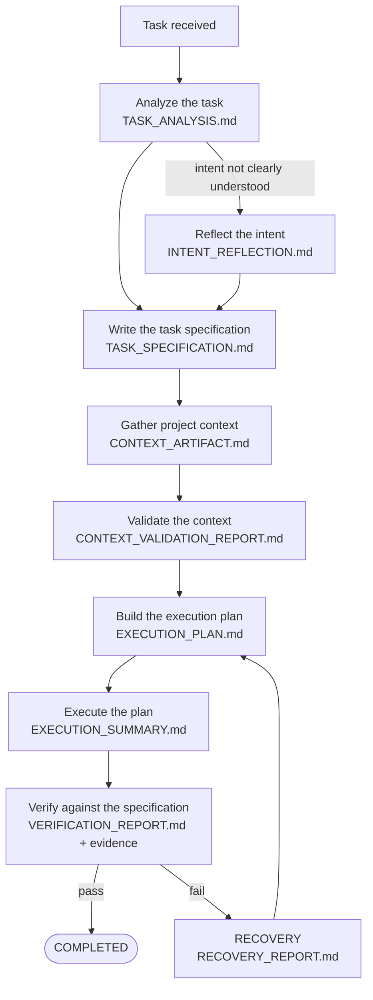

# ARgentOS

**A document-based, state-based protocol for agent orchestration.**
It gives an AI agent a governed, reviewable procedure for changing a project — explicit
states, written plans, review gates, verification and evidence — and it leaves a reviewable
trace of what happened.

`Protocol 12.3.3` · `MIT` · `No package to install` · `Status: active development`

```text
request → understand → plan → execute → verify → evidence → knowledge → next decision
```

ARgentOS is a **protocol**, not a program: a self-contained payload of Markdown documents
(roles, a state machine, contracts, gate checklists, evidence rules) plus a small
standard-library Python harness — the scripts that record gate state, validate artifacts and,
when installed, enforce hooks. A project *adopts* it by vendoring the payload under
`.argentos/`; there is no package, service, SDK or bundled model. Your agent brings the
reasoning; ARgentOS brings the procedure and the record.

The claim is deliberately modest: the protocol does not make an agent correct. It makes an
agent's work **accountable** — what was understood, who authorized it, what was planned,
what was checked, and what evidence supports the word "done".

---

## TL;DR

- **What it is** — a protocol written as documents, read by the agent during a session.
- **What it changes** — `prompt → edits` becomes a sequence of written, reviewed states:
  analysis, specification, context, plan, execution, verification, evidence.
- **What you get** — explicit task states, review gates, an evidence discipline, an
  authorization model and a project knowledge base.
- **What it does not do** — run a model, sandbox the agent or guarantee correctness.
  Enforcement is declarative by default; see [Status and declared limits](#status-and-declared-limits).
- **How to adopt** — pin a published payload, materialize the canonical layout, validate,
  then tell your agent to read `AGENTS.md` → [`docs/ADOPTION.md`](docs/ADOPTION.md).
- **Where you are** — the source repository that develops the protocol. Only the payload
  ships; this repository's tooling does not
  ([Protocol vs. this repository](#protocol-vs-this-repository)).

**Who it is for:** teams and agents working on changes where "who authorized this, what was
checked and what proves it" must stay answerable. **Not for:** anyone looking for a prompt
library, a hosted agent runtime, or enforcement that is mechanical by default.

## Why ARgentOS exists

The premise is that coding agents produce changes quickly but leave little record of what was
authorized, understood, checked or proved. The default interaction is a request, some
reasoning and a set of edits.

```text
Typical:    request → reasoning → edits → "done"
ARgentOS:   request → written analysis → plan → review gates → execution → verification → evidence
```

The point is not that no other tool does any of this. The point is that ARgentOS makes the
steps **explicit, ordered and reviewable**: a state is a verifiable condition of the task,
not a workflow position, and a transition requires the artifact the protocol defines. The
result is not a guarantee of correctness — it is a record a human can check.

## How work moves through ARgentOS



`review` in the flow above is a gate on a transition, not a task state.

- **Every worker-invoked state produces an artifact.** Session artifacts live under
  `.argentos/.project/<session-uuid>/<iteration>/` in an adopting project (under the
  repository-root `.project/` in this DEV repository) and follow contracts: what was
  understood, what was specified, what context was gathered and validated, how the work will
  be done, what changed, and what was verified.
- **Critical transitions are reviewed.** Before each important hand-off the orchestrator
  applies a review gate from a prose checklist (gate IDs `H00`–`H07` and others; see
  [`protocol/.agents/harness/INDEX.md`](protocol/.agents/harness/INDEX.md)). The gates are evaluated
  by judgment, and for the supported triggers the orchestrator must invoke a structural
  validator before judging PASS — a documented deviation is the only override.
- **Work is classified once, then only escalates.** The task is classified as `trivial`,
  `standard` or `complex` in `TASK_ANALYSIS.md`; the profile decides which phases and gates
  are mandatory. A `trivial` task still plans and verifies. Reclassification can only escalate
  to a larger profile, and the change is recorded.
- **"Done" is derived from evidence, not declared.** `COMPLETED` requires the verification
  gates (`H06`, `H07`) to pass, every in-scope gate recorded PASS (gates omitted by the task
  profile are recorded as skipped), a verification report whose in-scope criteria are not
  failing or pending, human approvals completed or deferred with confirmation, and recorded
  evidence. `ABORT` requires a founded, recorded cause. Failures go to `RECOVERY`, which
  routes back to planning or to an earlier artifact.
- **The state machine is a written contract, not a runtime.** The protocol does not persist
  a "current state" or advance by itself; the artifacts and the gate records are the trail.
  That is a deliberate limit ([Status and declared limits](#status-and-declared-limits)).

The normative description lives in
[`protocol/.agents/orchestrators/core/states/AGENT_STATE_MACHINE.md`](protocol/.agents/orchestrators/core/states/AGENT_STATE_MACHINE.md);
the phases are indexed in
[`protocol/.agents/orchestrators/core/workflow/INDEX.md`](protocol/.agents/orchestrators/core/workflow/INDEX.md).

## Key concepts

The vocabulary below is the one the repository actually uses. Each idea is stated in plain
language first, then tied to its ARgentOS name and to where it lives.

| The idea | ARgentOS name | Where it lives | Maturity |
|---|---|---|---|
| Work advances through verifiable states, and each critical transition is reviewed against a written checklist. | **Task lifecycle and review gates** | Protocol payload (`AGENT_STATE_MACHINE.md`, `harness/`) | Protocol — normative; gate checklists judged |
| Every claim is backed by a recorded entry: a re-readable object, a command result with its exit code, a citation — or, weakest, the agent's own attestation. | **Evidence classes and the `VERIFIED` invariant** | Protocol payload (`standards/quality/EVIDENCE.md`) | Protocol — normative; declarations validated structurally |
| An agent may act only inside explicit boundaries: a capability is not a permission, and an effect outside the default frontier (what the protocol allows without asking) needs recorded authorization. | **Authority and authorization model** | Protocol payload (`standards/runtime/AUTHORIZATION.md`) | Protocol — normative; judged |
| Knowledge about the project is kept with freshness, provenance and curation instead of being re-derived every session. | **Knowledge base, Knowledge Lifecycle, Memory System** | Protocol contracts; adopter state under `.argentos/.project/knowledge/`; DEV reference in `runtime/memory/` (not shipped) | Protocol model shipped; implementation not implemented; DEV reference only |
| A change is governed from intake to closed, and "done" is a derived condition rather than an editable status. | **Change Lifecycle** | DEV only (`docs/rfc/75-change-lifecycle.md`, `docs/`, `.agents/`) | DEV only — operational here; not shipped |
| Before applying a plan already committed to the repository, the agent walks through it to find missing dependencies, contradictions and unverifiable claims without writing anything. | **Theoretical Execution (TE)** | DEV only (`runtime/theoretical/`, plan 176) | DEV only — implemented here; not shipped |
| More than one attributed evaluation can examine a proposal before a human decides, preserving the disagreement. | **Adversarial deliberation** | Protocol payload (`skills/adversarial-deliberation/`, `contracts/DELIBERATION_REPORT.md`) | Protocol — shipped; invoked by judgment; advisory |
| A change should declare the systems, contracts, states and consumers it connects to. | **Integration Surface** | Not a mechanism today | Idea — recorded; not implemented |

**Maturity terms:** *Protocol* = normative or capability content that ships on `dist`; *DEV* =
capability of this repository only, never shipped; *Idea* = recorded, no mechanism yet.

*DEV additions, not shipped:* validation anchors and Git checkpoints (evidence); the DEV
authority model and autonomy frontier (authority).

The five evidence classes — `observation`, `measurement`, `attestation`, `assertion`,
`reference` — and their recording format are defined in
[`EVIDENCE.md`](protocol/.agents/standards/quality/EVIDENCE.md). An *attestation* is the
agent's own statement about its own process; it is never a substitute for externally
checkable evidence. "Verified" means a gate PASS plus evidence that is not an attestation.

### Change Lifecycle: governing a change, not just doing it

A change is not "an edit". It is a unit of work with an origin, a classification, an
authorization, a plan, a validation, evidence and a closure — and the lifecycle states which
of those must exist before the next one. ARgentOS's own development runs on this
**Change Lifecycle** (RFC-75); it governs *this repository*, not the protocol it publishes.

```text
request / directive
      ↓
detect and classify the change        RFC-56 payload class · Change Level L0–L3
      ↓
write or consult a plan → maintainer authorization
      ↓
execute on `dev` → validation (tests, checkers)
      ↓
evidence: validation anchor · findings / corrections if needed
      ↓
atomic commit → Git checkpoint → closure (derived)
      ↓
promotion and release are separate, human-authorized acts (`dev` → `master` + tag)
```

What makes it a lifecycle rather than a checklist is its closure semantics: `Executed` is a
plan status the agent writes when implementation and validation are done; `Committed` is
repository state (the atomic commit exists), **not** a plan status; `Closed` is a derived
condition (governance + checkpoint + checkpoint↔anchor consistency); `Promoted` is a verified
`dev` → `master` merge; and `Released` is an immutable annotated tag. The repository states
them explicitly so that `Executed ≠ Committed ≠ Closed ≠ Promoted ≠ Released`. Read the model
in [`docs/rfc/75-change-lifecycle.md`](docs/rfc/75-change-lifecycle.md) and the operational
workflow in [`.agents/workflows/change-lifecycle.md`](.agents/workflows/change-lifecycle.md).

### Theoretical Execution — thinking a change through before applying it

Before touching the repository, an agent can walk through a plan already committed to the
repository conceptually: enumerate its declared deliverables, check citations, artifact
statuses, scope and authority against the base commit, and surface missing dependencies,
contradictions, omissions or claims that cannot be evaluated yet. ARgentOS's development
layer calls this **Theoretical Execution (TE)**.

```text
plan committed to the repository
      ↓
Theoretical Execution              reads the plan against a base commit; writes nothing
      ↓
does the plan hold up?
   ├── no  → revise the plan / escalate / verify what cannot be evaluated
   └── yes → actual execution → verification
```

TE is a DEV capability (plans 175/176; implementation in `runtime/theoretical/`, policy in
[`.agents/policies/theoretical-execution.md`](.agents/policies/theoretical-execution.md)).
It returns a theoretical result — `CONVERGED`, `OPEN_FINDINGS`, `REQUIRES_HUMAN`, `GAP`,
`NO_PROGRESS` or `RESOURCE_LIMIT` — and never `PASS`, `VERIFIED` or `EXECUTED`. It is not
execution, verification, evidence, authorization or a gate; it does not prove that the real
change works, and it is not part of the protocol payload.

### Adversarial deliberation — more than one evaluation before a decision

For a decision with at least two material directions, more than one attributed evaluation
can examine the proposal before the human decides — conclusions committed before revelation,
criteria instead of adjectives, disagreement preserved in the synthesis, and one advisory
verdict. ARgentOS ships this as the Protocol capability **adversarial deliberation**
(RFC-77: a skill, a `DELIBERATION_REPORT.md` contract and an orchestrator decision point).

```text
proposal
   │
   ├─ pass A: evaluation → conclusion committed
   └─ pass B: evaluation → conclusion committed      (at least two attributed passes)
                │
                ↓
        revelation → comparative evaluation per criterion
                ↓
        synthesis preserving disagreement
                ↓
        one advisory verdict (VIABLE / NOT_VIABLE / UNDETERMINED) + optional recommendation
                ↓
        a human decides — the mechanism never does
```

It is discretionary — the orchestrator invokes it by recorded judgment when a decision has at
least two material directions; there is no feature flag — and it is never a gate, a vote or an
authority: its output is advisory attestation, not evidence, and it does not claim epistemic
independence. A courtroom-style model — prosecution, defense, rebuttal, independent jurors,
voting — is explicitly out of scope (RFC-77 Non-Goals) and not implemented; the internal
program that produced the capability was called *Jury Trial*, but that is a label, not a
mechanism, and the payload contains no jury, panel, juror or voting entity.

### Integration Surface — an idea that is not a mechanism yet

A change should know which existing systems, contracts, states and consumers it connects to.
The maintainer's priority notes (not a tracked repository artifact) record integration
continuity as the next major area of work: plans should eventually be able to declare an
**Integration Surface** and its integration evidence. No such field, checker or mechanism
exists today. What does exist is narrower: for `standard` and `complex` tasks the protocol
requires context to be gathered *and validated* before planning (the `trivial` profile skips
those context states but still plans and verifies), and DEV plans declare their scope and
effects. [`docs/placement-contract.md`](docs/placement-contract.md) governs where artifacts
belong; it is not an integration mechanism.

## One change, end to end

Consider an adopting project and a request: *"Add CSV export to the reports module."* The
example is illustrative — the task profile decides how much of the path actually runs — but
it shows what the protocol makes explicit.

```text
ANALYZING_TASK ........ TASK_ANALYSIS.md           what the request means, how big, what is missing
CONFIRMING_INTENT ..... INTENT_REFLECTION.md       "this is what I understood — confirm or correct"
BUILDING_TASK_SPEC .... TASK_SPECIFICATION.md      objective, scope, acceptance criteria, unknowns
GATHERING_CONTEXT ..... CONTEXT_ARTIFACT.md        the project facts this work depends on
VALIDATING_CONTEXT .... CONTEXT_VALIDATION_REPORT.md the context is sufficient, not merely present
PLANNING .............. EXECUTION_PLAN.md          how the work will be done (not the result)
EXECUTING ............. EXECUTION_SUMMARY.md       what changed, which steps ran, validations
VERIFYING ............. VERIFICATION_REPORT.md     each criterion vs. evidence; scope compliance
COMPLETED                                          gates pass, nothing in scope left pending
```

What this buys, concretely:

- If the agent misread the request, the correction happens **before** code is written.
- If the context was incomplete, validation exposes it **before** the plan is fixed.
- "Done" is not the agent's opinion: the verification report evaluates each acceptance
  criterion, records evidence with a class and a reference, and the scope gate checks that
  only authorized work changed.
- What the session learned can be curated into the project knowledge base for the next
  session, with provenance and freshness.

A verification report is not prose plus a promise: it carries structured evidence entries
like this one (format: [`EVIDENCE.md`](protocol/.agents/standards/quality/EVIDENCE.md)).

```toml
[[evidence]]
class = "measurement"
claim_id = "AC-02"
ref = "tests/reports/test_csv_export.py"
command = "python -m pytest tests/reports/test_csv_export.py"
exit_code = 0
```

The `class`, `claim_id` and `ref` fields are what make the claim re-checkable; an entry whose
class is `attestation` cannot make a claim "verified". Gate results and terminal status are
recorded separately in `state.json` by the protocol's state writer.

For how ARgentOS itself is changed by its own maintainers, the same shape applies one layer
up: classification, plan, authorization, execution, validation anchored to the exact
repository state, evidence, and a Git checkpoint at closure — the
[Change Lifecycle](#change-lifecycle-governing-a-change-not-just-doing-it).

## Protocol vs. this repository

Two different things share vocabulary here, and confusing them is the most common reading
error. The **protocol payload** is the product; the rest of this repository is how the
product is developed.

```text
┌────────────────────────────────────────────────────────────────────────────┐
│ THIS REPOSITORY (DEV)                                                      │
│ AGENTS.md · .agents/ · docs/ · tools/ · runtime/ · tests/                  │
│ instructions, governance and reference implementations used to develop it  │
└───────────────────────────────────┬────────────────────────────────────────┘
                                    │ publishes the payload (CI, from master)
                                    ▼
┌────────────────────────────────────────────────────────────────────────────┐
│ PROTOCOL PAYLOAD (product)                                                 │
│ protocol/.agents/ + protocol/_AGENTS.md                                    │
│ published on branch `dist` as `.agents/` + `AGENTS.md` at its root         │
└───────────────────────────────────┬────────────────────────────────────────┘
                                    │ materialized by the shipped lifecycle
                                    ▼
┌────────────────────────────────────────────────────────────────────────────┐
│ ADOPTING PROJECT                                                           │
│ AGENTS.md (non-normative adapter)                                          │
│ .argentos/{.agents/, features.toml, .project/, .backup/}                   │
└────────────────────────────────────────────────────────────────────────────┘
```

| Question | Protocol payload (what you adopt) | This repository (DEV) |
|---|---|---|
| What it is | The product: standards, contracts, roles, state machines, skills, harness | Where that product is developed and verified |
| Lives in | `protocol/.agents/` + `protocol/_AGENTS.md`; published on `dist` | `AGENTS.md`, `.agents/`, `docs/`, `tools/`, `runtime/`, `tests/` |
| Governs | An adopting project's protocol sessions | How ARgentOS itself changes |
| Entry point | `.argentos/.agents/INDEX.md` (reached through the root `AGENTS.md` adapter) | [`AGENTS.md`](AGENTS.md), then [`.agents/AGENTS.md`](.agents/AGENTS.md) |
| Lifecycle | The task state machine and its review gates | The Change Lifecycle (RFC-75) |
| Ships to adopters | **Yes** | **No** |

Two paths look similar and are not: the **root `.agents/`** of this repository is the DEV
operational layer (instructions for working *on* ARgentOS), while **`protocol/.agents/`** is
the product payload (data here, never instructions). Adopters receive neither this
repository's `.agents/` nor `docs/`, `tools/` or `runtime/`.

## Status and declared limits

### Status

ARgentOS is actively developed. The current published protocol version is **12.3.3**
([`protocol/.agents/VERSION`](protocol/.agents/VERSION), history in
[`CHANGELOG.md`](CHANGELOG.md)). By policy, development happens on `dev`; a release is a
verified `dev` → `master` promotion plus an annotated tag, and CI regenerates `dist` from
`master`. This README does not describe the current branch state — that snapshot belongs to
[`docs/VERSIONING.md`](docs/VERSIONING.md) §9.

### Declared limits

Several properties are *declared limits* rather than guarantees — this is part of the
protocol, not a disclaimer bolted on:

- **Gate judgments are prose, not code.** There is no executable gate runner: the orchestrator
  evaluates written checklists, and it must invoke a structural validator before judging PASS
  on the supported gates. In opt-in enforced mode a hook can block an action whose required
  gate state is missing, but it only covers writes through `Write`/`Edit` and a `Stop` without
  closure; other tools are covered by a post-hoc scan, not prevention.
- **The default mode enforces nothing mechanically.** In declarative mode nothing blocks an
  agent that ignores the protocol; compliance is audited afterwards, from the orchestrator's
  self-reported `HARNESS_REPORT.md` — an attestation, not independent evidence. The opt-in
  enforced mode adds the CLI hook, and its hooks are **fail-open** by contract: a crash,
  timeout or malformed event allows the action.
- **"Verified" is a record discipline, not truth.** It means gate PASS plus non-attestation
  evidence for that claim. It does not mean semantically correct, and the protocol explicitly
  does not guarantee "zero hallucinations" — the evidence class is assigned by the author.
- **The audit trail is partial and self-reported.** Reconstruction depends on the project's
  artifacts: the trail is not self-contained by design, raw execution evidence is not
  persisted, and the harness report is written by the orchestrator.
- **No sandbox, no credentials, no provider, no network.** The protocol does not isolate the
  agent, manage credentials, ship a model or provide network access. Effects outside the
  default frontier (network, remote git, installs, destructive changes, writes outside the
  project) need recorded user authorization.
- **No persisted "current state".** `state.json` records gate results, the last gate, the
  task profile and the terminal status — not a cursor. A skipped state is invisible, by
  design.
- **Knowledge is curated, not self-maintaining.** The payload has no automated knowledge
  indexer and no retrieval engine; freshness and provenance are rules the agent must follow.
- **The DEV layer is not the product.** Change Lifecycle mechanics (validation anchors,
  checkpoints, findings, pending decisions), Theoretical Execution, the autonomous
  orchestrator and the memory reference implementation are development capabilities of
  this repository. They do not ship and are not protocol requirements. The payload does ship
  one narrower change record — a documented-only change-governance artifact contract (RFC-76,
  `protocol/.agents/contracts/CHANGE_GOVERNANCE.md`) whose append/current semantics are
  explicitly deferred — but that is not the DEV Change Lifecycle.
- **One version at a time.** Adoption is not designed for parallel protocol versions;
  upgrades follow [`docs/MIGRATION.md`](docs/MIGRATION.md).
- **The protocol states its own enforcement status.** Each canonical invariant declares
  whether it is enforced (7 of 15), validated (2) or neither (6); none is mechanically
  enforced in a distributed session in the default declarative mode. See
  [`docs/INVARIANTS.md`](docs/INVARIANTS.md).

## Adopting ARgentOS

Adoption is vendoring, not installation. The complete procedure, rules and limits live in
**[`docs/ADOPTION.md`](docs/ADOPTION.md)**; this is the map.

1. **Get the payload.** It is published on the `dist` branch: `.agents/` plus `AGENTS.md`,
   nothing else. Pin a tag or commit for reproducibility.
2. **Materialize the canonical layout**, with the payload's stdlib lifecycle (`install`) or
   by copying manually:

   ```text
   <project>/
   ├── AGENTS.md                 # non-normative adapter → .argentos/.agents/INDEX.md
   └── .argentos/
       ├── features.toml          # the single active configuration
       ├── .agents/               # the vendored payload (read-only for the project)
       ├── .project/              # protocol-owned session state and install manifest
       └── .backup/               # lifecycle backups
   ```

3. **Validate the installation.** Declarative mode: the payload's health checklist, applied
   at bootstrap, must pass. Enforced mode: also run the state-storage probe; enforcing the
   critical gates additionally requires installing the CLI hook.
4. **Start a session.** Tell your agent to read `AGENTS.md`; it loads the payload's
   bootstrap (`INDEX.md`), verifies protocol health and takes over from there.

**Requirements.** An agent that reads Markdown. Python 3 with the standard library only is
needed whenever a mechanical part of the payload runs: the adoption lifecycle, the
state-storage probe, the structural validator invoked before supported gates, or the optional
enforced-mode hook. No third-party packages, provider, network or credentials. The protocol's
decision procedure itself is prose.

**Updating.** [`docs/MIGRATION.md`](docs/MIGRATION.md) covers moves between versions,
including the historical layout. Changes per version are in [`CHANGELOG.md`](CHANGELOG.md).

The shipped lifecycle (`install` / `update` / `uninstall` / `doctor` / `recover`) is
deterministic and reversible: it keeps a manifest, verified backups and a recovery journal,
reports a state with a matching exit code so automation does not parse prose, and stops on
ambiguity — detecting a situation never authorizes resolving it.

## Where to look next

### Repository map

| Path | What it is | Ships to adopters? |
|---|---|---|
| [`protocol/`](protocol/) | The product payload, as data. Instructions: [`protocol/_AGENTS.md`](protocol/_AGENTS.md); bootstrap: [`protocol/.agents/INDEX.md`](protocol/.agents/INDEX.md) | **Yes**, via `dist` |
| [`.agents/`](.agents/) | DEV operational layer: how an agent works *on this repository* | No |
| [`docs/`](docs/) | Governance, adoption, behavior model, terminology, RFCs, ADRs, plans | No |
| [`tools/`](tools/) | Deterministic checkers (with `tests/`, the canonical verification battery) | No |
| [`runtime/`](runtime/) | DEV reference implementations (materialization, placement, memory, theoretical execution, orchestrator) | No |
| [`tests/`](tests/) | DEV test suites | No |
| [`AGENTS.md`](AGENTS.md) | Entry instructions for this repository | No |
| [`ROADMAP.md`](ROADMAP.md) · [`CHANGELOG.md`](CHANGELOG.md) | Strategic direction · version history | No |
| `dist` branch | The published payload itself: `.agents/` + `AGENTS.md` | It *is* the artifact |

### I want to…

| Goal | Read |
|---|---|
| Adopt the protocol, install it and validate it | [`docs/ADOPTION.md`](docs/ADOPTION.md) |
| Upgrade an existing adoption | [`docs/MIGRATION.md`](docs/MIGRATION.md) |
| Understand how the system behaves, layer by layer | [`docs/behavior-patterns.md`](docs/behavior-patterns.md) |
| Read the protocol as an adopter | [`protocol/.agents/INDEX.md`](protocol/.agents/INDEX.md) |
| Understand the task lifecycle and its phases | [`AGENT_STATE_MACHINE.md`](protocol/.agents/orchestrators/core/states/AGENT_STATE_MACHINE.md) · [`workflow/INDEX.md`](protocol/.agents/orchestrators/core/workflow/INDEX.md) |
| Understand gates, modes and guarantees | [`protocol/.agents/harness/INDEX.md`](protocol/.agents/harness/INDEX.md) |
| Understand what counts as evidence | [`protocol/.agents/standards/quality/EVIDENCE.md`](protocol/.agents/standards/quality/EVIDENCE.md) |
| Understand authorization and boundaries | [`AUTHORIZATION.md`](protocol/.agents/standards/runtime/AUTHORIZATION.md) · [`PROTOCOL_BOUNDARIES.md`](protocol/.agents/standards/runtime/PROTOCOL_BOUNDARIES.md) |
| Understand knowledge and memory | [`KNOWLEDGE_LIFECYCLE.md`](protocol/.agents/standards/context/KNOWLEDGE_LIFECYCLE.md) · [`MEMORY_SYSTEM.md`](protocol/.agents/standards/context/MEMORY_SYSTEM.md) |
| Understand the DEV Change Lifecycle | [`docs/rfc/75-change-lifecycle.md`](docs/rfc/75-change-lifecycle.md) · [`.agents/workflows/change-lifecycle.md`](.agents/workflows/change-lifecycle.md) |
| Understand Theoretical Execution | [`.agents/policies/theoretical-execution.md`](.agents/policies/theoretical-execution.md) · [plan 176](docs/plans/176-theoretical-execution-dev-complete.md) |
| Understand adversarial deliberation | [`RFC-77`](docs/rfc/77-protocol-native-adversarial-deliberation.md) · [`SKILL.md`](protocol/.agents/skills/adversarial-deliberation/SKILL.md) · [`DELIBERATION_REPORT.md`](protocol/.agents/contracts/DELIBERATION_REPORT.md) |
| Know where a document or artifact belongs | [`docs/placement-contract.md`](docs/placement-contract.md) |
| Check terminology | [`docs/glossary/INDEX.md`](docs/glossary/INDEX.md) |
| See versions, tags and release policy | [`docs/VERSIONING.md`](docs/VERSIONING.md) |
| See the design history | [`docs/rfc/INDEX.md`](docs/rfc/INDEX.md) · [`docs/adr/INDEX.md`](docs/adr/INDEX.md) · [`docs/plans/INDEX.md`](docs/plans/INDEX.md) |
| See where the project is going | [`ROADMAP.md`](ROADMAP.md) |

## Developing in this repository

Work on ARgentOS happens on `dev` and every change follows the
[Change Lifecycle](.agents/workflows/change-lifecycle.md). Start with [`AGENTS.md`](AGENTS.md),
then [`.agents/AGENTS.md`](.agents/AGENTS.md); the documentary taxonomy is in
[`docs/AGENTS.md`](docs/AGENTS.md). The canonical verification battery (checkers plus tests)
is defined once in [`docs/VERSIONING.md`](docs/VERSIONING.md) §4.1. Remember the hard boundary:
`protocol/.agents/` is product data in this repository, not a set of instructions.

## License

[MIT](LICENSE).
