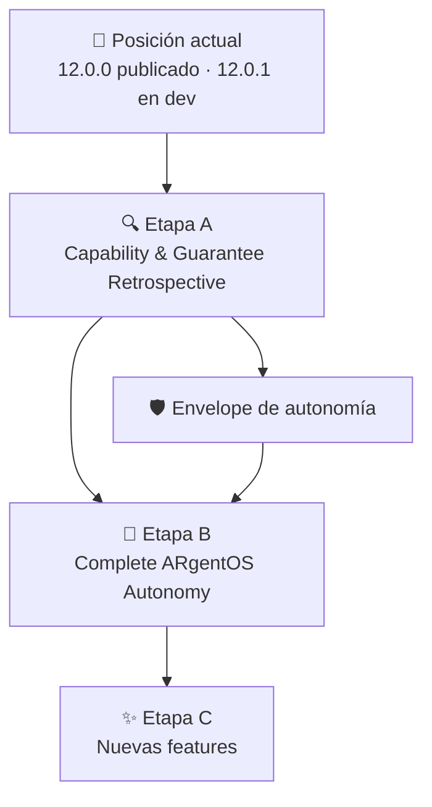
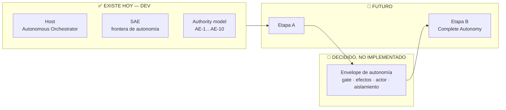

# 🗺️ Roadmap de ARgentOS

> **Qué es este documento.** El mapa **estratégico y visual** de la evolución de
> ARgentOS: dónde estamos, hacia dónde vamos, qué iniciativas constituyen el
> camino, en qué secuencia aproximada se abordan y qué dependencias o bloqueos
> lo condicionan.
>
> **Qué NO es.** No es un changelog, ni un backlog, ni un tracker, ni un
> registro de capacidades, ni un decision register, ni una especificación
> técnica. El detalle vive en los artefactos que lo poseen (ver
> [`## Dónde consultar qué`](#dónde-consultar-qué)).
>
> **Última actualización:** 2026-10-11 · **Protocolo publicado:** `12.0.0`

---

## 🎯 Visión / Destino

ARgentOS quiere ser un **protocolo documental y basado en estado para orquestar
agentes**: no una herramienta que se instala, sino un conjunto de contratos que
un proyecto adopta materializando un payload bajo `.argentos/`.

El destino es una ARgentOS capaz de **recibir un objetivo suficientemente amplio
y ejecutarlo de forma autónoma bajo supervisión humana**, sin perder sus
garantías de **autoridad, alcance, contexto, evidencia, recuperación y
terminación**:

```text
Autonomy ⊆ Scope ∩ Authority
```

**Éxito, a alto nivel:** que la autonomía sea **operacional, no decisional** —
que elimine traspasos operativos dentro de trabajo ya autorizado, y que nunca
elimine el control humano sobre alcance, autoridad, decisiones normativas,
arquitectura, protocolo, release o promoción.

**Lo que el destino NO significa:** acumular mecanismos, estados, checkers,
registries o ceremonia de gobernanza. La dirección es **claridad y calidad de
decisión**, y «ningún cambio» es un resultado válido.

---

## 📍 Posición actual

**Desde dónde partimos.** ARgentOS tiene ya un conjunto significativo de
mecanismos operativos en DEV y un Protocol publicado y adoptable.

| | |
|---|---|
| **Protocolo publicado** | `12.0.0` — tag anotado sobre `78ca512` (`master`) |
| **Payload publicado** | `origin/dist` @ `1181db6`, `VERSION` = `12.0.0` |
| **En curso en `dev`** | PATCH `12.0.1` — reconciliación documental del payload con el layout canónico `.argentos/` |
| **Promoción pendiente** | `12.0.1` está implementado y **sin tag**: su promoción es un acto de release **no autorizado** |
| **Trabajo activo** | **Ninguno.** La próxima iniciativa declarada es la **Etapa A**, y no está autorizada |

> ⚠️ **Leer el payload publicado desde `origin/dist`, no desde la ref local
> `dist`**: la ref local está rezagada (`11.7.1`) y no contiene el lifecycle de
> adopción. La fuente inmutable de la verdad es `git tag` + `protocol/.agents/VERSION`.

### Capacidades ya disponibles

**DEV** — nunca se distribuyen al adoptante:

| Capacidad | Dónde |
|---|---|
| Change Lifecycle (anchors, checkpoints, findings, pending) | `docs/rfc/75-change-lifecycle.md`, `docs/VERSIONING.md` |
| Validation & Closure + gates C-1/C-2/C-3 | `.agents/policies/validation-closure.md`, `tools/` |
| DEV Autonomous Orchestrator + SAE | `runtime/orchestrator/` |
| Agent Worker (sin provider/modelo/red/credenciales) | `runtime/orchestrator/agent_worker.py` |
| Memory System (implementación de referencia) | `runtime/memory/` |
| Placement resolver + Materialización de contexto | `runtime/placement/`, `runtime/toolcalls/` |
| Verificación determinista (checkers + suites) | `tools/`, `tests/` |

**PROTOCOL** — viajan en `dist`:

| Capacidad | Dónde |
|---|---|
| Agent State Machine + perfiles de tarea | `protocol/.agents/orchestrators/core/states/AGENT_STATE_MACHINE.md` |
| Ciclo de sesión, gates y harness | `protocol/.agents/harness/INDEX.md` |
| Delegación, roles y skills | `protocol/.agents/delegation/WORKER_DELEGATION_CONTRACT.md`, `protocol/.agents/roles/`, `protocol/.agents/skills/` |
| Discovery + Discovery KB | `protocol/.agents/orchestrators/discovery/` |
| Lifecycle de adopción (`install`/`update`/`uninstall`/`doctor`/`recover`) | `protocol/.agents/harness/lifecycle.py` |
| Modelos de contexto, evidencia, autorización y conocimiento | `protocol/.agents/standards/` |

> Esta lista es **orientativa, no un registro**. El estado detallado de cada
> capacidad vive en su artefacto dueño — ver [`## Dónde consultar qué`](#dónde-consultar-qué).

### Estado del que parte este roadmap

Las capacidades anteriores **no se reabren**: son el punto de partida, no trabajo
pendiente. Los cambios de payload ya publicados y sus releases quedan registrados en
`CHANGELOG.md`, y el estado detallado de cada plan en `docs/plans/INDEX.md`.

---

## 🚦 Roadmap at a Glance

```text
        NOW                    NEXT                     LATER
         │                      │                        │
         ▼                      ▼                        ▼
  ┌──────────────┐      ┌──────────────┐        ┌────────────────────┐
  │ 12.0.1       │      │ Etapa A      │        │ Etapa B            │
  │ promoción    │ ───▶ │ Retrospectiva │ ─────▶ │ Complete Autonomy  │
  │ pendiente    │      │ de garantías │        │ + Etapa C          │
  └──────────────┘      └──────────────┘        └────────────────────┘
```

### ▶️ NOW — lo inmediato

```text
┌─────────────────────────────────────────────────────────────────────┐
│ 🚚 Promoción de la PATCH 12.0.1                                     │
├─────────────────────────────────────────────────────────────────────┤
│ Objetivo:   publicar la reconciliación documental del payload       │
│             con el layout canónico `.argentos/`                     │
│ Domain:     PROTOCOL                                                │
│ Priority:   HIGH      Status: Implemented, awaiting authorization   │
│ Depends on: autorización de release del mantenedor                  │
│ Ref:        docs/plans/156-payload-layout-documentation-reconciliation.md │
└─────────────────────────────────────────────────────────────────────┘
```

**No hay otra iniciativa activa.** El resto del camino empieza después de la Etapa A.

### ⏭️ NEXT — lo siguiente

```text
┌─────────────────────────────────────────────────────────────────────┐
│ 🔍 Etapa A — Capability & Guarantee Retrospective                   │
├─────────────────────────────────────────────────────────────────────┤
│ Objetivo:   determinar qué capacidades y garantías están realmente  │
│             demostradas, y con qué evidencia                        │
│ Unidad:     capacidad + garantía + evidencia (no archivo ni feature)│
│ Producto:   Capability & Guarantee Matrix                           │
│ Domain:     BOTH      Priority: HIGH                                │
│ Status:     Planned — requiere su propio Change autorizado          │
│ Ref:        docs/plans/149-argentos-capability-and-autonomy-roadmap.md │
└─────────────────────────────────────────────────────────────────────┘
```

> **La Etapa A es la compuerta.** No se asume que una capacidad está completa
> porque exista código o tests. Lo que la retrospectiva demuestre innecesario
> **no** se implementa.

### ⏳ LATER — el horizonte

```text
┌─────────────────────────────────────────────────────────────────────┐
│ 🛡️ Envelope de autonomía                                            │
├─────────────────────────────────────────────────────────────────────┤
│ Objetivo:   materializar el modelo de autoridad ya decidido: gate de│
│             efectos, clases de efecto, actor, aislamiento, Memory   │
│ Domain:     DEV       Priority: MEDIUM                              │
│ Status:     Decided, not implemented (AE-1…AE-10 vigentes)          │
│ Depends on: Etapa A                                                 │
│ Ref:        docs/adr/19-autonomy-envelope-authority.md              │
└─────────────────────────────────────────────────────────────────────┘

┌─────────────────────────────────────────────────────────────────────┐
│ 🤖 Etapa B — Complete ARgentOS Autonomy                             │
├─────────────────────────────────────────────────────────────────────┤
│ Objetivo:   cerrar las fronteras reales que impiden ejecutar un     │
│             objetivo amplio de forma autónoma bajo supervisión      │
│ Domain:     BOTH      Priority: HIGH (estratégica)                  │
│ Status:     Planned — fronteras candidatas, NO compromisos          │
│ Depends on: Etapa A (determina cuáles son realmente necesarias)     │
│ Ref:        docs/plans/149-argentos-capability-and-autonomy-roadmap.md │
└─────────────────────────────────────────────────────────────────────┘

┌─────────────────────────────────────────────────────────────────────┐
│ ✨ Etapa C — Nuevas features                                        │
├─────────────────────────────────────────────────────────────────────┤
│ Objetivo:   incorporar capacidad nueva **sólo** tras A y B          │
│ Regla:      no se agrega una feature por disponibilidad tecnológica │
│             ni por simetría con otro sistema                        │
│ Domain:     BOTH      Priority: LOW (subordinada)                   │
│ Status:     Planned — sin entradas admitidas                        │
│ Depends on: resultados de A y de B                                  │
│ Ref:        docs/plans/149-argentos-capability-and-autonomy-roadmap.md │
└─────────────────────────────────────────────────────────────────────┘
```

**Fronteras candidatas de la Etapa B** — explícitamente **candidatas, no compromisos de
implementación**; la Etapa A determina cuáles son realmente necesarias:
ejecución real mediante provider/model · persistencia y consumo de Worker Results ·
derivación de la siguiente acción · ejecución multi-step · recuperación ante fallos
reales · fallos del provider · salidas inválidas del Worker · presupuestos de ejecución ·
garantías de terminación · ejecución multi-worker · deliberación cuando aporte valor ·
integración real de Prompt Cache · persistencia de Project/Knowledge.

---

## 🔗 Dependencias estratégicas

Sólo las que condicionan el camino. El detalle de dependencias por Change vive en
`Depende de:` del plan correspondiente.



**Reglas de secuencia**

- **B depende de A** y **C depende de los resultados de A y B**. No son tres iniciativas independientes.
- Ninguna etapa se ejecuta desde este documento: **cada una es un Change propio con su propia autorización**.
- La Etapa A puede **reducir** el alcance de B: una frontera candidata que la retrospectiva demuestre innecesaria no se implementa.

---

## 🚧 Blockers y decisiones que condicionan el camino

Sólo lo que puede cambiar **prioridad, secuencia, alcance, viabilidad o siguiente paso**.
El detalle de cada decisión vive en el artefacto que la posee.

| Decisión / Blocker | Impacto | Afecta a | Estado |
|---|---|---|---|
| Autorización de release de `12.0.1` | secuencia | NOW | Pendiente — acto del mantenedor |
| `work_type` sin criterio de admisión (`P-5 = GAP`) | alcance del modelo de autonomía | Envelope, Etapa B | Pendiente — `docs/plans/151-autonomy-authority-decision-closure.md` |
| ADR-worthiness de las decisiones de autoridad de autonomía | registro de la decisión | Envelope | Pendiente — `docs/plans/152-authority-decisions-gov-1-10.md` |
| Semántica de lifetime/persistence en el contrato Protocol | viabilidad (exige RFC `Accepted`) | persistencia, Change Governance | Pendiente — `docs/plans/125-repository-architecture-decisions.md` |
| Implementación derivada de ADR-17 | viabilidad (efecto payload, RFC-56) | estructura del repositorio fuente | Pendiente — `docs/adr/17-repository-lifetime-and-composite-structure.md:Estado de implementación` |
| Medición operacional de métricas del lifecycle | alcance | observabilidad | Diferido — `docs/VERSIONING.md:11. Métricas del Change Lifecycle (observability schema baseline)` |

### ⏸️ Pendientes que requieren autorización y trabajo diferido

Trabajo **deliberadamente diferido o a la espera de autorización**, que condiciona el camino
pero **no** se ejecuta desde este documento. El detalle y el estado de cada decisión viven en
el artefacto que la posee.

| Trabajo diferido | Dominio | Qué falta | Ref |
|---|---|---|---|
| Enforcement mecánico de placement | DEV | dirección autorizada, **no implementada**; su consumo por el Orchestrator exige un Change propio | `docs/placement-contract.md:Enforcement deferred` |
| Persistencia de Project/Knowledge e integración de Memory | DEV | semántica de lifetime/persistence en el contrato Protocol | `docs/plans/125-repository-architecture-decisions.md` |
| Ampliación del conjunto mecánico de EARS | PROTOCOL | cambio de contrato del payload ⇒ RFC-56 Clase A | `docs/plans/137-ears-structural-validator.md` |
| Promoción de `12.0.1` y regeneración de `dist` | PROTOCOL | acto de release | `docs/plans/156-payload-layout-documentation-reconciliation.md` |

---

## 🧭 Autonomy — mapa del caso

La autonomía se representa en cuatro planos distintos, con estados distintos.
**No son el mismo hecho y no se fusionan.**



### ❓ Qué autonomía existe ya

| Plano | Qué es | Domain | Estado |
|---|---|---|---|
| **DEV Host Autonomy** | un host que conduce **un** Change ya autorizado: observa, deriva, autoriza, delega, ejecuta, ingiere, verifica y decide continuar o parar. **No guarda estado propio** | DEV | ✅ Implementado y testeado |
| **SAE** (Supervised Autonomous Execution) | la frontera de lo que el host puede ejecutar sin volver a preguntar: `autonomy ⊆ scope ∩ authority`, con verificación **antes** del efecto y `--sae` opt-in | DEV | ✅ Implementado y testeado |
| **Authority model** | los diez invariantes que gobiernan el envelope: el Change es la unidad; `Effect ⊥ Scope`; la derivación precede a la delegación; sin eje de recurso; sin autorización parcial; sin continuación válida sobre derivación incompleta | DEV | ✅ Decidido (`AE-1`…`AE-10`) |

### ❓ Qué autonomía todavía falta

| Plano | Qué falta | Domain | Estado |
|---|---|---|---|
| **Envelope de autonomía** | gate de efectos, clases de efecto, actor con provider/modelo, aislamiento, integración de Memory, superficie de derivación | DEV | 📐 Decidido, **no implementado** |
| **Complete ARgentOS Autonomy** | cerrar las fronteras reales para ejecutar un objetivo amplio bajo supervisión | BOTH | 🎯 Futuro — Etapa B, gateada por A |

> **Precisión obligatoria.** Lo que existe **no** es «Complete ARgentOS Autonomy»:
> es un host DEV funcional con una frontera de autoridad, **sin provider, sin
> modelo, sin red y sin credenciales**. El envelope que falta está descrito en
> `docs/adr/19-autonomy-envelope-authority.md:Estado de implementación`.
>
> **Y la autonomía ya implementada es DEV-only:** no forma parte del payload que
> distribuye `dist`. El Protocol tiene su propio concepto de autonomía del
> agente —el permiso de actuar sin preguntar **dentro de sus reglas**—, descrito
> en `protocol/.agents/standards/runtime/PROTOCOL_BOUNDARIES.md`; no es la misma
> cosa y no se confunde con ella.

### ❓ Qué depende de qué, y cuál es el siguiente paso

```text
Host + SAE + Authority model   ✅ ya disponible
        │
        ▼
Etapa A — retrospectiva        ⏭️ SIGUIENTE PASO (requiere autorización)
        │
        ▼
Envelope de autonomía          ⏳ decidido, sin implementar
        │
        ▼
Etapa B — Complete Autonomy    🎯 futuro
```

---

## 🗂️ Dónde consultar qué

| Necesito saber… | Consulto… |
|---|---|
| Hacia dónde va ARgentOS y en qué orden | **este documento** |
| El contrato de este documento (qué es y qué no es un ROADMAP) | `docs/CONVENTIONS.md` |
| Qué estado tiene cada plan | `docs/plans/INDEX.md` |
| Qué capacidades tiene el runtime DEV | `runtime/README.md` |
| Qué decisiones arquitectónicas se tomaron | `docs/adr/INDEX.md` y cada ADR |
| Cómo se implementa algo | el **Plan** correspondiente en `docs/plans/` |
| Qué se publicó y cuándo | `CHANGELOG.md` |
| Qué versión está publicada y qué es la verdad inmutable | `git tag` + `protocol/.agents/VERSION` |
| Qué exige la governance | `.agents/policies/` y `.agents/workflows/` |
| Qué reglas normativas rigen el repo | `docs/CONVENTIONS.md`, `docs/VERSIONING.md` |
| Qué contiene el Protocol que adopta un proyecto | `protocol/.agents/INDEX.md`, `docs/ADOPTION.md` |

---

## 📐 Qué es y qué NO es este documento

**SÍ ES** — una hoja de ruta; representación de dirección, evolución y
prioridades; una vista estratégica y visual; un mapa de iniciativas
relevantes; representación de secuencia; vista de dependencias relevantes;
vista de grandes milestones; una ayuda para entender qué falta para alcanzar
el destino.

**NO ES** — un backlog; un task tracker; un plan de implementación; un
changelog; un release history; un registro exhaustivo de capacidades ni de
decisiones; un ADR; un RFC; una especificación técnica; una fuente primaria de
evidencia; un inventario de archivos; un registro de planes históricos; una
lista de commits; una lista de trabajo cerrado.

**Responsabilidad única:** *comunicar visualmente la dirección de evolución de
ARgentOS y el camino de alto nivel para alcanzarla.* El **orden de ejecución
detallado** pertenece al Plan; este documento expresa sólo el orden de alto
nivel de sus iniciativas.

### Regla de admisión

Un contenido pertenece a este documento **sólo si** eliminarlo impide entender
hacia dónde evoluciona ARgentOS o cómo se relacionan y secuencian sus
principales iniciativas. Si eliminarlo sólo quita detalle de implementación,
evidencia, historia, tareas, decisiones técnicas o estado exhaustivo de
capacidades, **pertenece a otro artefacto**.

### Regla de frescura

Este documento se actualiza cuando cambia la **dirección**, la **secuencia** o
las **prioridades** — no cuando se cierra una tarea. El trabajo cerrado no se
cataloga aquí: se registra en `CHANGELOG.md` y en `docs/plans/INDEX.md`.
