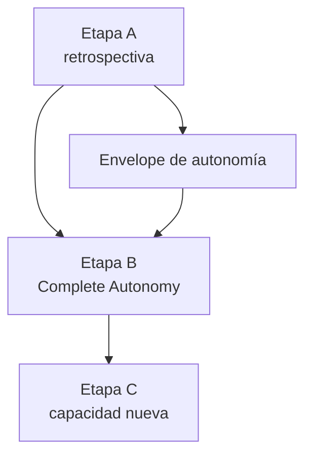

# 🗺️ Roadmap de ARgentOS

> Hacia dónde vamos y cuál es el camino estratégico desde el estado actual.
> Este documento muestra **dirección y secuencia**, no estado detallado: qué es
> un ROADMAP y su contrato viven en `docs/CONVENTIONS.md`.

---

## 🎯 Destino

ARgentOS quiere ser un **protocolo documental y basado en estado para orquestar
agentes**: contratos que un proyecto adopta materializando un payload, no una
herramienta que se instala.

El destino es una ARgentOS capaz de **recibir un objetivo suficientemente amplio
y ejecutarlo de forma autónoma bajo supervisión humana**, sin perder sus
garantías de autoridad, alcance, contexto, evidencia, recuperación y
terminación: `Autonomy ⊆ Scope ∩ Authority`.

**Éxito** significa que la autonomía sea **operacional, no decisional**: elimina
traspasos operativos dentro de trabajo ya autorizado, y nunca elimina el control
humano sobre alcance, autoridad, decisiones normativas, protocolo y release.

---

## 🧭 Posición actual

- **Protocolo publicado:** `12.0.0`, tag anotado sobre `78ca512` (`master`).
- **Payload publicado:** `origin/dist` @ `1181db6` — leer desde ahí, no desde la
  ref local `dist`, que está rezagada.
- **En `dev`:** PATCH `12.0.1` implementado y **sin tag**; su promoción es un
  acto de release no autorizado.
- **Trabajo activo:** ninguno. El próximo paso declarado es la retrospectiva.

### Estado del que parte este roadmap

Las capacidades que ARgentOS ya tiene **no se reabren**: son el punto de partida,
no trabajo pendiente. El trabajo cerrado no se cataloga aquí — su traza vive en
`CHANGELOG.md` y en `docs/plans/INDEX.md`.

---

## 🚦 Roadmap

### ▶️ NOW

- **[PROTOCOL] HIGH — Promover `12.0.1`.** Publicar la reconciliación del payload
  con el layout canónico `.argentos/` y regenerar `dist`
  ([plan 156](docs/plans/156-payload-layout-documentation-reconciliation.md)).

### ⏭️ NEXT

- **[BOTH] HIGH — Etapa A, retrospectiva de capacidades y garantías.** Determinar
  qué garantías están realmente demostradas y con qué evidencia; es la compuerta
  de todo lo que sigue, y su resultado puede **reducir** el alcance de la Etapa B
  ([plan 149](docs/plans/149-argentos-capability-and-autonomy-roadmap.md)).

### ⏳ LATER

- **[BOTH] HIGH — Complete ARgentOS Autonomy (Etapa B).** Cerrar las fronteras que
  impiden ejecutar un objetivo amplio bajo supervisión. Sus fronteras son
  **candidatas, no compromisos**.
- **[BOTH] LOW — Etapa C, capacidad nueva.** Sólo después de A y B: ninguna feature
  entra por disponibilidad tecnológica ni por simetría con otro sistema.

> El **envelope de autonomía** ya no figura aquí: su admisión de efectos y su
> terminación por recurso quedaron implementadas y verificadas
> ([plan 159](docs/plans/159-autonomy-envelope-implementation.md)); la clase de actor
> y el aislamiento siguen diferidos dentro de la Etapa B
> ([ADR-19](docs/adr/19-autonomy-envelope-authority.md)).

---

## 🔗 Dependencias críticas

**B depende de A** y **C depende de A y B**. Ninguna etapa se ejecuta desde este
documento: cada una es un Change con su propia autorización.

---

## 🚧 Bloqueos que pueden cambiar el camino

| Bloqueo | Qué cambia | Detalle |
|---|---|---|
| Autorización de release de `12.0.1` | cuándo se publica NOW | acto del mantenedor |
| **La Etapa A no está autorizada** | si arranca NEXT y todo lo posterior | acto de autorización requerido (owner: mantenedor), especificado en `docs/plans/160-cierre-decisiones-od-y-preparacion-etapa-a.md` (`### Pending decisions`) |
| ADR-worthiness del acto de autoridad de autonomía | cómo se registra la decisión | `docs/plans/152-authority-decisions-gov-1-10.md` |
| Semántica de lifetime/persistence en el contrato Protocol | viabilidad (exige RFC `Accepted`) | `docs/plans/125-repository-architecture-decisions.md` |
| Enforcement de placement y persistencia de Project/Knowledge | alcance de LATER | [placement-contract](docs/placement-contract.md) — §Enforcement deferred |

---

_Última actualización: 2026-10-12 · Protocolo publicado: `12.0.0`_
