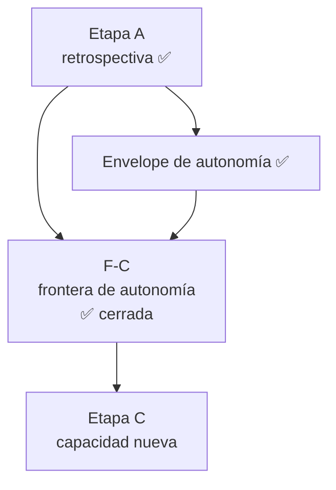

# 🗺️ Roadmap de ARgentOS

> Hacia dónde vamos y cuál es el camino estratégico desde el estado actual.
> Este documento muestra **dirección y secuencia**, no estado detallado: qué es
> un ROADMAP y su contrato viven en `docs/CONVENTIONS.md`.

---

## 🎯 Destino

ARgentOS quiere ser un **protocolo documental y basado en estado para orquestar
agentes**: contratos que un proyecto adopta materializando un payload, no una
herramienta que se instala.

El destino es una ARgentOS capaz de **recibir un objetivo suficientemente amplio
y ejecutarlo de forma autónoma bajo supervisión humana**, sin perder sus
garantías de autoridad, alcance, contexto, evidencia, recuperación y
terminación: `Autonomy ⊆ Scope ∩ Authority`.

**Éxito** significa que la autonomía sea **operacional, no decisional**: elimina
traspasos operativos dentro de trabajo ya autorizado, y nunca elimina el control
humano sobre alcance, autoridad, decisiones normativas, protocolo y release.

---

## 🧭 Posición actual

- **Protocolo publicado:** `12.1.0`, tag anotado sobre el commit de promoción de `dev` (`master`).
- **Payload publicado:** `origin/dist` @ `1181db6` — leer desde ahí, no desde la
  ref local `dist`, que está rezagada. **Todavía corresponde a `12.0.0`**: la
  publicación remota de `12.1.0` (push de `master` y del tag, que dispara
  `publish-dist`) es un acto no autorizado ([plan 168](docs/plans/168-release-12-1-0.md)).
- **En `dev`:** sin cambios de payload pendientes de promoción; `dev` y `master`
  comparten el mismo contenido de payload en `12.1.0`.
- **Trabajo activo:** ninguno.
- **Último trabajo cerrado:** la release `12.1.0`
  ([plan 168](docs/plans/168-release-12-1-0.md), 2026-10-14) y la reconciliación documental del
  cierre de `F-C` ([plan 167](docs/plans/167-reconciliacion-del-cierre-de-f-c.md), 2026-10-14),
  junto con el cierre de `F-C` (`CLOSED`, 2026-10-13): implementada y verificada internamente, sin
  demo externa ni release propia
  ([plan 165](docs/plans/165-f-c-autonomy-frontier-implementation.md)).

### Estado del que parte este roadmap

Las capacidades que ARgentOS ya tiene **no se reabren**: son el punto de partida,
no trabajo pendiente. El trabajo cerrado no se cataloga aquí — su traza vive en
`CHANGELOG.md` y en `docs/plans/INDEX.md`.

---

## 🚦 Roadmap

### ▶️ NOW

- **[PROTOCOL] HIGH — Promover `12.0.1`.** Publicar la reconciliación del payload
  con el layout canónico `.argentos/` y regenerar `dist`
  ([plan 156](docs/plans/156-payload-layout-documentation-reconciliation.md)).

### ⏭️ NEXT

- **[BOTH] CLOSED — `F-C`: frontera de autonomía (cerrada; implementada + verificada internamente).**
  `F-C` **es** Etapa B delimitada por el resultado de Etapa A a la frontera de autonomía: actor con
  provider/modelo, aislamiento/sandbox, Memory como contexto y objetivo multi-Change, con `C-02`
  (contención de autoridad fuera del host) y `C-26` (recuperación ante fallos reales) como condiciones
  ([acto](docs/plans/163-acto-autoridad-od1-alcance-f-c.md); norma en `docs/CONVENTIONS.md`, subsección
  «Modelo de autonomía — alcance canónico de `F-C`»). **Cerrada** (`CLOSED`) con sus decisiones de
  autoridad cerradas (ID-1 actor agnóstico, ID-3 ausencia de aislamiento declarada, ID-5 semántica
  multi-Change) y sus decisiones de implementación resueltas; el payload de sus dos decisiones
  Protocol-native se materializó por [RFC-83](docs/rfc/83-objective-multi-change-and-actor-provenance.md)
  ([plan 166](docs/plans/166-materialize-objective-and-actor-provenance.md)). Traza y cierre en
  ([plan 165](docs/plans/165-f-c-autonomy-frontier-implementation.md); [acto](docs/plans/164-acto-autorizacion-ejecucion-f-c.md)).

### ⏳ LATER

- **[PROTOCOL] — Brechas de capacidad del payload relevadas por la Etapa A (`C-16`, `C-17`, `C-21`).**
  **Explícitamente fuera de `F-C`**: su garantía depende de una adopción real. Sin iniciativa asignada
  ni autorización; requieren su propia decisión de alcance.
- **[BOTH] LOW — Etapa C, capacidad nueva.** Sólo después de `F-C`: ninguna feature
  entra por disponibilidad tecnológica ni por simetría con otro sistema.

> El **envelope de autonomía** ya no figura aquí: su admisión de efectos y su
> terminación por recurso quedaron implementadas y verificadas
> ([plan 159](docs/plans/159-autonomy-envelope-implementation.md)); la clase de actor
> y el aislamiento siguen diferidos dentro de la Etapa B
> ([ADR-19](docs/adr/19-autonomy-envelope-authority.md)).

---

## 🔗 Dependencias críticas

**`F-C` depende de A y del envelope** (ambos cerrados) y **C depende de `F-C`**. Ninguna etapa se ejecuta desde este
documento: cada una es un Change con su propia autorización.

---

## 🚧 Bloqueos que pueden cambiar el camino

| Bloqueo | Qué cambia | Detalle |
|---|---|---|
| Autorización de la publicación remota de `12.1.0` | cuándo llega a `dist` | acto del mantenedor ([plan 168](docs/plans/168-release-12-1-0.md)) |
| ADR-worthiness del acto de autoridad de autonomía | cómo se registra la decisión | `docs/plans/152-authority-decisions-gov-1-10.md` |
| Semántica de lifetime/persistence en el contrato Protocol | viabilidad (exige RFC `Accepted`) | `docs/plans/125-repository-architecture-decisions.md` |
| Enforcement de placement y persistencia de Project/Knowledge | alcance de LATER | [placement-contract](docs/placement-contract.md) — §Enforcement deferred |

---

_Última actualización: 2026-10-14 · Protocolo publicado: `12.0.0`_
