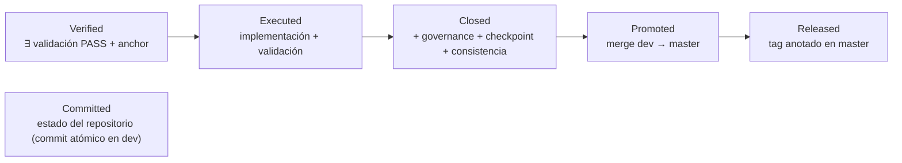
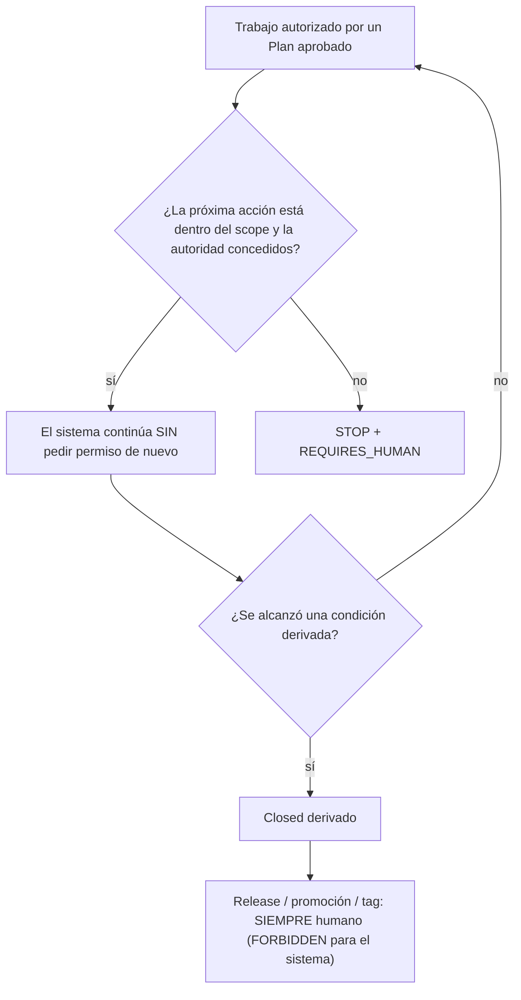

# Patrones de comportamiento — ARgentOS

**Naturaleza:** Policy (ver `docs/AGENTS.md:Naturaleza documental`)
**Lifecycle:** active
**Alcance:** descriptivo — cómo se comporta el sistema que existe hoy, en este repositorio
**No es:** normativa nueva, ni un registro, ni una máquina de estados

Este documento responde a una pregunta:

> ¿Cómo **trabaja** ARgentOS —cómo fluye el trabajo, cómo se usan los estados,
> cómo se toman decisiones, cómo se ejecutan acciones, cómo se observan
> resultados y cómo termina o continúa una ejecución?

Describe **comportamiento observable**: conceptos, contratos y efectos
verificables. No describe razonamiento interno de modelos, no reconstruye
cadenas de pensamiento privadas y no explica la implementación incidental
(nombres de variables internas, funciones, estructuras de datos). Cuando una
afirmación depende de un detalle de implementación que puede cambiar, se enuncia
el patrón, no el detalle.

**Regla de lectura.** Este documento no es fuente de verdad de nada: cada patrón
cita la fuente que lo gobierna y no la duplica. Si este documento y una fuente
citada discrepan, **la fuente citada manda** y la discrepancia se corrige aquí.
Las afirmaciones que dependen de código están ancladas a `ruta:sección` o a la
ruta del módulo; las que no pudieron verificarse se declaran como límite.

---

## 1. Dos capas que no deben confundirse

ARgentOS tiene **dos sistemas de comportamiento distintos** que comparten
vocabulario parcial. Confundirlos es el error de lectura más probable de este
documento, así que se separan explícitamente antes de describir cualquier
patrón.

```text
┌──────────────────────────────────────────────────────────────┐
│ CAPA DEV — este repositorio                                  │
│ Gobierna cómo se DESARROLLA ARgentOS.                        │
│ Agentes: el host autónomo DEV y sus workers.                 │
│ Estado: derivado de Git + artefactos de gobernanza.          │
│ Fuente: `AGENTS.md`, `./.agents/`, `docs/`.                    │
├──────────────────────────────────────────────────────────────┤
│ CAPA PROTOCOL — el payload que se distribuye                 │
│ Gobierna cómo un proyecto ADOPTANTE ejecuta su trabajo.      │
│ Agente: el Orchestrator del protocolo y sus workers.         │
│ Estado: máquina de estados explícita + `state.json`.         │
│ Fuente: `protocol/.agents/` (datos del producto).            │
└──────────────────────────────────────────────────────────────┘
```

| Pregunta | Capa DEV | Capa Protocol |
|---|---|---|
| ¿Quién "conduce"? | el host autónomo DEV / el humano | el Orchestrator del protocolo |
| ¿El estado es explícito? | **no**: se re-deriva en cada iteración | **sí**: máquina de estados con transiciones |
| ¿Existe `next_state`? | no existe | es el mecanismo central |
| ¿Dónde vive la verdad? | Git + artefactos de gobernanza | el payload + `.argentos/.project/` del adoptante |
| ¿Qué la gobierna? | `docs/`, `./.agents/` | `protocol/.agents/` |

La frontera es real y está declarada: el host DEV **conforma** a los contratos
de comportamiento del Protocol y los usa como referencia, pero **no importa sus
mecanismos** (`./.agents/policies/autonomous-orchestration.md:11.6 Boundary with
the Protocol`, y `./.agents/AGENTS.md:Hard boundary: DEV vs Protocol`). El
payload nunca referencia a DEV.

Los patrones de §2–§7 son de la **capa DEV**. §8 documenta la interacción que
cruza la frontera. El comportamiento propio del Protocol —sus estados,
transiciones, gates del harness (H00–H07, H09–H11, H13 y H15 —el payload no
asigna H08 ni H14—) y artefactos— vive en su propia documentación
(`protocol/.agents/orchestrators/core/states/AGENT_STATE_MACHINE.md:Purpose`,
`protocol/.agents/harness/INDEX.md:Guarantee catalog`) y este documento no lo
repite.

---

## 2. Patrón de estado: **nada se almacena, todo se deriva**

**Pregunta que responde:** ¿dónde vive el estado de un Change, y quién puede
cambiarlo?

El patrón es el opuesto al de una máquina de estados. No hay estado persistido,
no hay cursor, no hay `next_state` y no hay base de datos de estado
(`./.agents/policies/autonomous-orchestration.md:2. What the host is not`). El
estado se **re-deriva** en cada iteración a partir de:

```text
estado observado = Git + artefactos de gobernanza + evidencia persistida
                   + autoridad + gates aplicables + pending decisions
                   + stop conditions
```

La consecuencia importante es que **un reinicio no pierde posición**: el host no
guarda memoria entre invocaciones y reconstruye la situación desde el
repositorio y la evidencia persistida
(`./.agents/policies/autonomous-orchestration.md:9. Recovery / continuity`). La
contrapartida es que un artefacto de evidencia faltante o ilegible **no se
convierte en un hecho positivo**: se declara como `GAP`.

### 2.1 Estados que se afirman

Un estado **afirmado** existe como literal en un artefacto versionado. Los
principales:

| Familia | Valores | Dónde se afirma |
|---|---|---|
| Status de Plan | `Aprobado para redacción`, `Aprobado para ejecución`, `Executed`, `Executed (parcial: …)`, `Superseded` | `docs/VERSIONING.md:7. Estados de planes y RFCs` |
| Status de RFC | `Proposal` → `Accepted` → `Superseded` | `docs/VERSIONING.md:7. Estados de planes y RFCs` |
| Lifecycle de artefacto | `active`, `archived`, `superseded`, `deprecated` | `docs/AGENTS.md:Lifecycle` |

### 2.2 Condiciones que se derivan

Una condición **derivada** no es un estado: se computa y puede dejar de valer
sin que nadie escriba nada. Son cinco, y su cadena de implicación es el esqueleto
del ciclo de trabajo:



Reglas que el diagrama no muestra y que importan:

- `Committed` es **estado del repositorio**, no un status de Plan
  (`docs/VERSIONING.md:7. Estados de planes y RFCs`).
- La cadena de implicación objetivo es `Verified ⊆ Executed ⊆ Closed ⊆ Promoted
  ⊆ Released`; `Closed` sin `Verified` es inválido y `Promoted` sin `Closed` es
  anomalía (`docs/VERSIONING.md:7. Estados de planes y RFCs`).
- `Closed` **se deriva, nunca se escribe** como status
  (`./.agents/policies/validation-closure.md:6. Derived conditions`).
- Un plan **docs-only** se cierra sin release (RFC-69,
  `docs/VERSIONING.md:3. Versionado`).

### 2.3 Por qué el patrón importa

Porque elimina una clase entera de errores: no puede haber estado desincronizado
con la realidad, porque el estado **es** una lectura de la realidad. Y porque
obliga a que toda afirmación de progreso sea reproducible: si `Closed` se deriva,
cualquiera puede re-derivarlo desde Git y los artefactos.

---

## 3. Gate pattern: la autoridad precede al efecto

**Pregunta que responde:** ¿qué impide que una acción se ejecute cuando no está
autorizada?

El patrón es uniforme en todo el sistema: **ningún efecto ocurre antes de que su
autoridad se resuelva**. La forma general es:

```text
ACCIÓN DERIVADA
      |
      v
[ GATE DE AUTORIDAD ] --no autorizada--> STOP / REQUIRES_HUMAN
      |                                        (no hay efecto)
    autorizada
      |
      v
   EJECUCIÓN  ---->  [ VERIFICACIÓN POSTERIOR ] --contradice--> STOP
      |
      v
   EVIDENCIA PERSISTIDA
      |
      v
   RE-OBSERVACIÓN (siguiente iteración)
```

Tres propiedades definen el patrón:

1. **La autoridad se consulta antes del efecto, no después.** Una acción que no
   resulta autorizada se convierte en un stop y **nada se delega**
   (`./.agents/policies/autonomous-orchestration.md:5. Authority boundary`).
2. **El gate no crea autoridad; sólo la lee.** El host detecta, clasifica,
   propone, ejecuta bajo autorización existente, verifica, registra y escala. No
   aprueba planes, no acepta RFCs, no cambia scope normativo, no resuelve
   findings ni pending decisions, no decide ADR-worthiness y no autoriza release
   (`./.agents/policies/autonomous-orchestration.md:5. Authority boundary`).
3. **Prevención y detección son garantías distintas y no se confunden.** La
   prevención ocurre cuando el host controla el efecto; la detección cubre los
   efectos que ocurren dentro de código que el host no posee. Un stop que llegó
   *después* del efecto se reporta como detección, nunca como prevención
   (`./.agents/policies/supervised-autonomous-execution.md:12. Declared limits`).

### 3.1 Los gates que existen

| Gate | Qué decide | Autoridad | Al fallar |
|---|---|---|---|
| Autoridad del host | ¿la acción está dentro de la autoridad concedida? | veredictos `AUTHORIZED_EXISTING` / `REQUIRES_HUMAN` / `FORBIDDEN` | `STOP`; no hay efecto |
| Frontera SAE | ¿la acción está dentro del **scope autorizado** y la autorización no derivó? | `./.agents/policies/supervised-autonomous-execution.md:2. The two gates, in order` | `STOP` / `REQUIRES_HUMAN` |
| Gates de lifecycle C-1/C-2/C-3 | ¿el anchor, el checkpoint y el lineage son coherentes? | `./.agents/policies/lifecycle-checkers.md` | `ANOMALY` → `STOP`; `GAP` es advisory |
| Gates del Protocol (H00–H07, H09–H11, H13, H15) | ¿el trabajo del adoptante cumple su contrato? | `protocol/.agents/harness/INDEX.md:Guarantee catalog` | depende del modo declarativo/enforced |

Que un gate sea **advisory** como proceso no lo vuelve ignorable como señal: los
gates C-1/C-2/C-3 no cambian su exit code por un `GAP` —sólo un `ANOMALY` lo
hace no-cero— pero el host **sí** trata `ANOMALY` y `BOUNDARY` como bloqueantes
(`./.agents/policies/lifecycle-checkers.md`).

---

## 4. Orquestación: una responsabilidad por componente

**Pregunta que responde:** ¿quién decide qué, y qué no decide nadie más?

El sistema evita el solapamiento de responsabilidades. Cada componente tiene un
trabajo y ninguno toma el del otro:

| Componente | Responsabilidad | Lo que **no** hace |
|---|---|---|
| Plan aprobado | autoriza la implementación: qué trabajo y sobre qué rutas | no decide autoridad ni resuelve conflictos |
| Host autónomo DEV | observa, deriva, autoriza, delega, verifica, registra, escala | no decide; no aprueba; no libera |
| Worker | ejecuta el trabajo delegado y persiste su resultado | no cambia estado; no declara condiciones derivadas |
| Gates | clasifican coherencia y producen señales | no son autoridad normativa |
| Humano (mantenedor) | decide: scope, autoridad, normativa, arquitectura, release | no opera el workflow paso a paso |

La frase que fija la frontera, declarada una vez y vinculante en todo el sistema,
es:

> **El humano no opera el workflow; el humano es la autoridad.**
> (`./.agents/policies/supervised-autonomous-execution.md`)

### 4.1 Delegación: contrato y límites

El host delega a un **worker** a través de una única frontera (`WorkerAdapter`).
Que el worker sea un ejecutor de comandos o un agente que razona **no cambia el
patrón**: el contrato del resultado es el mismo.

Todo resultado de ejecución es un `WorkerResult` **persistente y
reconstruible** que permite saber qué recibió el worker, qué hizo, qué artefactos
modificó, qué comandos ejecutó, qué evidencia produjo, qué problemas encontró,
qué quedó pendiente y qué autoridad usó. Dos reglas son estructurales:

1. **`exit code 0` nunca es completitud del workflow.** El éxito de un comando
   dice que el comando corrió. La completitud es una condición derivada.
2. **Una recomendación nunca es una autorización.** El campo que propone la
   próxima acción es insumo advisory; el host deriva su propia acción y la
   frontera de autoridad decide. Un `WorkerResult` no declara ninguna condición
   derivada.

Fuente: `./.agents/policies/autonomous-orchestration.md:4. Worker Result (M4)` y
`:11.5 Execution is not Closed`.

### 4.2 El patrón de escritura de gobernanza

Las escrituras en artefactos de gobernanza tienen un patrón propio: existe **un
único escritor**, y ese escritor **rechaza** toda operación que no llegue con un
veredicto de autorización existente. La consecuencia de diseño es que el registro
de gobernanza no puede ser la vía por la que se cuela una decisión: si la
autoridad no existe, el registro no se escribe
(`./.agents/policies/autonomous-orchestration.md:10. Declared limits of the MVP`).

---

## 5. Autonomy loop: el ciclo autónomo real

**Pregunta que responde:** ¿cómo avanza el sistema solo, y dónde se detiene?

El ciclo tiene **dos versiones** según el nivel de autonomía que se habilite.
Ambas comparten la misma forma y difieren en un gate.

```text
                    ┌─────────────────────────────────────────┐
                    │  OBSERVAR                               │
                    │  re-leer repo + evidencia persistida     │
                    └────────────────────┬────────────────────┘
                                         v
                    ┌─────────────────────────────────────────┐
                    │  DERIVAR                                │
                    │  la próxima acción válida (vocabulario  │
                    │  cerrado), como función de la           │
                    │  observación                            │
                    └────────────────────┬────────────────────┘
                                         v
                    ┌─────────────────────────────────────────┐
                    │  AUTORIZAR                              │
                    │  ¿dentro de la autoridad concedida?     │
                    └────────────────────┬────────────────────┘
                          no ────────────┴──────────── sí
                          v                            v
                    ┌───────────┐        ┌────────────────────────────┐
                    │   STOP    │        │  [ FRONTERA SAE, opt-in ]  │
                    │ + escalar │        │  ¿dentro del scope y sin   │
                    │ + evidencia│       │  deriva de autorización?   │
                    └───────────┘        └────────────┬───────────────┘
                                          no ─────────┴──────── sí
                                          v                     v
                                    ┌───────────┐   ┌────────────────────┐
                                    │   STOP    │   │  DELEGAR / EJECUTAR│
                                    │ + escalar │   │  el worker corre y │
                                    └───────────┘   │  persiste resultado│
                                                    └─────────┬──────────┘
                                                              v
                                                    ┌────────────────────┐
                                                    │  VERIFICAR         │
                                                    │  scope (snapshot) +│
                                                    │  contrato M4       │
                                                    └─────────┬──────────┘
                                                              v
                                                    ┌────────────────────┐
                                                    │  DECIDIR           │
                                                    │  ¿terminal?        │
                                                    └────┬──────────┬────┘
                                                      no│          │sí
                                                        v          v
                                                  (iterar)      (terminar
                                                                + reportar)
```

### 5.1 Las dos versiones

| | Ciclo base | Ciclo con SAE |
|---|---|---|
| Gate de autoridad | activo siempre | activo siempre |
| Frontera de scope | **no** se evalúa antes de delegar | se evalúa **antes** de delegar |
| Garantía de scope | detección posterior (snapshot de contenido, sobre las escrituras **delegadas**) | prevención previa **+** detección posterior |
| Habilitación | por defecto | **opt-in** (`--sae`) |

Que la frontera SAE sea `opt-in` es deliberado y está declarado: la frontera es
aditiva y sin ella el host se comporta como antes
(`./.agents/policies/supervised-autonomous-execution.md:12. Declared limits`). El
patrón importante es que **la prevención no es la garantía por defecto**: en la
configuración base la garantía de scope que corre es la detección, que es la más
débil de las dos.

### 5.2 Qué **no** existe en el loop

Enumerarlo evita el error de atribuirle al sistema mecanismos que no tiene:

- **No hay `next_state`**, transición ni cursor.
- **No hay un mecanismo de retry, y la política está alineada con el código —no
  hay discrepancia—.** La política **no** enumera un reintento interno con ciclo
  de vida propio: declara que un fallo que exige rehacer trabajo autorizado se
  conduce como una **nueva derivación** sobre el estado observado
  (`./.agents/policies/supervised-autonomous-execution.md:7. Recovery`). El código
  **no implementa ningún mecanismo de reintento**, de modo que la política y la
  conducción efectiva dicen lo mismo: la capacidad de la frontera es la
  **derivación**, no un reintento declarado. La alineación la fijó el Plan 165
  (`ID-8`), que eligió **alinear la política con el código** en lugar de
  implementar un retry, y `tests/test_fc_recovery_alignment.py` la verifica.
- **No hay recuperación multi-nivel.** La noción de "recovery" que el sistema
  cuenta es estrecha: una iteración que **re-conduce** trabajo que el Change ya
  había producido con evidencia —una revalidación sobre contenido cambiado— no
  es recovery (`./.agents/policies/supervised-autonomous-execution.md:11. Execution
  summary and the autonomy metric`).
- **La corrección autónoma de findings no está cableada al loop** (§6 lo detalla
  con su evidencia).
- **Tres clases de acción del vocabulario no son alcanzables desde el bucle.**
  `SYNC_REPOSITORY_STATE`, `UPDATE_DOCUMENTATION_AUTHORIZED` y `RECOVER_IN_SCOPE`
  están definidas en `runtime/orchestrator/autonomy.py` (vocabulario cerrado y
  clases de escritura que exigen declarar su path), pero **no** figuran en
  `_AUTONOMY_CLASS_BY_ACTION` de `runtime/orchestrator/host.py`, que es el mapeo
  que traduce una acción derivada a la clase que la frontera evalúa. Hoy son
  construibles sólo en tests y **ninguna derivación las produce**: en particular,
  el host **no** actualiza documentación por sí mismo —su única escritura es el
  registro de gobernanza sobre el propio Plan (`runtime/orchestrator/governance.py`)—
  y no existe un mecanismo automático que mantenga sincronizada la documentación
  (`./.agents/policies/validation-closure.md` §5.1: la determinación de impacto
  documental es gobernanza y ningún checker interpreta prosa).
- **No hay una segunda representación del estado**: ni base de datos, ni
  registry, ni `state.json` del lado DEV.

### 5.3 Cómo termina un ciclo

Termina cuando la acción derivada es **terminal**. Las formas reales de terminar
son (agrupadas por **clase** de stop; el vocabulario de stops concretos es más
fino que esta tabla y vive en `runtime/orchestrator/contracts.py`):

| Fin | Qué significa |
|---|---|
| condición derivada alcanzada | el Change llegó a `Closed` (derivado; release queda al humano) |
| stop de autoridad | la próxima acción válida exige al humano, o la frontera SAE la clasificó `REQUIRES_HUMAN` (`STOP_AUTHORITY_REQUIRED`) o la acción es de una clase fuera del vocabulario autónomo (`STOP_UNCLASSIFIABLE_ACTION`) |
| stop de scope o de acción prohibida | una escritura cae fuera del scope autorizado (`STOP_SCOPE_VIOLATION`), o la acción es de una clase prohibida con independencia de la autorización (`STOP_FORBIDDEN_AUTONOMY`), o el worker escribió fuera del scope declarado y la detección posterior lo capturó (`STOP_FORBIDDEN_ACTION`) |
| stop sin trabajo autorizado | no hay acción autorizable que conducir (`STOP_NO_AUTHORIZED_WORK`) |
| stop de gate | un gate devolvió `ANOMALY` o `BOUNDARY` (`STOP_GATE_ANOMALY`), o su evidencia quedó incompleta donde el cierre la necesita (`STOP_GATE_INCOMPLETE`) |
| stop de validación | la validación declarada dio `FAIL` (`STOP_VALIDATION_FAIL`) |
| stop de evidencia | el `WorkerResult` falta o es inválido (`STOP_WORKER_RESULT_MISSING` / `STOP_WORKER_RESULT_INVALID`) |
| stop de entrada | el plan no existe o está superseded (`STOP_PLAN_NOT_FOUND` / `STOP_PLAN_SUPERSEDED`), la autorización no está dada o sus criterios de entrada no se cumplen (`STOP_AWAIT_PLAN_AUTHORIZATION` / `STOP_ENTRY_CRITERIA_UNMET`), hay una pending decision bloqueante (`STOP_BLOCKING_PENDING_DECISION`) o un finding abierto (`STOP_OPEN_FINDINGS` / `STOP_FINDING_REQUIRES_HUMAN`) |
| límite de iteraciones o no-progreso | el loop no puede avanzar (`STOP_MAX_ITERATIONS` / `STOP_NO_PROGRESS`) |
| frontera de release | el cierre quedó derivado y la release queda al humano |

La tabla no pretende ser exhaustiva: agrupa el vocabulario de stops por la
autoridad que decide, que es lo que un lector necesita saber. Los nombres
concretos son de `runtime/orchestrator/contracts.py` y
`runtime/orchestrator/autonomy.py`, y pueden cambiar sin cambiar el patrón.

Un stop **no es un fallo**: escalar con evidencia es un resultado correcto
(`./.agents/policies/supervised-autonomous-execution.md:5. Stop conditions (escalate
with evidence)`).

### 5.4 La métrica de autonomía

El ciclo produce un resumen de ejecución. Dentro de él, **dos conteos humanos
nunca se fusionan**, porque significan cosas opuestas:

```text
human_operational_intervention   un paso que el host NO pudo conducir
                                 → costo de autonomía incompleta
human_authority_decision         una decisión que EXCEDE la autonomía concedida
                                 → la frontera funcionando como se diseñó
```

La relación que se reporta es `autonomous_steps / authorized_steps`. Sin pasos
autorizados la relación es **N/A**, nunca `0` ni un puntaje perfecto, de modo que
una corrida vacía no puede parecer un éxito. La métrica **observa** la autonomía;
no la incentiva (`./.agents/policies/supervised-autonomous-execution.md:11.
Execution summary and the autonomy metric`).

El resumen no se limita a esos dos conteos: también reporta `authorized_steps`,
`autonomous_steps`, `findings_detected`, `findings_autonomously_corrected`,
`findings_escalated`, `recoveries`, `stop_conditions` y `deferred_branches`, y
`runtime/orchestrator/autonomy.py` los deriva del journal y de los
`WorkerResult`. El resumen es una **vista**, no un sistema de tracking: no hay
store de métricas, ni base de datos, ni registry
(`./.agents/policies/supervised-autonomous-execution.md:11. Execution summary and
the autonomy metric`).

---

## 6. Human-in-the-loop: dónde está exactamente la frontera

**Pregunta que responde:** ¿en qué puntos decide el humano, y qué puede decidir?

Hay intervención humana real, y es **acotada y enumerable**. No es un mecanismo
de aprobación por paso: es una frontera de autoridad.



**Lo que el sistema decide solo:** continuar de un paso autorizado al siguiente;
observar, reconstruir estado y derivar; planificar el próximo paso; delegar,
ejecutar y verificar; **recuperar** dentro del scope cuando el ancla quedó *stale*
(revalidación); revalidar y reconstruir evidencia; correr checkers y tests;
derivar el cierre cuando las condiciones se cumplen
(`./.agents/policies/supervised-autonomous-execution.md:4. Autonomous
continuation`).

> **Precisión sobre la corrección autónoma de findings.** La política declara que
> el host **puede** corregir un finding dentro del scope, bajo once condiciones
> (`./.agents/policies/supervised-autonomous-execution.md:6. Findings`), y la
> frontera de esa decisión existe en el código
> (`runtime/orchestrator/autonomy.py`, evaluación de resolución de findings). Pero
> **esa capacidad no está cableada al loop**: la derivación **se detiene ante
> cualquier finding abierto** antes de poder derivar una corrección
> (`runtime/orchestrator/derivation.py`, `STOP_OPEN_FINDINGS` /
> `STOP_FINDING_REQUIRES_HUMAN`), y el propio código lo declara — el comentario de
> `runtime/orchestrator/autonomy.py` afirma que un registro de corrección «cannot
> yet arise from the loop». La política lo reconoce en su propio texto
> (`./.agents/policies/supervised-autonomous-execution.md:11. Execution summary
> and the autonomy metric`). El resultado práctico es que **el ciclo real no
> corrige findings de forma autónoma**: los detecta, los registra y escala. Se
> documenta la frontera declarada y su límite real, no la capacidad esperada.

**Lo que sólo decide el humano** (`./.agents/policies/supervised-autonomous-execution.md:8.
Human boundary`): autorizar scope y sus cambios; aceptar o rechazar decisiones
normativas; resolver conflictos de autoridad; autorizar una RFC; autorizar un
ADR; autorizar cambios de Protocol; aceptar o rechazar cambios de arquitectura;
autorizar release; autorizar promoción; abortar el Change; resolver lo
escalado; y **transicionar el estado de un finding**.

Dos consecuencias que suelen malinterpretarse:

1. **Una obligación no es un permiso.** Que una determinación de cierre diga
   `REQUIRED` —documentación o roadmap— obliga al **estado**, no autoriza a
   escribir. Si el artefacto que la satisface está fuera del scope autorizado, la
   obligación se registra `DEFERRED` y **no se escribe**
   (`./.agents/policies/supervised-autonomous-execution.md:1.1 Scope precedes every
   obligation (plan 138)`).
2. **No existe expansión autónoma de scope.** El sistema no puede ampliar `Task`,
   `Scope` ni `Authority` por su cuenta, ni derivando una lectura más amplia, ni
   escribiendo la ampliación en el artefacto para releerla después. La vía
   legítima es una decisión humana y una nueva autorización
   (`./.agents/policies/supervised-autonomous-execution.md:1.4 There is no
   autonomous Scope Expansion (plan 139, <PLAN-138>:PC-2)`).

---

## 7. Fallo y recuperación: una taxonomía de señales, no de estados

**Pregunta que responde:** ¿qué pasa cuando algo sale mal?

El sistema **no** tiene una taxonomía de estados de fallo. Tiene una taxonomía de
**señales** —vocabulario cerrado— que el gate produce y el loop interpreta. La
distinción que hay que retener es cuál señal bloquea y cuál no:

| Señal | Significado | Efecto |
|---|---|---|
| `VALID` | registro presente y consistente | única evidencia **positiva** |
| `GAP` | información requerida ausente o no verificable | **advisory**: se registra y se sigue |
| `ANOMALY` | información presente pero contradictoria | **bloquea**: `STOP` + escalar |
| `BOUNDARY` | ambigüedad estructural | **bloquea**: revisión humana, nunca adivinar |
| `FAIL` | violación mecánica (batería) | corregir o declarar desviación aceptada |
| `N/A` / `EXCLUDED` | no aplica / legacy | esperado; no es invalidez |

Dos reglas gobiernan la lectura:

- **La ausencia de evidencia nunca se convierte en evidencia positiva.** Sólo
  `VALID` es evidencia positiva
  (`./.agents/policies/autonomous-orchestration.md:7. Failure semantics`).
- **`GAP ≠ ANOMALY ≠ FAIL`.** Falta de evidencia es `GAP` (advisory); información
  contradictoria es `ANOMALY` (bloqueante); violación mecánica es `FAIL`.
  Tratarlos como equivalentes es un error
  (`./.agents/AGENTS.md:Fundamental operating rules (always in force)` regla 7).

### 7.1 Recuperación: qué es y qué no

| Situación real | Qué ocurre |
|---|---|
| La validación declarada falla | `STOP`; corregir o declarar desviación aceptada |
| Un gate devuelve `ANOMALY` | `STOP`; registrar finding/corrección y revalidar antes de continuar |
| El contenido cambió y el anchor quedó *stale* | revalidación: la misma validación sobre el estado nuevo, registrada como **nuevo anchor** que referencia al original y **nunca lo reemplaza** |
| El resultado del worker falta o no cumple el contrato | `STOP`; nunca se acepta el objeto devuelto en lugar del persistido |
| Una escritura cae fuera del scope | prevención (si la frontera está activa) o detección posterior; en ambos casos `STOP` |
| Una línea del journal es ilegible | se declara `GAP`, **no** se descarta en silencio |
| Una integración o un proveedor externo falla | se clasifica según la clase ambiental declarada por el plan: `GAP` si está cubierta por la declaración, `FAIL` si no |

El patrón transversal: **una falla no se oculta ni se reinterpreta**; se clasifica
con el vocabulario existente, se registra como evidencia y, si excede la
autoridad concedida, detiene el loop. La recuperación **nunca** sobrescribe
trabajo posterior ni amplía el scope para rodear un bloqueo
(`./.agents/policies/supervised-autonomous-execution.md:7. Recovery` y `:6.1
Blocked findings do not block independent work`).

### 7.2 Límites declarados del patrón

- No hay transacción multi-archivo real: la atomicidad se limita al reemplazo por
  archivo, y el journal más la idempotencia de los pasos **son** el mecanismo de
  recuperación (`docs/ADOPTION.md:8.3. Backups y recovery`).
- El enforcement cubre los efectos que quien conduce controla. Entre delegar y el
  retorno del worker, el control pasa a código que el host no posee: por eso hay
  prevención donde el host controla el efecto y detección donde no
  (`./.agents/policies/supervised-autonomous-execution.md:12. Declared limits`).
- Los hooks del Protocol son **fail-open** ante crash o timeout: protegen contra
  la omisión del agente, no contra el hook fallando
  (`docs/ADOPTION.md:6.3. Límite honesto: los hooks son fail-open`).

---

## 8. Client interaction: cómo entra el trabajo y cómo sale el resultado

**Pregunta que responde:** ¿cuál es el flujo entre quien pide el trabajo, el
protocolo y el runtime?

Existen **dos flujos de cliente** distintos, correspondientes a las dos capas de
§1.

### 8.1 El adoptante (capa Protocol)

El adoptante no es un programa cliente: es un proyecto que **materializa** el
payload. El flujo tiene dos momentos separados por diseño —**instalar** y
**operar**— y el segundo no depende del primero.

```mermaid
sequenceDiagram
  participant M as Mantenedor
  participant D as dist (payload publicado)
  participant L as lifecycle (stdlib)
  participant P as Proyecto adoptante
  participant O as Orchestrator del protocolo

  M->>D: obtiene el payload publicado
  M->>L: install --project-root <proyecto> (ref fija o copia local)
  L->>P: materializa <proyecto>/.argentos/{.agents,features.toml,.project,.backup}
  L-->>M: manifest install.json + estado determinista
  Note over L,P: detección ≠ autorización; preservación por defecto
  M->>O: da la instrucción de leer AGENTS.md
  O->>P: bootstrap, estados, gates, artefactos de sesión
```

La distinción que el flujo hace explícita y que conviene retener: **`dist`
transporta el payload, no el layout**. La rama publicada contiene `./.agents/` +
`AGENTS.md`; el layout canónico `<proyecto>/.argentos/…` lo **produce** el
lifecycle al instalar (`docs/ADOPTION.md:1.1. Layout canónico` y
`docs/VERSIONING.md:9. Estado actual`).

Propiedades del flujo de instalación:

- El payload instalado es **read-only** para el adoptante: se cambia en el repo
  fuente y se migra (`docs/ADOPTION.md:1.1. Layout canónico`).
- La **propiedad** de un artefacto se decide por procedencia registrada (`origin`)
  más estado verificado; la huella `sha256` **detecta divergencia, no acredita
  autoría** (`docs/ADOPTION.md:8.1. Ownership`).
- La operación **se detiene** ante ambigüedad (fail-closed) y nunca sobrescribe
  cambios posteriores del adoptante (`docs/ADOPTION.md:8. Lifecycle: ownership,
  manifest, backups, recovery y límites`).
- Cada operación reporta un **estado determinista con su exit code** —
  `success` (0), `no-op` (10), `conflict` (20), `recovery-pending` (30)— de modo
  que un llamador automatizado no necesita interpretar prosa para saber si la
  operación corrió, no cambió nada o se detuvo. `doctor` reporta nueve estados de
  diagnóstico que se proyectan sobre esos tres códigos de salida
  (`protocol/.agents/harness/lifecycle.py`).
- Hay dos modos de enforcement: **declarativo** (default; gates por juicio, sin
  Python) y **enforced** (gates impuestos por el entorno)
  (`docs/ADOPTION.md:6. Modos de enforcement: declarativo (default) y enforced`).

### 8.2 El desarrollo de ARgentOS (capa DEV)

El "cliente" del sistema DEV es el **mantenedor**. El flujo es:

```text
Humano (autoridad)
   │  pedido + autorización de un Plan
   v
Plan aprobado ──> host autónomo DEV ──> workers ──> evidencia persistida
                        │                              │
                        └──────── observación ─────────┘
                                       │
                                       v
                        condiciones derivadas + escalaciones
                                       │
                                       v
                        Humano decide: scope, normativa, release
```

El humano **no opera el workflow**: autoriza, decide y resuelve lo escalado.
Entre esas decisiones, el sistema conduce.

### 8.3 Qué es realmente un "cliente" en ARgentOS

Conviene decirlo sin ambigüedad, porque el término invita a una lectura
equivocada: **ARgentOS no tiene un modelo de clientes**. No hay registro de
plugins, ni abstracción de host, ni configuración de IDE, ni artefacto "cliente"
alguno, ni integración con editores u otros agentes como categoría del modelo.
En el payload, toda aparición de la palabra *client* pertenece a vocabulario
genérico de diseño de software (SOLID/ISP, DDD), no a una entidad del protocolo.

Lo que **sí** existe son **tres superficies de integración**, y son todas las que
el código define:

| Superficie | Qué es | Dónde se define |
|---|---|---|
| Adapter `AGENTS.md` | Artefacto **generado** y no normativo en la raíz del proyecto adoptante, que apunta al bootstrap real (`.argentos/.agents/INDEX.md`). Se genera **solo si no existe**. | `protocol/.agents/harness/lifecycle.py` (generación del adapter) |
| Contrato de raíz | Toda entrada del harness recibe el `PROJECT_ROOT` como **input** (`--project-root` —con alias `--root` en `health_check.py`, `lifecycle.py` y `gate_validator.py`— o `ARGENTOS_PROJECT_ROOT`; `runner_state.py` acepta sólo `--project-root`, y `hook_gate.py` lo toma del evento del hook o del entorno); nunca se descubre por la ubicación del script. | `protocol/.agents/harness/roots.py` |
| Hook de CLI (opcional) | Registro de un hook compartido que lee el evento del CLI y puede **bloquear** tres situaciones: una escritura que no nombra ningún target, una escritura sobre un deliverable sin el gate correspondiente, y un cierre de iteración sin registro. | `protocol/.agents/harness/INDEX.md:Hook setup (enforced mode)`; `docs/ADOPTION.md:6.1. Configuración de hooks por CLI` |

Dos consecuencias que se derivan de esa lista:

1. **"Integrar un cliente" significa, en la práctica, una de dos cosas:**
   materializar el payload en un proyecto (adopción, §8.1) o registrar el hook en
   un CLI soportado (modo enforced). No existe una tercera vía.
2. **El soporte de hooks es explícito y acotado.** La documentación del payload
   describe la configuración concreta para los CLI soportados; un CLI distinto no
   está cubierto por el contrato, y los hooks son **fail-open** ante crash o
   timeout del propio hook (`docs/ADOPTION.md:6.3. Límite honesto: los hooks son
   fail-open`).

---

## 9. Dónde vive cada verdad

Este documento describe patrones; **no** es fuente de verdad de ninguno. La
tabla siguiente indica qué documento gobierna cada área, para que ninguna
afirmación de este archivo tenga que sostenerse sola:

| Área | Fuente de verdad |
|---|---|
| Comportamiento ejecutable | código + tests (`runtime/`, `tests/`) |
| Materialización del Execution Context | `runtime/toolcalls/` y [`runtime/README.md`](runtime/README.md) (contrato canónico: RFC-72; prefijo estable provider-bound: RFC-78) |
| Placement de artefactos (realización mecánica) | `runtime/placement/` (biblioteca de sólo lectura; el contrato normativo es `docs/placement-contract.md`) |
| Ciclo de vida del Change DEV | `docs/rfc/75-change-lifecycle.md`; reglas operativas en `docs/CONVENTIONS.md:Convenciones` |
| Conducir un Change (host) | `./.agents/policies/autonomous-orchestration.md` |
| Frontera de autonomía (SAE) | `./.agents/policies/supervised-autonomous-execution.md` |
| Autoridad y conflictos | `./.agents/policies/authority.md`; ADR-16 |
| Validación, anchors y cierre | `./.agents/policies/validation-closure.md` |
| Gates C-1/C-2/C-3 | `./.agents/policies/lifecycle-checkers.md` |
| Versión, changelog, tags, estados | `docs/VERSIONING.md` |
| Adopción e instalación | `docs/ADOPTION.md` |
| Migración entre versiones | `docs/MIGRATION.md` |
| Ubicación de artefactos | `docs/placement-contract.md` |
| Taxonomía documental | `docs/AGENTS.md` |
| Estados y transiciones del protocolo | `protocol/.agents/orchestrators/core/states/AGENT_STATE_MACHINE.md` |
| Fronteras del protocolo adoptado | `protocol/.agents/standards/runtime/PROTOCOL_BOUNDARIES.md` |
| Gates del harness del protocolo | `protocol/.agents/harness/INDEX.md` |

---

## 10. Límites de este documento

- Describe el comportamiento **de este repositorio y del payload que publica** en
  el estado de la release vigente; un cambio de comportamiento cambia esta
  descripción, y la reconciliación es responsabilidad del Change que lo produce.
- **No** documenta el comportamiento interno del Protocol adoptado más allá de lo
  necesario para situar la frontera: ese comportamiento vive en el payload.
- **No** documenta razonamiento interno de modelos ni decide cómo un worker
  alcanza su resultado.
- Las afirmaciones sobre el ciclo autónomo describen el host DEV tal como está
  implementado, incluida la distinción prevención/detección y el carácter
  `opt-in` de la frontera SAE. Donde este documento y una fuente citada
  discrepen, la fuente citada manda.