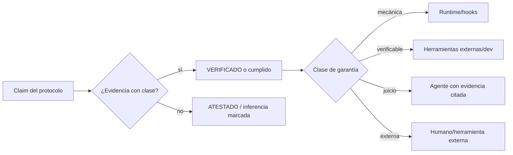

# RFC-62 — Guarantee Model & Enforcement Boundaries

**Status:** Accepted
**Fecha:** 2026-08-25
**Serie:** Arquitectura post-auditoría (25 ago 2026)
**Origen:** `ARCHITECTURAL_DECISION_MODEL.md:D0 — Guarantee Model`, `ARCHITECTURAL_DECISION_MODEL.md:D11 — Enforcement Boundaries`
**Pregunta:** ¿Qué garantiza ARgentOS, qué no garantiza, y quién verifica cada garantía?
**Afectados:** protocol/.agents/standards/runtime/PROTOCOL_HEALTH.md; protocol/.agents/harness/INDEX.md; contratos SESSION_LOG/METRICS/HARNESS_REPORT/VERIFICATION_REPORT; policies H01/H06/H07; tools/check_session_artifacts.py, tools/aggregate_metrics.py, tools/audit_gates.py

## Status

ACCEPTED

Aceptada el 2026-08-25 por el mantenedor junto con la autorización de ejecución
del plan 76 (`plans/76-guarantee-model-enforcement-boundaries.md`); la versión
del protocolo que la implementa es la 4.0.0 (MAJOR).

## Summary

ARgentOS adopta un modelo híbrido de garantías. Define un catálogo cerrado de garantías, cada una
clasificada en una de cinco clases (declarativa, verificable, mecánicamente enforceada, dependiente
del juicio del agente, dependiente de actores externos) y asigna a cada garantía un responsable de
verificación (agente, harness, runtime, herramienta externa, humano). La expresión "zero
hallucinations" deja de usarse como garantía técnica y se reemplaza por una regla operacional: todo
claim del protocolo es evidencia-citado o está marcado explícitamente como atestación o inferencia.

## Motivation

- Problems: P1, P3, P4, P10, P15, P16, P18; CG-02, CG-03; RC-01
  (`ARCHITECTURAL_PROBLEM_MODEL.md:4. Confirmed Problems`,
  `ARCHITECTURAL_PROBLEM_MODEL.md:8. Root Cause Candidates`).
- Decisions: D0, D11 (`ARCHITECTURAL_DECISION_MODEL.md:D0 — Guarantee Model`,
  `ARCHITECTURAL_DECISION_MODEL.md:D11 — Enforcement Boundaries`).

El Problem Model concluye que la mayoría de los problemas confirmados son de enforcement y de
semántica no definida, y que la causa estructural es el modelo "documentos + juicio del agente"
sin límites explícitos entre declaración, observación, evidencia, verificación y enforcement.
Sin una decisión sobre qué garantiza el sistema, ninguna decisión posterior (evidencia, registro,
autorización) tiene criterio.

## Context

ARgentOS declara un modelo de enforcement de tres capas (enforced / reviewed / verified)
(`protocol/.agents/harness/INDEX.md:Enforcement model`): la capa enforced es una cáscara mínima
stdlib (hooks fail-open, `runner_state.py`, `health_check.py`), la capa reviewed son los gates
evaluados por juicio del orquestador con trail auto-reportado, y la capa verified son los checkers
del repositorio de desarrollo (dev-only). El modo declarativo no requiere Python. BeaconRBX mostró
que en la práctica los cuatro registros divergen (P3), los artefactos de sesión pueden faltar sin
detección (P1/P10) y los claims de "verificado" pueden basarse en atestación del mismo agente (P16).

## Decision

ARgentOS MUST:

- D-001: Mantener un catálogo cerrado de garantías con su clase, según la tabla del Model.
- D-002: Clasificar cada garantía en exactamente una clase: declarativa, verificable,
  mecánicamente enforceada, dependiente del juicio del agente, o dependiente de actores externos.
- D-003: Verificar cada garantía en la capa que su clase asigna (matriz de Enforcement Boundaries).
- D-004: Reemplazar "zero hallucinations" como garantía técnica por la regla operacional: todo claim
  emitido por el protocolo es evidencia-citado o está marcado explícitamente como atestación o
  inferencia.
- D-005: Registrar la clase de garantía junto con la claim que la invoca cuando la claim declare
  "verificado", "cumplido" o "enforcement".
- D-006: Mantener el modo declarativo sin requisito de Python; las garantías mecánicas son opcionales
  en ese modo y se verifican post-hoc por herramientas externas (dev-only) o se declaran como
  atestación.

ARgentOS MUST NOT:

- D-101: Etiquetar una garantía como "mecánica" si su evaluación depende del juicio del agente.
- D-102: Afirmar "zero hallucinations" como propiedad técnica del runtime.
- D-103: Presentar una atestación del mismo agente como verificación externa sin la marca de
  atestación (semántica definida en RFC-65).

ARgentOS SHOULD:

- D-201: Exponer la matriz de enforcement en la documentación de adopción para que cada adoptante
  sepa qué verifica su runtime y qué verifica el agente.

ARgentOS MAY:

- D-301: Añadir checks mecánicos nuevos (presencia de registros, versión, reconciliación) siempre
  que sean stdlib-only y no bloqueen el modo declarativo.

## Scope

Cubre: catálogo de garantías, clases, matriz de verificación por capa, límites del juicio del
agente, semántica operacional de atestación vs verificación, y límites de autoridad entre agente,
harness, runtime, herramientas externas y humano.

## Non-Goals

- No define las clases de evidencia en detalle (lo hace RFC-65).
- No define el modelo de autorización (lo hace RFC-66).
- No introduce un kernel de ejecución ni un runtime obligatorio.
- No redefine el modelo de tres capas; lo extiende con un catálogo explícito.

## Terminology

- **Garantía declarativa:** política del protocolo sin verificación mecánica (p. ej., "la KB solo se
  actualiza por pipeline").
- **Garantía verificable:** comprobable desde artefactos por herramientas (presencia, versión,
  timestamps, evidencia asociada, consistencia bidireccional de gates).
- **Garantía mecánicamente enforceada:** ejecutada por runtime/hooks (registro de gates, sonda de
  estado, deny de escritura sin H04 en modo enforced).
- **Garantía dependiente del juicio del agente:** evaluación semántica no cubierta por las clases
  anteriores; su resultado se registra con evidencia citada o como atestación.
- **Garantía dependiente de actores externos:** aprobaciones humanas, herramientas externas,
  reproductibilidad de salidas de comandos (best-effort).
- **Atestación:** afirmación del agente sobre su propio proceso o estado, no re-derivable de objetos
  durables; se marca explícitamente (RFC-65).
- **Verificación:** evaluación de una claim contra evidencia con clase distinta de atestación
  (RFC-65).

## Model

### Catálogo de garantías

| Garantía | Clase | Verificada por |
|---|---|---|
| Identidad y versionado de sesión (protocol_version, UUID) | Verificable | Runtime (dev tool) + agente |
| Presencia de registros de sesión (state.json, HARNESS, METRICS, SESSION_LOG) | Verificable | Runtime (dev tool) + agente |
| Registro de gates (gate, resultado, cuándo) | Mecánica | runner_state (estado) + agente (review) |
| Coherencia state.json ↔ HARNESS (bidireccional, tiempos) | Verificable | Runtime (dev tool) |
| Estructura de artefactos (secciones, ENTRY/METRIC, EARS) | Verificable | gate_validator (estructural) + agente |
| Evidencia asociada a claims (clase + referencia) | Verificable | agente + dev tool (RFC-65) |
| Autorización determinable para efectos fuera de frontera | Verificable | agente + humano (RFC-66) |
| Freshness/invalidación de knowledge | Verificable | agente + dev tool (RFC-67) |
| Cumplimiento de budget (par declared/consumed) | Verificable | runtime + agente (RFC-64) |
| Reproducibilidad de ítems `[gate]` | Verificable (best-effort) | dev tool (audit_gates) |
| Independencia de verificación | Dependiente de actores externos | solo multi-agent; en single-instance se declara atestación |
| Aprobaciones humanas | Dependiente de actores externos | humano |

### Matriz de Enforcement Boundaries

| Property | Agent | Harness (gates) | Runtime (scripts/hooks) | External (dev tools/CI) | Human |
|---|---|---|---|---|---|
| Identidad/versión de sesión | declara | — | registra | verifica | — |
| Presencia de registros raíz | produce | chequea (item [gate]) | — | verifica | — |
| Registro de gates | juzga | — | registra en state.json | reconcilia (bidireccional) | — |
| Estructura de artefactos | produce | evalúa con gate_validator | — | verifica post-hoc | — |
| Evidencia con clase y asociación | cita | evalúa (H05/H06) | — | detecta atestaciones sin marca | — |
| Timestamps canónicos | marca fuente | — | escribe UTC (runner_state) | compara | — |
| Autorización de efectos | declara (effects) | verifica (H01/H04) | — | audita | confirma/deniega |
| Budget (declared/consumed) | declara | — | mide (opcional) | verifica presencia | — |
| Reproducibilidad de ítems `[gate]` | — | — | — | re-ejecuta (audit_gates) | — |
| Independencia de verificación | — | — | — | — | solo multi-agent; single-instance ⇒ atestación |
| Aprobaciones humanas | — | — | — | — | decide |
| Discovery consent | consulta | — | — | — | decide |



## Invariants

```text
G-001:
Toda sesión declara protocol_version y produce los registros raíz (state.json,
HARNESS_REPORT, METRICS, SESSION_LOG).

G-002:
Todo gate PASS identifica su evidencia o declara atestación.

G-003:
Toda claim de "verificado" referencia una entrada de evidencia con clase.

G-004:
Los timestamps de registros mecánicos usan reloj UTC; los del agente se marcan
`source: agent_clock` cuando no hay reloj disponible.

G-005:
Ninguna garantía se etiqueta "mecánica" si depende de juicio del agente.

ENF-001:
Ninguna garantía etiquetada "mecánica" depende de juicio del agente.

ENF-002:
En modo declarativo, toda garantía verificable se declara y se verifica post-hoc
por herramienta externa o se marca atestación.

ENF-003:
Los hooks siguen fail-open; la matriz no los declara como control absoluto.
```

## Alternativas consideradas

- **Garantías declarativas puras (opción A):** mantener el estado actual. Se descarta porque
  reproduce P1/P3/P4/P10/P15/P16 sin respuesta.
- **Enforcement mecánico total (opción C):** convertir la mayoría de las garantías en checks de
  runtime. Se descarta porque rompe el modo declarativo sin Python y es inviable en el horizonte
  inmediato.
- **No hacer nada:** se descarta por la evidencia de BeaconRBX (claims no falsables y trazas
  divergentes).

## Impacto en el protocolo

- `protocol/.agents/standards/runtime/PROTOCOL_HEALTH.md`: agrega items de checklist para presencia
  de registros y versión.
- `protocol/.agents/harness/INDEX.md`: agrega la sección de matriz de enforcement y el catálogo de
  garantías.
- Contratos `SESSION_LOG.md`, `METRICS.md`, `HARNESS_REPORT.md`, `VERIFICATION_REPORT.md`: agregan
  campos de clase de garantía/evidencia (detalle en RFC-64/RFC-65).
- Policies H01/H06/H07: ajustan checklists para citar evidencia con clase.
- Herramientas: `check_session_artifacts.py`, `aggregate_metrics.py`, `audit_gates.py` implementan
  las celdas External.
- Compatibilidad: MAJOR (cambia el significado declarado de "verificado" y agrega obligaciones);
  requiere confirmación del usuario y nota en `docs/MIGRATION.md`.
- Deja de ser válido: el uso de "zero hallucinations" como garantía técnica y la presentación de
  atestación sin marca como verificación.

## Criterios de aceptación

- [ ] El payload declara el catálogo de garantías con sus cinco clases.
- [ ] La matriz de enforcement está documentada en el payload y en la guía de adopción.
- [ ] "Zero hallucinations" no aparece como garantía técnica en el payload.
- [ ] Los checkers dev implementan las celdas External de la matriz (presencia, versión,
      reconciliación).
- [ ] Los reportes generados después de la implementación distinguen "verificado" de "atestado".

## Amendment Log

- 2026-08-25 — Aceptada (RFC-62 Accepted, plan 76; versión 4.0.0 MAJOR).
- 2026-08-25 — Creación.
