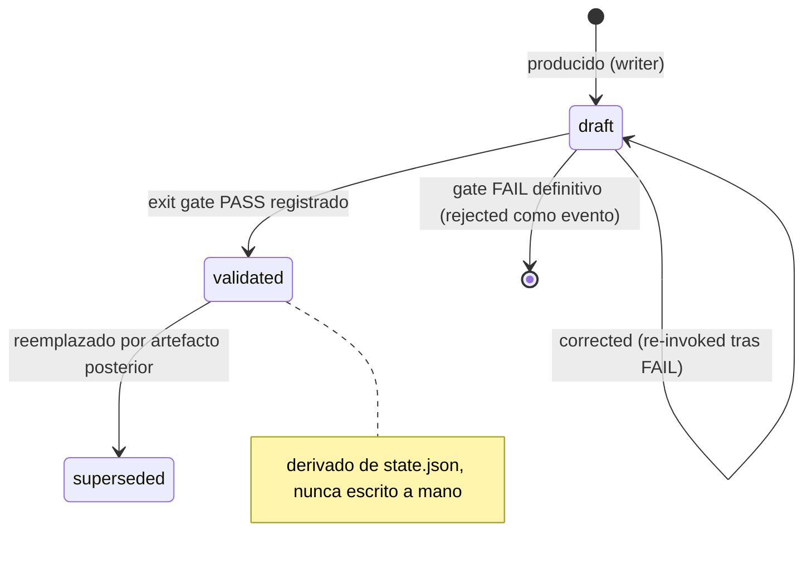

# RFC-63 — State & Artifact Lifecycle Model

**Status:** Accepted (plan 77)
**Fecha:** 2026-08-25
**Serie:** Arquitectura post-auditoría (25 ago 2026)
**Origen:** `ARCHITECTURAL_DECISION_MODEL.md:D1 — State Semantics (dimensiones de estado)`, `ARCHITECTURAL_DECISION_MODEL.md:D2 — Artifact Lifecycle`, `ARCHITECTURAL_DECISION_MODEL.md:D3 — Completion Semantics`
**Pregunta:** ¿Qué dimensiones de estado existen, cuál es el lifecycle de los artefactos y qué significa COMPLETED?
**Afectados:** protocol/.agents/orchestrators/core/states/AGENT_STATE_MACHINE.md; contratos de artefactos (TASK_ANALYSIS, TASK_SPECIFICATION, CONTEXT_ARTIFACT, CONTEXT_VALIDATION_REPORT, EXECUTION_PLAN, EXECUTION_SUMMARY, VERIFICATION_REPORT); policies H05/H06/H07; protocol/.agents/harness/gate_validator.py; tools/check_session_artifacts.py

## Status

ACCEPTED

Aceptada el 2026-08-25 por el mantenedor junto con la autorización de ejecución
del plan 77 (`plans/77-state-artifact-lifecycle-model.md`); la versión del
protocolo que la implementa es la 5.0.0 (MAJOR).

## Summary

ARgentOS separa el estado en tres dimensiones con entidad propia (Task State, Gate State, Artifact
Lifecycle) y cuatro conceptos derivados (Execution State, Verification State, Approval State, Plan
State). El Artifact Lifecycle es derivado del registro de gates, no escrito a mano. COMPLETED se
define como completitud relativa al alcance confirmado, con aprobaciones humanas diferidas
explícitamente registradas. El "review gate" deja de ser un estado de tarea y pasa a ser un Gate
State sobre REVIEW_REPORT.

## Motivation

- Problems: P2, P8, P9, P17; CG-01; RC-02
  (`ARCHITECTURAL_PROBLEM_MODEL.md:4. Confirmed Problems`,
  `ARCHITECTURAL_PROBLEM_MODEL.md:7. Conceptual Gaps`).
- Decisions: D1, D2, D3 (`ARCHITECTURAL_DECISION_MODEL.md:D1 — State Semantics (dimensiones de estado)`,
  `ARCHITECTURAL_DECISION_MODEL.md:D2 — Artifact Lifecycle`,
  `ARCHITECTURAL_DECISION_MODEL.md:D3 — Completion Semantics`).

La evidencia de BeaconRBX muestra artefactos con `status="draft"` y `approved=false` mientras los
gates registran PASS (P2), una máquina de estados que declara un "review gate" sin trigger para
complex (P8), sesiones cerradas con pendientes humanos (P9) y un TASK_ANALYSIS auto-contradictorio
(P17). Estos no son problemas de sincronización: son síntomas de un modelo de estado mal factorizado.

## Context

La máquina de estados core define 18 estados y una tabla de perfiles donde `complex` exige
`REVIEW_REPORT.md` y "the review gate"
(`protocol/.agents/orchestrators/core/states/AGENT_STATE_MACHINE.md:Task Profiles`), pero el
orchestrator trata la invocación del reviewer como opcional (`protocol/.agents/orchestrators/core/roles/orchestrator.md:4.1 Optional reviewer invocation`). Los contratos de artefactos dejan
`status = ""` sin enum ni regla de actualización
(`protocol/.agents/orchestrators/core/contracts/EXECUTION_PLAN.md:Metadata`). `state.json` registra
gates PASS y status terminal (`protocol/.agents/harness/INDEX.md:Protocol State and Hook Enforcement`).

## Decision

ARgentOS MUST:

- D-001: Modelar tres dimensiones de estado con entidad propia: Task State, Gate State y Artifact
  Lifecycle.
- D-002: Modelar Execution State como alias derivado del Task State; no como entidad nueva.
- D-003: Modelar Verification State como derivada del Gate State (H06/H07) y del VERIFICATION_REPORT.
- D-004: Modelar Approval State como conjunto derivado de registros de aprobación (SESSION_BRIEF +
  pendientes humanos); no como estados de la máquina core.
- D-005: Tratar el Plan State como gobernanza externa del proyecto; ARgentOS la referencia pero no
  la define.
- D-006: Derivar el Artifact Lifecycle del registro de gates; prohibir su escritura manual.
- D-007: Definir COMPLETED como completitud relativa al alcance confirmado (ver D3 del Model).
- D-008: Registrar aprobaciones humanas diferidas en una sección `Deferred Items` del
  VERIFICATION_REPORT y en SESSION_BRIEF con `deferred: true` y confirmación del usuario.
- D-009: Resolver el "review gate" como Gate State sobre REVIEW_REPORT
  (`review_required → review_passed | review_failed`), no como estado de tarea.

ARgentOS MUST NOT:

- D-101: Permitir que un artefacto declare `validated`, `approved` o `verified` por escritura del
  autor; esos valores son derivados.
- D-102: Usar COMPLETED para declarar cierre absoluto si existen aprobaciones en-scope no completadas
  ni diferidas.
- D-103: Mezclar el Artifact Lifecycle con el Task State en un mismo campo.

ARgentOS SHOULD:

- D-201: Retirar los campos manuales `status`/`approved`/`validation.complete` de los contratos de
  artefactos y reemplazarlos por metadata de solo lectura derivada.

## Scope

Cubre: dimensiones de estado y sus derivaciones; lifecycle de artefactos (estados, eventos,
propiedades, transiciones, ownership); semántica de COMPLETED/APPROVED/VERIFIED/VALIDATED/REJECTED/
SUPERSEDED; resolución del review gate; reglas de coexistencia y exclusión entre dimensiones.

## Non-Goals

- No redefine la lista de 18 estados de la máquina core (salvo la remoción del review gate como
  estado de tarea).
- No define clases de evidencia (RFC-65).
- No define el registro de eventos (RFC-64).
- No define la gobernanza de planes del proyecto (Plan State).

## Terminology

- **Task State:** dimensión única por tarea, definida por la máquina core; transiciones solo por el
  orquestador.
- **Gate State:** dimensión por gate (`pending`, `passed`, `failed`, `skipped: profile`), registrada
  en state.json (gates de transición) y HARNESS_REPORT.
- **Artifact Lifecycle:** dimensión por artefacto, derivada del Gate State.
- **Execution State:** alias derivado del Task State (no entidad nueva).
- **Verification State:** derivada del Gate State y del reporte de verificación.
- **Approval State:** conjunto de registros de aprobación (confirmaciones del usuario y pendientes
  humanos).
- **Plan State:** estado del plan en la gobernanza del proyecto (Draft/Executed/…); externo a
  ARgentOS.
- **Deferred Item:** aprobación humana en-scope diferida con confirmación del usuario.

## Model

### Dimensiones

| Dimensión | Tipo | Fuente de verdad | Transiciones producidas por |
|---|---|---|---|
| Task State | entidad (máquina core) | state.json + AGENT_STATE_MACHINE | orquestador |
| Gate State | entidad (por gate) | state.json (gates de transición) + HARNESS ENTRY | orquestador (juicio) + runner_state (registro) |
| Artifact Lifecycle | entidad (D2) | derivada del Gate State | derivación mecánica |
| Execution State | derivada | ≡ Task State | — |
| Verification State | derivada | Gate State (H06/H07) + VERIFICATION_REPORT + REVIEW_REPORT | — |
| Approval State | derivada | SESSION_BRIEF + `Deferred Items` | usuario |
| Plan State | externa | docs/plans del proyecto | gobernanza del proyecto |

### Artifact Lifecycle



- Estados: `draft`, `validated`, `superseded`.
- Eventos: `produced`, `corrected`, `gate_failed`, `gate_passed`.
- Propiedades: `archived` (iteración parcial preservada; propiedad de ubicación), `rejected`
  (evento de corrección, no estado persistente).
- `approved`, `verified`, `executed` NO son estados del artefacto: pertenecen a otras dimensiones
  (Gate/Verification/Approval).

### Significados formales

| Término | Dimensión | Significado |
|---|---|---|
| COMPLETED | Task State | completitud relativa al alcance confirmado (D3) |
| APPROVED | Approval/Gate State | decisión de aprobación registrada (usuario o reviewer) sobre un ítem |
| VERIFIED | Verification State | Gate State PASS con evidencia de clase distinta de atestación (RFC-65) |
| VALIDATED | Artifact Lifecycle | gate de salida del artefacto con PASS registrado en state.json |
| REJECTED | Gate/Approval State | gate FAIL definitivo o aprobación denegada (evento) |
| SUPERSEDED | Artifact Lifecycle | reemplazado por un artefacto posterior |

### Semántica de COMPLETED

COMPLETED ⇔

1. El Task State alcanzó COMPLETED por la vía normal (H06 + H07 PASS).
2. Todos los gates en-scope tienen PASS en state.json.
3. El Verification Report no declara criterios en-scope FAIL ni PENDING.
4. Toda aprobación humana en-scope está completada o diferida con confirmación de usuario
   (`SESSION_BRIEF`, `deferred: true`) y aparece en `Deferred Items`.

### Coexistencia y exclusión

- Task State y Artifact Lifecycle coexisten (un artefacto puede estar `validated` mientras la tarea
  está en EXECUTING).
- Gate State es por gate; Task State es único por tarea.
- Approval State y Task State no se mezclan.
- Terminal: Task terminal = COMPLETED/ABORT; Gate terminal = passed/failed/skipped; Artifact
  terminal = superseded/archived.

## Invariants

```text
ST-001:
El Task State solo cambia por transiciones permitidas de AGENT_STATE_MACHINE.

ST-002:
Todo gate de transición (H00–H07, H11) tiene Gate State registrado en state.json.

ST-003:
El Artifact Lifecycle nunca es escrito a mano; es derivado del Gate State.

ST-004:
Ningún documento del payload declara "estado" sin indicar la dimensión.

AL-001:
El estado del artefacto es derivado; nunca escrito a mano.

AL-002:
`validated` ⇔ el gate de salida tiene PASS en state.json.

AL-003:
Un artefacto `superseded` no se consume como entrada de fases posteriores.

AL-004:
Secciones en conflicto dentro de un artefacto = FAIL estructural.

CMP-001:
COMPLETED ⇒ todos los gates en-scope PASS en state.json.

CMP-002:
COMPLETED ⇒ ningún criterio en-scope FAIL/PENDING en el reporte.

CMP-003:
Todo item diferido tiene confirmación de usuario y aparece en `Deferred Items`.

CMP-004:
Ningún item diferido se presenta como "completado".

REL-001 (depende de RFC-65):
Un artefacto declara "verified" ⇔ Gate State PASS + evidencia con clase distinta de
atestación para el claim (o usa "atestado").

REL-002:
`validated` del lifecycle ⇔ PASS del gate de salida en state.json.
```

## Alternativas consideradas

- **Dimensión única + atributos:** no resuelve P2/P8/P9 (los campos siguen sin semántica).
- **Separación completa en 7 máquinas independientes:** sobre-ingeniería; la evidencia no la
  justifica.
- **No hacer nada:** reproduce los problemas observados.

## Impacto en el protocolo

- `AGENT_STATE_MACHINE.md`: la tabla de Task Profiles deja de listar "the review gate" como gate de
  tarea; el review pasa a Gate State sobre REVIEW_REPORT.
- Contratos de artefactos: retiro/derivación de `status`, `approved`, `validation.complete`, `state`;
  VERIFICATION_REPORT gana `Deferred Items`.
- Policies H05/H06/H07: checklists de completitud, evidencia y diferidos.
- `gate_validator.py`: checks de existencia de REVIEW_REPORT para complex, coherencia de
  dimensiones, secciones en conflicto.
- `check_session_artifacts.py`: verificación de presencia y version.
- Compatibilidad: MAJOR (cambia el significado de campos existentes); nota en `docs/MIGRATION.md`.
- Deja de ser válido: la escritura manual de estado en artefactos y el cierre COMPLETED con
  pendientes no registrados.

## Criterios de aceptación

- [ ] El payload define las 3 dimensiones + 4 derivadas con sus fuentes de verdad.
- [ ] El review gate aparece resuelto como Gate State sobre REVIEW_REPORT en la máquina de estados.
- [ ] COMPLETED tiene semántica de alcance y `Deferred Items` está en el contrato del reporte.
- [ ] El validador rechaza artefactos con secciones en conflicto y complex sin REVIEW_REPORT.
- [ ] Los artefactos nuevos no llevan campos de estado manuales.

## Amendment Log

- 2026-08-25 — Creación.
- 2026-08-25 — Aceptación (plan 77): dimensiones de estado, lifecycle de
  artefactos, semántica de COMPLETED y resolución del review gate, implementados
  en la versión 5.0.0.
