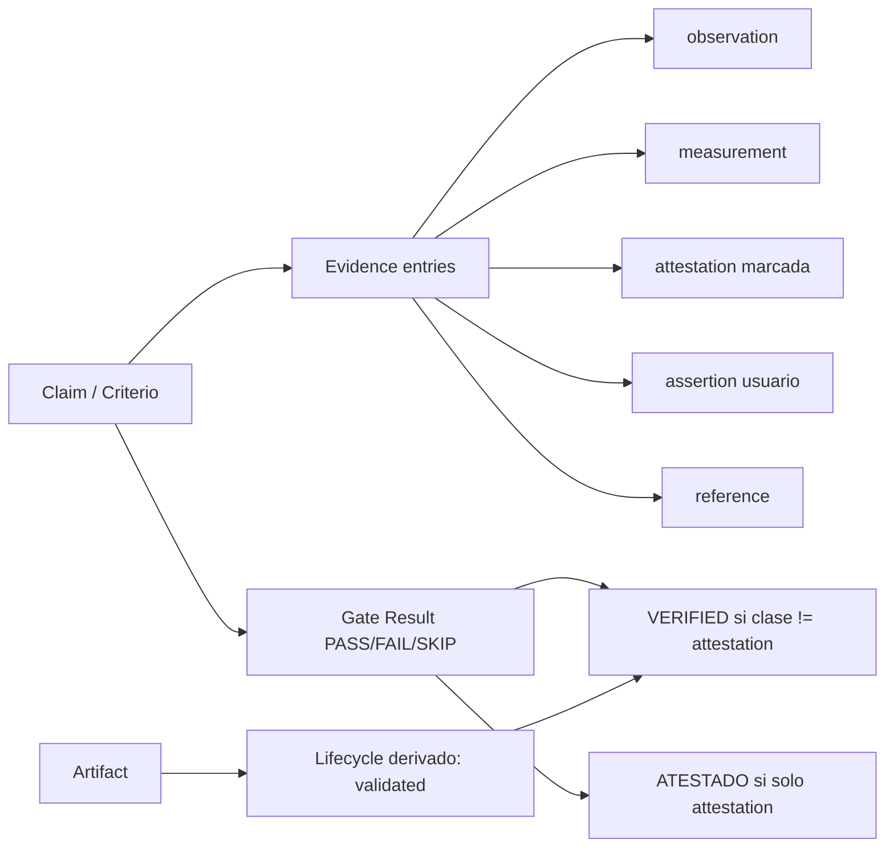

# RFC-65 — Evidence & Verification Model

**Status:** Accepted (plan 79)
**Fecha:** 2026-08-25
**Serie:** Arquitectura post-auditoría (25 ago 2026)
**Origen:** `ARCHITECTURAL_DECISION_MODEL.md:D4 — Evidence Model`, `ARCHITECTURAL_DECISION_MODEL.md:D12 — Artifact / State / Evidence Relationship`
**Pregunta:** ¿Qué cuenta como evidencia suficiente para justificar una afirmación o un gate, y cuándo un artefacto puede declararse VERIFIED?
**Afectados:** protocol/.agents/orchestrators/core/contracts/VERIFICATION_REPORT.md; protocol/.agents/contracts/HARNESS_REPORT.md; policies H05/H06/H07; protocol/.agents/harness/gate_validator.py; tools/audit_gates.py

## Status

ACCEPTED

## Summary

ARgentOS define cinco clases mínimas de evidencia (`observation`, `measurement`, `attestation`,
`assertion`, `reference`) y cuatro reglas que determinan qué puede sustentar un gate. Una atestación
del agente puede justificar ítems `[agent]`, pero nunca un ítem `[gate]` sin desviación documentada,
y siempre con marca explícita. La regla central: un artefacto no puede declararse VERIFIED sin
evidencia asociada de clase distinta de atestación; si la única evidencia es una afirmación del
agente, el término permitido es ATESTADO.

## Motivation

- Problems: P16, P4; CG-03
  (`ARCHITECTURAL_PROBLEM_MODEL.md:4. Confirmed Problems`,
  `ARCHITECTURAL_PROBLEM_MODEL.md:7. Conceptual Gaps`).
- Decisions: D4, D12 (`ARCHITECTURAL_DECISION_MODEL.md:D4 — Evidence Model`,
  `ARCHITECTURAL_DECISION_MODEL.md:D12 — Artifact / State / Evidence Relationship`).

BeaconRBX muestra un criterio de aceptación verificado con la atestación "escritos sin abrir
sources/" del mismo agente (P16) y claims de budget sin par declared/consumed (P4). Sin clases de
evidencia, "esto fue verificado" equivale a "el agente dijo que lo verificó".

## Context

El modelo de enforcement actual distingue ítems `[gate]` (estructuralmente comprobables) de ítems
`[agent]` (juicio) en los checklists de las policies, y H06 resuelve `evidence` a archivos
existentes o comandos registrados (`protocol/.agents/orchestrators/core/harness/policies/H06-verification-report.md:Checklist`). No distingue atestación de observación: ambas se representan como
texto libre.

## Decision

ARgentOS MUST:

- D-001: Representar toda evidencia con una clase de las cinco definidas en el Model.
- D-002: Exigir que todo ítem `[gate]` de un gate PASS tenga evidencia `observation`, `measurement`
  o `reference`; una `attestation` no satisface un ítem `[gate]` salvo desviación documentada.
- D-003: Exigir que todo ítem `[agent]` cite evidencia; si la evidencia es `attestation`, debe llevar
  la marca.
- D-004: Exigir que toda entrada de evidencia tenga `class`, `claim_id` y `ref`.
- D-005: Prohibir que un artefacto declare VERIFIED sin Gate State PASS y evidencia de clase distinta
  de `attestation` para el claim; en ese caso el término permitido es ATESTADO.
- D-006: Registrar la evidencia en bloques estructurados (`[[evidence]]`) en VERIFICATION_REPORT y en
  los ENTRY de HARNESS_REPORT cuando el checklist la cite.

ARgentOS MUST NOT:

- D-101: Tratar una atestación del mismo agente como verificación externa sin marca.
- D-102: Permitir la afirmación "verificado" en un reporte sin entrada de evidencia con clase.

ARgentOS SHOULD:

- D-201: Adjuntar a las entradas `measurement` el comando, el código de salida y una referencia a la
  salida capturada, cuando el runtime lo permita.

## Scope

Cubre: clases de evidencia, qué sustenta un gate, diferencia entre atestación del agente y evidencia
verificable externamente, proveniencia, relación Evidence↔Criterion, Artifact↔Evidence,
Verification↔Evidence, Gate↔Verification, y el invariante VERIFIED.

## Non-Goals

- No define el modelo de registro de eventos (RFC-64).
- No define el modelo de autorización (RFC-66).
- No crea un sistema de ontología de evidencia completo ni cadenas de derivación formales.

## Terminology

- **Observation:** lectura directa de un objeto durable (archivo, artefacto, config); re-verificable
  re-leyendo.
- **Measurement:** salida de herramienta/comando con comando, código de salida y referencia a la
  salida; re-ejecutable best-effort bajo entorno registrado.
- **Attestation:** afirmación del agente sobre su propio proceso o estado, no re-derivable de
  objetos durables; lleva actor + enunciado + marca.
- **Assertion:** dato o confirmación del usuario (clarificaciones); registrado en SESSION_BRIEF.
- **Reference:** cita a artifact o regla con path (+ hash opcional) y sección.
- **Claim:** la afirmación que se sustenta (p. ej., un criterio de aceptación).
- **Evidence:** conjunto de entradas con clase que sustenta una claim.
- **Verification:** evaluación de una claim contra evidencia con clase distinta de `attestation`.
- **Gate Result:** decisión PASS/FAIL/SKIP sobre un checklist donde cada ítem cita evidencia.

## Model



### Esquema mínimo de evidencia

```toml
[[evidence]]
class = "measurement"
claim_id = "AC-07"
ref = "tests/sync/test_tree_exporter.py"
command = "python -m pytest tests/sync/test_tree_exporter.py"
exit_code = 0

[[evidence]]
class = "attestation"
claim_id = "AC-11"
actor = "executor"
statement = "sources/ no fueron abiertos durante la escritura del kit"
```

### Reglas de suficiencia

1. Ítem `[gate]` ⇒ `observation` | `measurement` | `reference` (o desviación documentada).
2. Ítem `[agent]` ⇒ evidencia citada; `attestation` permitida solo con marca.
3. "Verificado" en un reporte ⇒ existe entrada de evidencia con clase distinta de `attestation`
   para el claim; si no, se usa "atestado".
4. Cada entrada de evidencia tiene `class`, `claim_id` y `ref`.

## Invariants

```text
EV-001:
Todo gate PASS tiene, por cada ítem [gate], evidencia observation/measurement/reference
o desviación documentada.

EV-002:
Toda attestation lleva actor, enunciado y marca.

EV-003:
Toda entrada de evidencia tiene class, claim_id y ref.

EV-004:
"Verificado" en un reporte ⇒ existe entrada de evidencia con clase distinta de
attestation para ese claim (o se usa "atestado").

REL-001:
Un artefacto declara "verified" ⇔ Gate State PASS + evidencia con clase distinta de
atestación para el claim (o usa "atestado").

REL-002:
`validated` del lifecycle ⇔ PASS del gate de salida en state.json.

REL-003:
Toda entrada de evidencia referencia el artifact y el claim que sustenta.
```

## Alternativas consideradas

- **Evidencia como texto libre (estado actual):** reproduce P16/P4; se descarta.
- **Modelo formal completo (ontología de evidencia y cadenas de derivación):** sobre-ingeniería;
  se descarta para el objetivo.
- **No hacer nada:** se descarta por la evidencia de BeaconRBX.

## Impacto en el protocolo

- `VERIFICATION_REPORT.md`: agrega bloque `[[evidence]]` y distingue "verificado" de "atestado".
- `HARNESS_REPORT.md`: los ENTRY pueden citar evidencia con clase.
- Policies H05/H06/H07: checklists exigen evidencia con clase por ítem.
- `gate_validator.py`: el check de evidencia de H06 valida `class`, `claim_id`, `ref` y la regla
  VERIFIED.
- `audit_gates.py`: detecta atestaciones sin marca.
- Compatibilidad: MAJOR (cambia el significado de PASS y de "verificado"); nota en
  `docs/MIGRATION.md`.
- Deja de ser válido: la declaración "verificado" sin entrada de evidencia.

## Criterios de aceptación

- [ ] El contrato VERIFICATION_REPORT soporta `[[evidence]]` con `class`, `claim_id`, `ref`.
- [ ] H06 rechaza un criterio PASS sin evidencia con clase válida.
- [ ] El validador distingue atestación de observación/medición.
- [ ] Ningún reporte nuevo usa "verificado" para claims sustentados solo por atestación.
- [ ] `audit_gates.py` marca atestaciones sin etiquetar.

## Amendment Log

- 2026-08-25 — Creación.
- 2026-08-25 — Aceptación (plan 79): clases de evidencia, bloques `[[evidence]]`,
  reglas de suficiencia por ítem `[gate]`/`[agent]` e invariante VERIFIED,
  implementados en la versión 7.0.0 (MAJOR).
