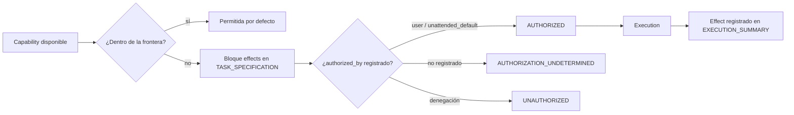

# RFC-66 — Authorization & Capability Model

**Status:** Accepted
**Fecha:** 2026-08-25
**Serie:** Arquitectura post-auditoría (25 ago 2026)
**Origen:** `ARCHITECTURAL_DECISION_MODEL.md:D8 — Authorization Model`, `ARCHITECTURAL_DECISION_MODEL.md:D11 — Enforcement Boundaries`
**Pregunta:** ¿Cuándo una capability está realmente autorizada para producir un efecto, y cómo se distingue de la capacidad disponible?
**Afectados:** protocol/.agents/orchestrators/core/contracts/TASK_SPECIFICATION.md, EXECUTION_PLAN.md, EXECUTION_SUMMARY.md; policies H01/H04; protocol/.agents/standards/requirements/NO_ASSUMPTIONS.md; protocol/.agents/standards/runtime/PROTOCOL_BOUNDARIES.md

## Status

ACCEPTED

## Summary

ARgentOS distingue formalmente Capability, Permission, Authorization, Execution y Effect. Define una
frontera por defecto (efectos sin autorización explícita) y un bloque declarativo `effects` en
TASK_SPECIFICATION que registra la autorización de cada efecto fuera de frontera. Toda capability
ejecutada fuera de la frontera debe poder vincularse a una autorización registrada; si no existe
registro, el estado es AUTHORIZATION_UNDETERMINED, nunca UNAUTHORIZED por defecto.

## Motivation

- Problems: P6; CG-05
  (`ARCHITECTURAL_PROBLEM_MODEL.md:5. Architectural Concerns`,
  `ARCHITECTURAL_PROBLEM_MODEL.md:7. Conceptual Gaps`).
- Decisions: D8, D11 (`ARCHITECTURAL_DECISION_MODEL.md:D8 — Authorization Model`,
  `ARCHITECTURAL_DECISION_MODEL.md:D11 — Enforcement Boundaries`).

En BeaconRBX se ejecutó acceso a red (búsquedas web y clones) con una suposición
`user_confirmed=false` en Assumptions. La evidencia demuestra que la autorización no puede
determinarse a partir de la traza; no demuestra una violación. La taxonomía no tiene entidad de
authorization y las skills "never grant permissions"
(`protocol/.agents/skills/README.md:Enforcement`).

## Context

La frontera de efectos externos está definida como prosa en
`protocol/.agents/standards/runtime/PROTOCOL_BOUNDARIES.md:External interaction` ("Unless explicitly
instructed, the agent MUST NOT perform external HTTP requests or network calls"). H01 permite
suposiciones no confirmadas si ningún criterio de aceptación deriva de ellas
(`protocol/.agents/orchestrators/core/harness/policies/H01-task-specification.md:Checklist`, items
16–17). No existe un registro que vincule una ejecución con su autorización.

## Decision

ARgentOS MUST:

- D-001: Distinguir Capability (disponibilidad de herramienta/skill), Permission (regla del
  protocolo), Authorization (registro que vincula capability con efecto permitido para una
  ejecución), Execution (uso efectivo) y Effect (cambio observable producido).
- D-002: Mantener la frontera por defecto: lectura/ejecución dentro del proyecto y del protocolo, y
  escritura planificada, no requieren autorización explícita. Red/HTTP, operaciones git remotas,
  instalaciones, cambios destructivos y escrituras fuera del proyecto SÍ la requieren.
- D-003: Registrar en TASK_SPECIFICATION un bloque `effects` con `name`, `kind`, `authorized_by`
  (`user` | `unattended_default`), `evidence_ref` y `status` (`authorized` |
  `not_authorized` | `pending_user_confirmation`).
- D-004: Exigir en H01/H04 que todo efecto fuera de frontera tenga entrada `effects` con
  `authorized_by` no vacío y `status` distinto de `not_authorized`.
- D-005: Establecer que una suposición con `user_confirmed=false` nunca constituye autorización;
  solo la confirmación del usuario o un default declarado en modo desatendido
  (PENDING_USER_CONFIRMATION) autorizan.
- D-006: Registrar en EXECUTION_SUMMARY todo efecto ejecutado con referencia a su entrada `effects`.
- D-007: Distinguir los estados AUTHORIZED, UNAUTHORIZED y AUTHORIZATION_UNDETERMINED: UNAUTHORIZED
  solo cuando exista una denegación registrada; si no hay registro, AUTHORIZATION_UNDETERMINED.

ARgentOS MUST NOT:

- D-101: Inferir UNAUTHORIZED a partir de la ausencia de registro.
- D-102: Permitir que la aprobación del plan autorice efectos implícitos no declarados en `effects`.
- D-103: Tratar una capability disponible como capability autorizada.

ARgentOS SHOULD:

- D-201: Registrar el bloque `effects` también en SESSION_BRIEF cuando la autorización provenga de
  una clarificación del usuario.

## Scope

Cubre: conceptos Capability/Permission/Authorization/Execution/Effect, frontera por defecto, bloque
`effects`, quién puede autorizar, cómo se registra, cómo se vincula una ejecución con su
autorización, y los tres estados de autorización.

## Non-Goals

- No define un sistema de control de acceso por rol/permiso completo.
- No define la semántica de evidencia (RFC-65) salvo la referencia mínima.
- No juzga si BeaconRBX cometió una violación: solo establece cómo determinarlo.

## Terminology

- **Capability:** disponibilidad de una herramienta o skill en el runtime.
- **Permission:** regla del protocolo (frontera por defecto + políticas).
- **Authorization:** registro que vincula una capability con un efecto permitido para una ejecución.
- **Execution:** uso efectivo de la capability.
- **Effect:** cambio observable producido por la ejecución.
- **AUTHORIZED:** existe registro de autorización para el efecto.
- **UNAUTHORIZED:** existe denegación registrada.
- **AUTHORIZATION_UNDETERMINED:** no existe registro suficiente para decidir.

## Model



### Ejemplo de bloque `effects`

```toml
[[effects]]
name = "fetch_remote_sources"
kind = "network"
authorized_by = "user"
evidence_ref = "SESSION_BRIEF clarification 5A"
status = "authorized"
```

### ¿Quién puede autorizar?

| Autorizante | Mecanismo | Registro |
|---|---|---|
| Usuario | clarificación / confirmación de plan | SESSION_BRIEF (`deferred`/`confirmed`) |
| Default declarado (modo desatendido) | policy de defaults | SESSION_BRIEF `source: unattended_default` + PENDING_USER_CONFIRMATION |
| Runtime | ninguno (los scripts no autorizan) | — |

## Invariants

```text
AUTH-001:
Todo efecto fuera de frontera tiene entrada effects con authorized_by y status.

AUTH-002:
user_confirmed=false nunca constituye autorización.

AUTH-003:
Todo efecto ejecutado se registra en EXECUTION_SUMMARY con referencia a su autorización.

AUTH-004:
AUTHORIZATION_UNDETERMINED no se reporta como UNAUTHORIZED.
```

## Alternativas consideradas

- **Consentimiento explícito por acción:** bloquea la ejecución plan-driven y desatendida; se
  descarta.
- **Matriz de permisos por skill/rol:** sobre-ingeniería; se descarta.
- **No hacer nada:** reproduce la indeterminabilidad de P6.

## Impacto en el protocolo

- `TASK_SPECIFICATION.md`: bloque `effects` obligatorio para efectos fuera de frontera.
- Policies H01/H04: checks de autorización de efectos.
- `EXECUTION_SUMMARY.md`: registro de efectos ejecutados.
- `NO_ASSUMPTIONS.md` y `PROTOCOL_BOUNDARIES.md`: interacción suposición/autorización explicitada;
  la política de frontera se mantiene pero ahora es verificable.
- Compatibilidad: MAJOR (nuevo bloque en contratos y nueva obligación de H01/H04); nota en
  `docs/MIGRATION.md`.
- Deja de ser válido: la ejecución de efectos externos con suposición no confirmada sin registro.

## Criterios de aceptación

- [ ] El bloque `effects` está definido en el contrato TASK_SPECIFICATION.
- [ ] H01/H04 rechazan efectos fuera de frontera sin autorización registrada.
- [ ] EXECUTION_SUMMARY registra efectos ejecutados con referencia a `effects`.
- [ ] La traza permite responder AUTHORIZED / UNAUTHORIZED / AUTHORIZATION_UNDETERMINED.
- [ ] El caso BeaconRBX se documenta como AUTHORIZATION_UNDETERMINED, no como violación.

## Amendment Log

- 2026-08-25 — Creación.
- 2026-08-25 — Aceptada por el mantenedor; implementada por el plan 80
  (`plans/80-authorization-and-capability-model.md`).
