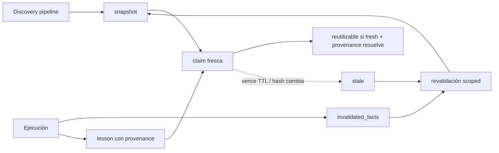

# RFC-67 — Knowledge Lifecycle Model

**Status:** Accepted (plan 81)
**Fecha:** 2026-08-25
**Serie:** Arquitectura post-auditoría (25 ago 2026)
**Origen:** `ARCHITECTURAL_DECISION_MODEL.md:D9 — Knowledge Lifecycle`
**Pregunta:** ¿Qué ciclo mínimo necesita el conocimiento para ser reutilizable, revalidable y capaz de aprender de la ejecución?
**Afectados:** protocol/.agents/orchestrators/discovery/contracts/KB_DISCOVERY_ENTRY.md, KB_RECOMMENDATION.md; protocol/.agents/orchestrators/core/contracts/EXECUTION_SUMMARY.md; protocol/.agents/standards/context/KNOWLEDGE_CURATION.md; protocol/.agents/orchestrators/discovery/states/DISCOVERY_STATE_MACHINE.md; protocol/.agents/orchestrators/core/roles/orchestrator.md (Closing Feedback)

## Status

ACCEPTED

## Summary

ARgentOS define un lifecycle mínimo de conocimiento con tres tipos (`snapshot`, `claim`, `lesson`),
una transición explícita ejecución → invalidación (campo `invalidated_facts` en EXECUTION_SUMMARY),
frescura por claim con proveniencia resoluble, reutilización condicionada a frescura, y aprendizaje
de sesión con identidad y proveniencia propias. No diseña una Knowledge Base completa.

## Motivation

- Problems: P5, P12, P13, P14; CG-04
  (`ARCHITECTURAL_PROBLEM_MODEL.md:4. Confirmed Problems`,
  `ARCHITECTURAL_PROBLEM_MODEL.md:7. Conceptual Gaps`).
- Decisions: D9 (`ARCHITECTURAL_DECISION_MODEL.md:D9 — Knowledge Lifecycle`).

BeaconRBX muestra una KB de discovery publicada a las 03:25 con "one-way pending" que el propio
plan 04 invalida a las 04:30 sin revalidación (P5), recomendaciones de KB con `session_uuid` sin
semántica de ubicación (P12), cero entradas curadas de sesiones (P13) y rediscovery full costoso
(P14). La regla de frescura actual es de consumo (TTL/hash/usuario/reporte) y no contempla que la
sesión actual cambie los hechos descubiertos
(`protocol/.agents/orchestrators/discovery/states/DISCOVERY_STATE_MACHINE.md:Freshness Rule`).

## Context

La KB tiene discovery (estados D00/D01), entries con `curation_status`, manifest con `stale`, TTL,
invalidación por hashes y revalidación por pipeline. 3.26.0 agrega el cierre "What we learned"
(`protocol/.agents/orchestrators/core/roles/orchestrator.md:Closing Feedback`). No existe
granularidad por claim, ni disparador de invalidación post-ejecución, ni identidad de ubicación en
las recomendaciones.

## Decision

ARgentOS MUST:

- D-001: Distinguir tres tipos de conocimiento: `snapshot` (entradas de discovery, point-in-time,
  TTL + hashes), `claim` (unidad dentro de una entrada; la frescura aplica por claim), `lesson`
  (aprendizaje de sesión con proveniencia).
- D-002: Aplicar la frescura por claim, no solo por entrada; una claim es reutilizable si está
  fresca y su proveniencia resuelve (source_files/source_sessions existen).
- D-003: Registrar en EXECUTION_SUMMARY el campo `invalidated_facts`: hechos descubiertos que la
  ejecución cambió; el pipeline revalida las entradas afectadas (scope por entrada).
- D-004: Escribir toda `lesson` con `session_id`, `protocol_version` y referencia de evidencia
  (RFC-65); una lesson es un tipo de claim.
- D-005: Añadir a KB_RECOMMENDATION los campos `kind` (`discovery`|`knowledge`|`lesson`) y `path`
  para resolver la ubicación de la entrada recomendada.
- D-006: Mantener la actualización de entradas solo a través del pipeline de discovery; la edición
  manual sigue siendo desviación.

ARgentOS MUST NOT:

- D-101: Reutilizar una claim vencida o con proveniencia no resoluble.
- D-102: Mezclar snapshot, current knowledge y historical knowledge sin etiqueta de tipo.
- D-103: Permitir que una ejecución modifique la KB sin pasar por la transición de invalidación
  (`invalidated_facts` → revalidación).

ARgentOS SHOULD:

- D-201: Medir el costo de rediscovery (tiempo, tokens, entradas reescritas) antes de decidir
  cambios de TTL (P14 permanece como tradeoff hasta tener medición).

## Scope

Cubre: tipos de conocimiento, transición observación→claim→knowledge, proveniencia, frescura por
claim, invalidación post-ejecución, revalidación, reutilización, diferencia histórico/current, y
relación ejecución→conocimiento.

## Non-Goals

- No diseña una Knowledge Base completa (índices, búsqueda, confianza por claim).
- No redefine el pipeline de discovery; lo extiende con el disparador post-ejecución.
- No define la semántica de evidencia (RFC-65) salvo la referencia en lessons.

## Terminology

- **Snapshot:** entrada de discovery point-in-time con TTL y hashes.
- **Claim:** unidad de conocimiento dentro de una entrada; objeto de frescura e invalidación.
- **Lesson:** claim de aprendizaje de sesión con proveniencia (session_id, protocol_version,
  evidencia).
- **Provenance:** vínculo resoluble a fuentes (source_files/source_sessions).
- **Freshness:** condición de reutilización por claim.
- **Invalidation:** transición que marca una claim/snapshot como no reutilizable.
- **Revalidation:** re-ejecución del pipeline sobre entradas afectadas.
- **Historical knowledge vs current knowledge:** snapshots/lessons pasadas (histórico) vs claims
  frescas reutilizables (current).

## Model



### Transición observación → conocimiento

Una observación se convierte en knowledge cuando:

1. Es producida por un worker con proveniencia registrada (source_files/source_sessions).
2. Pasa la validación del pipeline (D00/D01) o el cierre de sesión (lesson).
3. Su claim está fresca (TTL por claim) y su proveniencia resuelve.

### Invalidación

Disparadores: TTL vencido, cambio de hash, solicitud del usuario, reporte de inconsistencia del
executor, y **invalidación post-ejecución** (`invalidated_facts` declarado por la ejecución que
cambió los hechos).

## Invariants

```text
KN-001:
Toda entrada de discovery es snapshot con TTL y hashes.

KN-002:
Toda lesson tiene session_id, protocol_version y referencia de evidencia.

KN-003:
Una claim fresca requiere proveniencia resoluble.

KN-004:
Toda ejecución que cambia hechos descubiertos declara invalidated_facts.

KN-005:
Una claim vencida o sin proveniencia no es reutilizable.

KN-006:
Las entradas de KB solo se actualizan a través del pipeline de discovery.
```

## Alternativas consideradas

- **Knowledge como snapshot inmutable:** reproduce P5/P13; se descarta.
- **Motor de conocimiento completo (claims, confianza, derivación):** sobre-ingeniería; se descarta.
- **No hacer nada:** se descarta por la evidencia de BeaconRBX.

## Impacto en el protocolo

- `EXECUTION_SUMMARY.md`: campo `invalidated_facts`.
- `KB_RECOMMENDATION.md`: campos `kind` y `path`.
- `KB_DISCOVERY_ENTRY.md` y `KNOWLEDGE_CURATION.md`: tipo `lesson` y frescura por claim.
- `DISCOVERY_STATE_MACHINE.md`: disparador de revalidación post-ejecución.
- Orchestrator §Closing Feedback: las lessons se escriben con proveniencia.
- Compatibilidad: MAJOR (campos nuevos obligatorios en ejecución y contrato de KB); nota en
  `docs/MIGRATION.md`.
- Deja de ser válido: la reutilización de claims vencidas y la actualización de la KB sin pipeline.

## Criterios de aceptación

- [ ] EXECUTION_SUMMARY declara `invalidated_facts`.
- [ ] El pipeline revalida entradas afectadas por `invalidated_facts`.
- [ ] KB_RECOMMENDATION resuelve la ubicación de cada entrada con `kind` + `path`.
- [ ] Las lessons del cierre de sesión llevan session_id, protocol_version y evidencia.
- [ ] Una claim vencida no es recomendada ni consumida.

## Amendment Log

- 2026-08-25 — Creación.
- 2026-08-25 — Aceptación (plan 81): tipos `snapshot`/`claim`/`lesson`,
  frescura por claim con proveniencia resoluble, invalidación post-ejecución
  (`invalidated_facts` en `EXECUTION_SUMMARY.md`) con revalidación scoped, y
  lessons con `session_id`/`protocol_version`/evidencia, implementados en la
  versión 9.0.0 (MAJOR).
