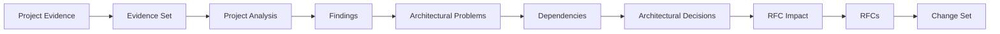

# RFC-68 — Architecture Evolution Workflow Model

**Status:** Accepted (plan 82)
**Fecha:** 2026-08-25
**Serie:** Workflow de evolución arquitectónica (25 ago 2026)
**Origen:** `WORKFLOW_PROPOSAL.md:30. Lo que sí podemos congelar desde ya`, `ARCHITECTURAL_PROBLEM_MODEL.md:19. Candidate RFC Boundaries`, `ARCHITECTURAL_DECISION_MODEL.md:D13 — Implementation Priority`
**Pregunta:** ¿Cómo convierte ARgentOS evidencia de ejecución real en evolución arquitectónica trazable, incremental y versionada, sin contaminar la arquitectura con proyectos de prueba y sin duplicar los modelos conceptuales ya aceptados?
**Afectados:** protocol/.agents/orchestrators/architecture/ (workflow nuevo: estados, contratos y policies); contratos nuevos ARCHITECTURAL_EVIDENCE_INDEX, ARCHITECTURAL_CHANGE_SET, ARCHITECTURE_MANIFEST; registries de proyecto/sesión (Project Registry, Session Registry); tools/check_architecture_traceability.py (dev-only); docs/ADOPTION.md; CHANGELOG.md

## Status

ACCEPTED

Aceptada el 2026-08-27 por el mantenedor junto con la autorización de ejecución
del plan 82 (`plans/82-architecture-evolution-workflow.md`); la versión del
protocolo que implementa la Fase 1 es la 9.1.0 (MINOR). La Fase 2 queda
declarada fuera de ese alcance y exige sus propios gates antes de planificarse.

## Summary

ARgentOS formaliza la evolución de su propia arquitectura como una capability de
dos niveles: **Level 1 — Project Analysis** (qué ocurrió en cada proyecto, sin
tocar arquitectura) y **Level 2 — Architecture Evolution** (qué significa lo
observado para ARgentOS), conectadas por la frontera de tres capas
Project Evidence → Project Knowledge → Architectural Knowledge. El workflow
recorre una cadena canónica evidencia → findings → problemas → dependencias →
decisiones → impacto en RFCs → RFCs → Change Set, con contratos por stage,
identidad de ejecución, un Change Set como unidad de revisión (incluida la
conclusión NO_CHANGE) y trazabilidad verificable mecánicamente. Reutiliza los
modelos ya aceptados (RFC-62…67) en lugar de crear taxonomías paralelas.

El modelo de persistencia de evidencia (Project Evidence Persistence Model)
define ownership, fuente de verdad, registries de proyecto/sesión con
fingerprints, evidencia derivada inmutable y la frontera del repositorio: los
proyectos externos y su `.project/` crudo nunca se versionan dentro de ARgentOS.

## Motivation

- **El proceso post-auditoría es manual y no repetible.** La cadena que produjo
  RFC-62…67 (auditoría → revisión → problem model → revisión → decision model →
  RFC) está documentada en la serie undécima
  (`plans/INDEX.md:Undécima serie: decisiones arquitectónicas post-auditoría (25 ago 2026)`)
  y en los modelos de la raíz (`ARCHITECTURAL_PROBLEM_MODEL.md:1. Executive Summary`,
  `ARCHITECTURAL_DECISION_MODEL.md:Decision Summary`). Funciona, pero depende de
  la disciplina del agente: no hay contratos de stage, ni identidad de
  ejecución, ni unidad de revisión incremental.
- **Riesgo de contaminación.** Un proyecto de prueba (BeaconRBX) puede inducir
  cambios de arquitectura sin evidencia transversal. La distinción entre
  Project Finding / Project Problem / Architectural Problem es la salvaguarda,
  pero hoy es prosa, no contrato
  (`WORKFLOW_PROPOSAL.md:16. Separaría Project Problem de Architectural Problem`).
- **Sin trazabilidad verificable.** Los modelos citan evidencia y orígenes de
  forma parcial e informal; no existe un checker que garantice
  Finding → Problem → Decision → RFC resoluble.
- **Sin unidad de revisión incremental ni resultado negativo.** No existe Change
  Set ni conclusión NO_CHANGE; cada ciclo regenera o sobrescribe documentos
  enteros, con riesgo de sobreajustar la arquitectura a cada prueba
  (`WORKFLOW_PROPOSAL.md:21. No-change es importante`).
- **Sin identidad de ejecución para el meta-proceso.** Las corridas de
  auditoría no son ejecuciones con identidad (RFC-64), por lo que no son
  auditablemente reconstruibles.
- **Costo no medido.** La investigación de reutilización concluye que no hay
  evidencia cuantificada de dónde está el costo y que una RFC de
  memoización/cache carece de justificación sin telemetría
  (`INVESTIGACION_COSTO_RECOMPUTACION_2026-08-25.md:O. Final Assessment`).

## Context

- **Modelos aceptados reutilizables:** garantías y enforcement (RFC-62),
  dimensiones de estado y lifecycle de artefactos (RFC-63), identidad y registro
  de ejecución (RFC-64), clases de evidencia (RFC-65), autorización de efectos
  (RFC-66) y lifecycle de conocimiento (RFC-67).
- **Reglas vigentes:** trazas históricas inmutables (RFC-46,
  `plans/INDEX.md:Convenciones`), ciclo de RFC `Proposal → Accepted →
  Superseded`, un plan = una versión (`docs/VERSIONING.md:4. Flujo por plan (playbook)`),
  confirmación del usuario para MAJOR y MINOR (`docs/VERSIONING.md:3. Versionado`),
  batería canónica (`docs/VERSIONING.md:4.1 Batería canónica de verificación`).
- **Precedente de tooling:** `tools/check_plan_citations.py` ya verifica citas
  `ruta:sección`; el checker de trazabilidad de este workflow es el mismo patrón,
  no una maquinaria nueva.
- **Origen de la propuesta:** el documento informal
  (`WORKFLOW_PROPOSAL.md:1. Concepto central`) describe la arquitectura
  conceptual; esta RFC la formaliza y la adapta al modelo existente en lugar de
  incorporarla tal cual.

## Decision

ARgentOS MUST:

- D-001: Modelar la evolución arquitectónica como una capability de dos niveles:
  Level 1 (Project Analysis, por proyecto) y Level 2 (Architecture Evolution,
  transversal), con la frontera de tres capas Project Evidence → Project
  Knowledge → Architectural Knowledge (`WORKFLOW_PROPOSAL.md:3. Dos niveles`,
  `WORKFLOW_PROPOSAL.md:17. El modelo final tendría tres capas`).
- D-002: Definir la cadena canónica Project Evidence → Evidence Set → Project
  Analysis → Findings → Architectural Problems → Dependencies → Architectural
  Decisions → RFC Impact → RFCs → Change Set. Una etapa puede omitirse solo si
  su contrato de entrada está satisfecho por un artefacto válido en la versión
  base; no existe omisión incondicional.
- D-003: Definir diez stages con contratos explícitos de
  input/output/precondition/postcondition y alcance MAY/MUST NOT por stage
  (ver Model).
- D-004: Reutilizar las clases de evidencia de RFC-65 en todo artefacto
  arquitectónico; la evidencia se cita en bloques con `class`, `claim_id` y
  `ref`. No se introduce una taxonomía de evidencia paralela
  (`plans/rfc/65-evidence-and-verification-model.md:Decision`).
- D-005: Modelar Findings, Architectural Problems, Dependencies y Architectural
  Decisions como claims de conocimiento con proveniencia y estado epistémico
  (RFC-67). Los problemas consolidados entre proyectos conservan identidad
  estable (AP-xxx) y confianza explícita; con evidencia insuficiente se usan
  `NOT_ENOUGH_EVIDENCE` (`plans/rfc/67-knowledge-lifecycle-model.md:Decision`,
  `ARCHITECTURAL_PROBLEM_MODEL.md:4. Confirmed Problems`).
- D-006: Usar el vocabulario de estados del Decision Model para las decisiones
  (OPEN / PROVISIONALLY_DECIDED / DECIDED / SUPERSEDED / REJECTED) y el ciclo
  canónico `Proposal → Accepted → Superseded` para las RFCs. DRAFT,
  IMPLEMENTED y REJECTED no son estados de RFC
  (`ARCHITECTURAL_DECISION_MODEL.md:D9 — Knowledge Lifecycle`,
  `plans/INDEX.md:Convenciones`).
- D-007: Conservar identidad estable para los artefactos arquitectónicos a
  través de los cambios de estado (P-014 sigue siendo P-014); git es el
  historial físico; las enmiendas de RFC se registran en el Amendment Log; no
  hay sobrescritura silenciosa (`WORKFLOW_PROPOSAL.md:23. Provenance completa`).
- D-008: Definir el Change Set (ACS) como unidad de revisión con los tipos de
  cambio NEW, MODIFIED, CONFIRMED, INVALIDATED, SUPERSEDED y UNAFFECTED, más la
  variante NO_CHANGE. Toda ejecución de evolución produce exactamente un ACS.
- D-009: Dar a cada ejecución de evolución una identidad según la composición
  de RFC-64 y mantener un manifest de evolución con `last_change_set`, evidence
  set, proyectos y punteros a los modelos. La Fase 1 no introduce un namespace
  SemVer paralelo para el modelo arquitectónico
  (`plans/rfc/64-execution-record-model.md:Decision`).
- D-010: Exigir links de trazabilidad resolubles: todo Architectural Problem cita
  al menos un Finding; toda Architectural Decision cita al menos un Architectural
  Problem; toda RFC generada o enmendada por el workflow cita sus decisiones de
  origen. Un checker dev-only verifica estos links.
- D-011: Aplicar gates humanos por clase de impacto (LOW automático / MEDIUM
  revisión / HIGH aprobación), mapeados a la gobernanza de versionado donde
  MAJOR y MINOR requieren confirmación del usuario
  (`WORKFLOW_PROPOSAL.md:26. Esto permite incluso human-in-the-loop`,
  `docs/VERSIONING.md:3. Versionado`).
- D-012: Nunca modificar `protocol/.agents/` desde dentro del workflow; la
  salida es un Change Set revisado bajo la gobernanza existente (RFC-42/RFC-56).
- D-013: Registrar un resultado negativo auditable: un ACS NO_CHANGE lista igual
  la evidencia examinada y los findings revisados
  (`WORKFLOW_PROPOSAL.md:21. No-change es importante`).
- D-014: Mantener la evidencia de proyecto fuera del repositorio de ARgentOS: el
  workflow persiste solo Evidence References (registries con locator +
  fingerprint) y Derived Evidence inmutable; nunca copia proyectos crudos
  (Storage Model, alternativa 5 híbrida).
- D-015: Tratar el `.project/` del proyecto externo como source of truth de la
  evidencia de sesión y como staging read-only para el workflow; nunca como
  cache ni como propiedad de ARgentOS.
- D-016: Mantener un Project Registry y un Session Registry versionados con
  identidades estables (PRJ-xxx y session_id declarada); el nombre y el path no
  son identidad.
- D-017: Detectar cambios por fingerprint de contenido con los estados
  NEW / UNCHANGED / MODIFIED / REMOVED / MOVED / INVALID; re-analizar solo NEW y
  MODIFIED, conservando identidad y marcando SUPERSEDED el análisis previo
  (RFC-67).
- D-018: Registrar la cadena de provenance con content hash en el eslabón
  Session → Source Artifact; si el source desaparece, marcar el eslabón
  unresolved sin borrar la cadena.
- D-019: Excluir del repositorio de ARgentOS el raw de proyectos externos, el
  `.project/` crudo, logs, prompts completos, código fuente y contenido
  sensible; el import de evidencia cruda requiere acción explícita del usuario
  en área gitignored.
- D-020: Tratar el ACS como propuesta: su generación no implica aprobación ni
  aplicación; la aprobación vive en los gates de gobernanza (D-011) y la
  aplicación en un plan de ejecución posterior.
- D-021: Tratar Project Registry y Session Registry como proyecciones mutables
  del estado actual; el historial se conserva en git y en los artefactos
  inmutables de ejecución (Evidence Snapshots, AE records, ACS), sin
  almacenamiento de eventos separado ni Event Sourcing.
- D-022: Mantener la identidad lógica (Project ID, Session ID) independiente del
  locator físico; un cambio de locator no implica un proyecto o sesión nuevos.
- D-023: Sellar un Evidence Snapshot por ejecución con el fingerprint observado;
  los snapshots son inmutables y los anteriores pasan a SUPERSEDED sin
  modificación retrospectiva; el `.project/` externo no se interpreta como
  inmutable.
- D-024: Representar el Evidence Set como índice de referencias a Evidence
  Snapshots (IDs), nunca como copia de su contenido; cada ejecución sella
  exactamente un Evidence Set como input de Project Analysis.
- D-025: Sellar un Evidence Snapshot por sesión solo cuando el fingerprint
  difiere del último estado analizado o es la primera vez; si la sesión no
  cambió, reutilizar el snapshot existente por referencia (dedup sin romper
  reproducibilidad).
- D-026: Registrar en el Session Registry, por sesión, el ID del Evidence
  Snapshot vigente junto con Fingerprint y Workflow Execution; actualizar la
  proyección cuando se sella un snapshot nuevo.
- D-027: Para Fase 1, el workflow consume proyectos únicamente desde el Import
  Workspace `sessions/<project-key>/.project/`; no referencia ubicaciones
  externas directamente.
- D-028: Tratar `sessions/` como workspace local de entrada/staging gitignored
  (excepto `.gitkeep`); el contenido importado no se versiona y su reemplazo no
  modifica el Evidence Store ni los snapshots históricos.
- D-029: Tratar `<project-key>` como local key mutable del workspace; el Project
  ID se asigna en el registry y nunca deriva del key.

ARgentOS MUST NOT:

- D-101: Permitir que evidencia de proyecto entre al modelo arquitectónico sin
  pasar por el análisis de Level 1 (frontera de tres capas).
- D-102: Inventar clases de evidencia, estados de RFC, tipos de conocimiento o
  esquemas de versionado paralelos a los ya aceptados.
- D-103: Consolidar problemas de proyecto en un problema arquitectónico sin
  confianza explícita ni referencias de evidencia resolubles.
- D-104: Tratar un artefacto arquitectónico como reescrito en lugar de
  versionado (no sobrescribir silenciosamente RFCs Accepted ni modelos).
- D-105: Escribir en `protocol/.agents/` directamente desde el workflow.
- D-106: Copiar automáticamente proyectos o `.project/` al repositorio de
  ARgentOS.
- D-107: Usar el nombre o el path como identidad de proyecto o sesión.
- D-108: Persistir logs completos, prompts, outputs o código como evidencia
  derivada.
- D-109: Introducir base de datos, servicio externo, cloud o Event Sourcing para
  la persistencia en Fase 1.

ARgentOS SHOULD:

- D-201: Instrumentar las ejecuciones de evolución (llamadas LLM, tokens de
  entrada/salida por stage, modelo por llamada) antes de cualquier RFC de
  memoización o reutilización
  (`INVESTIGACION_COSTO_RECOMPUTACION_2026-08-25.md:M. Required Instrumentation Before RFC`).
- D-202: Completar referencias de trazabilidad resolubles en los modelos y RFCs
  existentes (ARCHITECTURAL_PROBLEM_MODEL, ARCHITECTURAL_DECISION_MODEL,
  RFC-62…67) para que el checker de trazabilidad quede verde.
- D-203: Ejecutar el workflow bajo ARgentOS (dogfooding): cada ejecución de
  evolución produce su propia evidencia (RFC-65) y sus propios registros
  (RFC-64).
- D-204: Migrar el `reference/.project/` existente fuera del seguimiento de git
  (o a área gitignored) en el plan de Fase 1, conservando registries y evidencia
  derivada.

## Scope

Cubre: modelo de dos niveles y frontera de tres capas; cadena canónica; diez
stages con contratos; reuso de lifecycles existentes; Change Set y NO_CHANGE;
identidad de ejecución y manifest; contratos de trazabilidad y checker; gates
por clase de impacto; modelo de persistencia de evidencia (ownership, source of
truth, almacenamiento, registries de proyecto/sesión, stores lógicos, Import
Workspace (`sessions/`), incrementalidad, provenance, lifecycle, frontera del
repositorio, privacidad); y la división explícita Fase 1 / Fase 2.

No cubre (ver Non-Goals): propagación automática de impacto, correlación
multi-proyecto automatizada, namespace SemVer del modelo arquitectónico,
telemetría de costo y memoización, secret scanning/redacción de datos
sensibles, layout final de directorios del evidence store y cache de re-lectura
(deferidos a RFC o plan posterior).

## Non-Goals

- No implementa un motor de propagación automática de impacto (delta) en Fase 1;
  es Fase 2 y queda gated a telemetría e índice consultable.
- No automatiza la correlación cross-project en Fase 1; el juicio del agente se
  conserva con confianza explícita (Fase 2 lo mecaniza).
- No introduce un namespace SemVer `ARCH-x.y.z` en Fase 1; `docs/VERSIONING.md`
  sigue siendo la única fuente de versionado del protocolo.
- No crea taxonomías paralelas de evidencia, conocimiento ni ciclo de RFC.
- No diseña una Knowledge Base completa (RFC-67 cubre el lifecycle; el diseño de
  KB queda fuera).
- No modifica el modelo de ejecución core (sesiones, harness, gates H00–H15).
- No reescribe trazas históricas (RFC-46).
- No cambia los invariantes de versionado, changelog y tags
  (`docs/VERSIONING.md:2. Invariantes`).
- No introduce base de datos, servicio externo, cloud ni Event Sourcing para la
  persistencia de evidencia.
- No implementa secret scanning, redacción ni retención de datos sensibles; solo
  define el boundary (PRIV-1…PRIV-5).
- No fija el layout final de directorios del evidence store; es decisión del
  plan de ejecución.
- No cachea re-lectura de evidencia en Fase 1.

## Terminology

- **Architectural Evidence:** entradas de evidencia RFC-65 que sustentan claims
  arquitectónicos.
- **Evidence Snapshot:** unidad inmutable de Derived Evidence sellada por una
  ejecución de evolución para una sesión; representa lo observado (fingerprint +
  bloques RFC-65 + excerpts citados); identidad `E-<session>-v<n>`, sellado una
  vez por (sesión, fingerprint, analysis version).
- **Evidence Set:** artefacto inmutable por ejecución (`EVIDENCE-<n>`) que
  enumera, por referencia, los Evidence Snapshots que la ejecución consume como
  input de Project Analysis; no contiene el contenido de los snapshots.
- **Finding:** claim de conocimiento (RFC-67) producido por Level 1, con
  proveniencia y estado epistémico.
- **Project Problem:** problema que afecta el workflow de ejecución de un solo
  proyecto.
- **Architectural Problem:** claim sobre ARgentOS mismo, consolidado con
  identidad estable (AP-xxx).
- **Dependency:** relación resoluble entre problemas, decisiones o conceptos
  arquitectónicos.
- **Architectural Decision:** decisión sobre el modelo de ARgentOS con los
  estados del Decision Model.
- **Change Set (ACS):** artefacto revisable que registra qué cambió y por qué en
  una ejecución de evolución.
- **NO_CHANGE:** resultado válido de un ACS que concluye que no se requiere
  cambio arquitectónico.
- **Evolution Execution (AE):** ejecución con identidad RFC-64 que corre el
  workflow y produce exactamente un ACS.
- **Traceability Link:** referencia `ruta:sección` resoluble desde un artefacto
  downstream hacia su fuente upstream.
- **Impact Class:** clasificación LOW/MEDIUM/HIGH que determina el gate humano.
- **Logical Store:** categoría persistente de información del workflow con
  ownership y propósito definidos; su ubicación física se determina en la
  implementación.
- **Import Workspace (`sessions/`):** directorio local gitignored (excepto
  `.gitkeep`) donde el usuario copia manualmente los `.project/` de proyectos
  externos como input de Fase 1; es staging de entrada, no Evidence Store ni
  source of truth histórico.

## Model

### Cadena canónica



### Tres capas y dos niveles

```text
PROJECT EVIDENCE          Sessions / logs / artifacts / outputs
      |
      v
PROJECT KNOWLEDGE         Findings / project problems
      |
      v
ARCHITECTURAL KNOWLEDGE   Problems / dependencies / decisions / RFCs / invariants
```

Level 1 responde "qué ocurrió en este proyecto" y no modifica la arquitectura.
Level 2 responde "qué significa lo observado para ARgentOS" y consume múltiples
proyectos (`WORKFLOW_PROPOSAL.md:3. Dos niveles`).

### Stages y contratos

| # | Stage | Input | Output | Precondition | Postcondition |
|---|---|---|---|---|---|
| 0 | DISCOVER | manifest de evolución, señales de evidencia nueva | versión base + candidatos de delta | manifest existe o es primera ejecución | delta identificado; base registrada |
| 1 | EVIDENCE INGESTION | sesiones/artefactos/logs de proyecto | índice de evidencia del proyecto | DISCOVER complete | toda entrada tiene class/claim_id/ref (RFC-65) |
| 2 | PROJECT ANALYSIS | índice de evidencia (un proyecto) | findings + project problems | evidence index complete | findings con proveniencia y estado epistémico; sin cambios de arquitectura |
| 3 | CROSS-PROJECT CORRELATION | análisis de dos o más proyectos | candidatos de consolidación | analyses complete | consolidaciones con confianza explícita; NOT_ENOUGH_EVIDENCE si falta |
| 4 | PROBLEM MODEL | correlación + project problems | architectural problem model | correlation complete | todo problema cita findings, status y confidence |
| 5 | DEPENDENCY MODEL | problem model | dependency model | problem model complete | dependencias resolubles entre conceptos |
| 6 | DECISION MODEL | problem model + dependency model | decision model | problem.status ∈ CONFIRMED/PARTIALLY_CONFIRMED | decisiones con estados del Decision Model y citas a problemas |
| 7 | RFC IMPACT | decision model + índice de RFCs | lista AFFECTED/UNAFFECTED | decision model complete | impact refs resolubles |
| 8 | RFC GENERATION / UPDATE | decisiones + lista de impacto | borradores de RFC / enmiendas | decisiones DECIDED/PROVISIONALLY_DECIDED | ciclo canónico; Amendment Log; sin sobrescritura |
| 9 | CHANGE SET | salidas de stages 0–8 | ACS (incluye NO_CHANGE) | contratos 0–8 satisfechos | exactamente un ACS; gate humano por clase de impacto |

| Stage | MAY | MUST NOT |
|---|---|---|
| 0 DISCOVER | inspeccionar manifests, detectar base, listar evidencia nueva | omitir detección de base; inventar evidencia |
| 1 EVIDENCE INGESTION | estructurar entradas, vincular sesiones | alterar evidencia; inferir findings |
| 2 PROJECT ANALYSIS | inspeccionar sesiones/artefactos, producir findings, correlacionar dentro del proyecto | cambiar arquitectura; crear RFCs; modificar decisiones |
| 3 CROSS-PROJECT CORRELATION | comparar findings entre proyectos (fenómeno/causa/frontera/síntoma/contexto) | consolidar sin confianza; renombrar problemas de proyecto silenciosamente |
| 4 PROBLEM MODEL | formalizar problemas, asignar status/confidence | inventar decisiones; reinterpretar findings |
| 5 DEPENDENCY MODEL | modelar dependencias | cambiar status de problemas |
| 6 DECISION MODEL | decidir o decidir provisionalmente desde problemas confirmados | crear RFCs; resolver problemas |
| 7 RFC IMPACT | evaluar RFCs afectadas/no afectadas | modificar RFCs |
| 8 RFC GENERATION | redactar/enmendar RFCs desde decisiones; definir invariantes y contratos | inventar decisiones; modificar evidencia; reinterpretar findings; sobrescribir RFCs Accepted |
| 9 CHANGE SET | ensamblar ACS, clasificar tipos de cambio, declarar NO_CHANGE | modificar protocol/.agents; saltar el gate humano en HIGH |

### Lifecycle reutilizado

| Concepto | Fuente | Estados / lifecycle |
|---|---|---|
| Evidencia | RFC-65 | class + claim_id + ref; regla VERIFIED vs ATESTADO |
| Findings / Problems / Decisions | RFC-67 + Decision Model + Problem Model | estados epistémicos (CONFIRMED / PLAUSIBLE / DEGRADED / REJECTED / OPEN_QUESTION / NOT_ENOUGH_EVIDENCE); decisiones (OPEN / PROVISIONALLY_DECIDED / DECIDED / SUPERSEDED / REJECTED) |
| Artefactos arquitectónicos | RFC-63 | identidad estable; lifecycle derivado; sin status manual |
| RFCs | planes/INDEX conventions | Proposal → Accepted → Superseded; Amendment Log |
| Versionado | docs/VERSIONING.md | un plan = una versión; confirmación del usuario en MAJOR/MINOR |

### Change Set

```markdown
# ACS-NNNN — Architecture Change Set

## Base
Architecture Model Pointer: <git ref de los modelos base>
Evidence Set: EVIDENCE-<n>

## Trigger
<proyectos y sesiones incluidos>

## Evidence
<lista de claim_ids con clase RFC-65>

## Findings
F-xxx (NEW | MODIFIED | CONFIRMED | INVALIDATED | UNAFFECTED)

## Problems
P-xxx (transición de status)

## Dependencies
DPN-xxx (NEW | MODIFIED | UNAFFECTED)

## Decisions
D-xxx (transición de status)

## RFC Impact
RFC-xx (AFFECTED | UNAFFECTED)

## RFC Changes
- RFC-xx: <resumen de la enmienda>

## Change Rationale
Evidence → Finding → Problem → Decision → Proposed Change
<explicación trazable de la cadena de decisión>

## Change Kinds
NEW, MODIFIED, CONFIRMED, INVALIDATED, SUPERSEDED, UNAFFECTED

## Confidence
HIGH | MEDIUM | LOW

## Human Gate
LOW (automatic) | MEDIUM (review) | HIGH (approval)

## Result
CHANGE | NO_CHANGE
```

`## Change Rationale` explica, de forma trazable y concisa, la cadena
Evidence → Finding → Problem → Decision → Proposed Change y por qué la evidencia
justifica el cambio propuesto. No es una opinión libre ni una justificación
genérica del agente: cada eslabón cita los IDs correspondientes (AEW-022).

La variante NO_CHANGE conserva Trigger, Evidence y Findings examinados, con
Result: NO_CHANGE; es un resultado de primera clase, no una ausencia de
artefacto (`WORKFLOW_PROPOSAL.md:21. No-change es importante`).

### Semántica del ciclo del Change Set

`Change Set generated ≠ Change Set approved ≠ Change Set applied`.

Un ACS es el resultado/propuesta de una Evolution Execution y constituye la
unidad de revisión. Su generación no implica que el cambio haya sido aprobado,
aplicado o que el protocolo haya sido modificado. La frontera se preserva:

```text
Evolution Workflow
        ↓
Change Set
        ↓
Governance / Review
        ↓
Implementation
```

La aprobación vive en los gates por clase de impacto (D-011) y la aplicación en
un plan de ejecución posterior; el workflow nunca modifica `protocol/.agents/`
(D-012).

### Ejecución de evolución y manifest

Cada ejecución de evolución tiene identidad por composición de RFC-64
(alcance + iteración) y produce exactamente un ACS. El manifest registra el
estado sin versionar el modelo en paralelo:

```yaml
architecture_evolution:
  last_change_set: ACS-NNNN
  base_evidence_set: EVIDENCE-<n>
  projects:
    - BeaconRBX
    - Project-A
  models:
    problems: <git ref>
    dependencies: <git ref>
    decisions: <git ref>
  rfcs:
    index_version: <git ref>
```

### Gates por clase de impacto

| Clase | Ejemplos | Gate |
|---|---|---|
| LOW | correcciones documentales, no-change confirmado, toques clase PATCH | automático (registrado) |
| MEDIUM | finding nuevo → problema nuevo, decisión provisional, adiciones clase MINOR | revisión (humano o rol reviewer) |
| HIGH | cambio de contrato/modelo, candidato a RFC Accepted, clase MAJOR | aprobación obligatoria del usuario |

## Project Evidence Persistence Model

> Esta sección resuelve el gap de persistencia y almacenamiento de evidencia de
> proyecto (Project Evidence Persistence & Storage). Define ownership, source of
> truth, modelo de almacenamiento, registries, procesamiento incremental,
> provenance, lifecycle, frontera del repositorio y privacidad. No introduce
> base de datos, servicios externos, cloud ni Event Sourcing.

### A. Ownership

| Categoría | Propietario | Rol del workflow |
|---|---|---|
| External Project | usuario / sistema externo | solo lectura; nunca copiado ni modificado |
| Project Evidence | proyecto externo (su workspace) | input; lectura en el lugar o vía import explícito |
| Project Analysis | ARgentOS workflow | produce y persiste (derivado) |
| Architectural Knowledge | ARgentOS (gobernanza) | produce vía Change Sets; versionado en git |
| Workflow Metadata | ARgentOS workflow | produce y persiste; versionado en git |
| Change Sets | ARgentOS | produce; versionado en git; inmutable |

El workflow es huésped del External Project: no es dueño de nada del proyecto
externo y el proyecto externo no es dueño de nada dentro del repositorio de
ARGentOS.

### B. Source of Truth

| Data | Source of Truth | Persisted by | Mutable? |
|---|---|---|---|
| External project source files | workspace del proyecto externo | usuario / sistema externo | sí (control del usuario) |
| Project Evidence (session artifacts) | en Fase 1, la copia importada `sessions/<project-key>/.project/` (origen externo declarado en provenance) | usuario (import manual) | sí (puede cambiar; reemplazarla no modifica la evidencia histórica) |
| Evidence References (registry) | Project/Session Registry de ARgentOS | workflow | sí (proyección mutable del estado actual; historial en git y artefactos de ejecución) |
| Derived Evidence (excerpts, fingerprints, bloques RFC-65) | evidence store de ARgentOS | workflow | no (inmutable) |
| Project Findings / Project Problems | artifacts de Project Analysis | workflow | no (enmienda vía análisis nuevo; identidad estable) |
| Architectural Knowledge | repositorio de ARgentOS (git) | workflow + gobernanza | sí, solo vía Change Set aprobado |
| Workflow Metadata (manifest, registries, AE records) | repositorio de ARgentOS (git) | workflow | sí (append/update por ejecución) |
| Change Sets | repositorio de ARgentOS (git) | workflow | no (inmutable) |

No se asume que todo deba persistir dentro de ARgentOS: los datos crudos
pertenecen y viven en el proyecto externo. En Fase 1 el workflow no accede al
proyecto externo: consume exclusivamente la copia importada en `sessions/`
(sección O); el proyecto externo queda como origen declarado (Source Type
`evidence_import`), no como vía de acceso.

### C. Storage Model

Alternativas evaluadas:

1. **Copia completa de los proyectos al repositorio de ARgentOS.** Reproducible
   y simple para CI, pero rompe privacidad (logs, prompts, secrets y PII
   versionados), infla tamaño e historia git, crea una segunda verdad que puede
   desincronizarse del original, complica la eliminación de proyectos y degrada
   provenance. Fue el patrón del `reference/.project/` previo del repo
   (migrado a `sessions/` en el plan 82); este modelo lo corrige. Se descarta.
2. **Proyectos fuera del repositorio y ARgentOS conserva solo referencias.**
   Repo chico y privacidad máxima, pero reproducibilidad condicional: si el
   source desaparece no hay nada que re-analizar; CI no puede re-derivar sin
   acceso al proyecto externo; provenance frágil (paths locales); cross-machine
   roto. Válida como capa de referencia, insuficiente como modelo único.
3. **Proyectos fuera y ARgentOS conserva snapshot/cache.** Reproducibilidad e
   incrementalidad buenas, pero un snapshot de datos crudos reintroduce tamaño y
   privacidad salvo que se acote a evidencia derivada. La variante segura se
   absorbe en el híbrido (snapshot de derivados, no de raw).
4. **El usuario coloca explícitamente una copia de `.project/` en un directorio
   controlado.** Consentimiento y control de privacidad claros, reproducible
   para lo importado; pero duplica datos, exige sincronización manual y la
   provenance depende del mapeo declarado. Válida como canal de entrada
   opcional (import), no como modelo general.
5. **Modelo híbrido.** Proyectos externos se mantienen fuera (referencias +
   fingerprints en registries); ARgentOS persiste solo evidencia derivada
   inmutable (excerpts citados, fingerprints, bloques RFC-65) y análisis;
   conocimiento, ACS y metadata viven en git. El import explícito (4) queda
   como canal opcional para proyectos sin acceso directo.

| Criterio | 1 copia completa | 2 solo referencias | 3 refs + snapshot | 4 import explícito | 5 híbrido |
|---|---|---|---|---|---|
| Reproducibilidad | alta | condicional | alta | alta (solo importado) | alta (derivados) + condicional (re-ingestión cruda) |
| Privacidad | baja | alta | media (si snapshot raw) | alta (control usuario) | alta (raw nunca entra) |
| Tamaño del repo | alto | bajo | medio | medio | bajo |
| Git history | pesado | limpio | medio | medio | limpio |
| Provenance | débil (copia) | frágil (path) | buena (hash) | buena (mapeo declarado) | buena (registry + fingerprint) |
| Incrementalidad | requiere fingerprints | re-lectura externa | buena | buena | buena (registry + fingerprints) |
| Portabilidad | pobre (repo pesado) | buena (solo punteros) | buena | buena | buena (registries + derivados) |
| Reproducibilidad futura | alta | depende del source | alta | alta (importado) | alta para lo analizado; re-derivación exige source o import |
| Eliminación/modificación | conflictiva | frágil | manejable | manejable | manejable (registry marca MISSING/REMOVED) |
| CI | trivial | no re-deriva | corre sobre snapshot | corre sobre import | valida registries/derivados; re-ingestión con source o import |
| Otra máquina | fácil | paths locales rotos | fácil | fácil | fácil para metadata/derivados |

**Recomendación: alternativa 5 (híbrido).** Los proyectos externos nunca se
copian al repositorio; el registry guarda referencias y fingerprints; el
evidence store guarda evidencia derivada inmutable; el import explícito es un
canal opcional en área gitignored. Justificación: privacidad y tamaño dominan
(nunca versionar raw); la reproducibilidad se garantiza al nivel de "lo
analizado" (derivado + fingerprint) y la re-derivación cruda exige el source o
un import, sin depender del estado externo para la auditoría de lo ya
procesado; CI y cross-machine funcionan sobre el contenido versionado.

Decisión operativa de Fase 1: el input se materializa por el canal de import
(alternativa 4): el usuario copia `.project/` a `sessions/<project-key>/` y el
workflow no referencia ubicaciones externas directamente (D-027). El Evidence
Store conserva los snapshots derivados; el import no se versiona (sección O).

### D. Project Registry

Sí: el workflow necesita un registro explícito de proyectos. Contrato conceptual
(archivos versionados, no base de datos):

- **Project ID** — identificador estable asignado por el workflow (PRJ-0001);
  nunca deriva del nombre ni del path.
- **Project Name** — etiqueta humana mutable.
- **Project Location** — ubicación resuelta en la última ejecución; no es
  identidad y puede quedar stale.
- **Source Type** — `external_workspace | evidence_import | snapshot`.
- **Status** — estado del lifecycle (ver J).
- **First Seen / Last Seen** — timestamps UTC (RFC-64).
- **Evidence Version** — `EVIDENCE-<n>` del último evidence set procesado.
- **Last Analysis** — referencia a la ejecución AE / ACS que analizó el
  proyecto.
- **Content Fingerprint / Revision** — hash del índice de evidencia del
  proyecto (resumen de fingerprints de sesiones); detecta cambios sin
  re-analizar.
- **Provenance** — mapeo a la fuente (location + source type + método de
  acceso/import).

El Project Registry es una **proyección del estado actual**, no un log
append-only: campos como Last Seen, Status, Location o Analysis Version se
actualizan en cada ejecución. El historial no requiere un almacenamiento
separado: queda en git (cada actualización es un commit) y en los artefactos
inmutables de ejecución (Evidence Snapshots, AE records, ACS); no es Event
Sourcing (D-021).

**Logical Source Identity ≠ Physical Locator.** El Project ID (PRJ-0001) es la
identidad lógica estable; el locator físico (C:/Projects/BeaconRBX) puede
cambiar (p. ej., a D:/Archive/BeaconRBX) sin implicar un proyecto nuevo. La
identidad no depende de path, filename, machine ni ubicación física; el locator
solo se actualiza en el registry (D-022).

En Fase 1, `<project-key>` (p. ej., BeaconRBX o pay_back) es un local key del
workspace, no la identidad: el Project ID (PRJ-0001) se asigna en el registry y
nunca deriva del key; Project Location apunta a `sessions/<project-key>/` y
puede cambiar sin cambiar la identidad (D-029). El origen externo declarado se
registra en Provenance (Source Type `evidence_import`).

### E. Session Registry

Sí: las sesiones necesitan identidad persistente. **El nombre de archivo o path
no es identidad**; la identidad de sesión es la declarada por los artefactos de
sesión (session_id en SESSION_LOG/state.json o el UUID del directorio en
`.project/<uuid>/`), según RFC-22/RFC-64. Campos:

- **Session ID** — identidad declarada de la sesión.
- **Project ID** — proyecto al que pertenece.
- **Source** — locator relativo + source type.
- **First Seen / Last Seen** — timestamps UTC.
- **Fingerprint** — hash de contenido de los artefactos analizados (por
  artefacto o agregado).
- **Analysis Status** — `NEW | ANALYZED | SUPERSEDED | REMOVED | INVALID`.
- **Evidence Status** — estado de la evidencia derivada de la sesión.
- **Workflow Execution** — AE id que la analizó.
- **Analysis Version** — versión de protocolo + versión del contrato de
  análisis.

Detección:

- **NEW** — la Session ID no está en el registry → registrar, ingestar, analizar.
- **UNCHANGED** — en registry + fingerprint coincide + analysis version vigente
  → skip (solo actualizar Last Seen).
- **MODIFIED** — fingerprint difiere → re-ingestar; el análisis previo pasa a
  SUPERSEDED (invalida claims derivados según RFC-67); re-analizar con identidad
  conservada. Si el cambio contradice la inmutabilidad de trazas (RFC-46), se
  marca la irregularidad y se informa, sin reescribir el registro histórico.
- **REMOVED** — source ausente → marcar REMOVED; la evidencia derivada persiste
  y la provenance queda unresolved (ver I).
- **MOVED** — fingerprint igual, locator distinto → actualizar Source;
  identidad conservada.
- **INVALID** — sin identidad declarada, ilegible, IDs duplicados o en conflicto
  → excluir del análisis hasta resolución, con motivo registrado.

La Session ID es la identidad lógica; Source es el locator físico (path
relativo + source type). Un cambio de locator (MOVED) actualiza Source sin
cambiar la identidad; la identidad de sesión no depende de filename, path,
machine ni ubicación física. El Session Registry es, como el Project Registry,
una proyección mutable del estado actual (D-021).

### F. Evidence Storage

| Tipo | ¿Se persiste? | Dónde | Regla |
|---|---|---|---|
| 1. Original Project Data | no | proyecto externo | nunca copiado por defecto; solo lectura |
| 2. Evidence References | sí | Project/Session Registry (git) | proyección mutable; locator + fingerprint |
| 3. Derived Evidence | sí | evidence store (git) | inmutable; bloques RFC-65, excerpts citados acotados, fingerprints |
| 4. Project Findings | sí | Project Analysis (git) | identidad estable; enmienda vía análisis nuevo |
| 5. Architectural Findings | sí | modelos/RFCs/ACS (git) | gobernanza y Change Sets |

Regla de no duplicación: los datos crudos se referencian, no se copian; solo se
persiste lo que el análisis efectivamente citó (excerpt + fingerprint), nunca el
archivo fuente completo.

### G. Cache vs Source of Truth

Definición explícita:

- El `.project/` del proyecto externo es **source of truth de la evidencia de
  sesión** mientras el proyecto existe, y para el workflow funciona como
  **staging area de entrada, read-only**.
- No es cache del workflow ni snapshot de ARgentOS.
- El evidence store derivado de ARgentOS es el **immutable evidence archive**
  (append-only) de lo que fue analizado.
- Combinación: source of truth (externo) + staging (input read-only) + immutable
  archive (derivado). No hay cache en Fase 1; cachear re-lectura es Fase 2,
  gated a telemetría (AEW-015).

En Fase 1, el input se materializa en el Import Workspace (`sessions/`, sección
O): el workflow lee la copia importada, no la ubicación externa. El proyecto
externo queda como origen declarado en el Project Registry (Source Type
`evidence_import`).

La distinción semántica es inequívoca:

```text
External Project / .project/
    = source of truth del estado actual de la fuente
    = puede cambiar

Derived Evidence / Evidence Snapshot
    = representación de lo observado en una ejecución
    = persistente
    = inmutable
```

El `.project/` no es inmutable: el proyecto puede agregar, modificar o eliminar
contenido, y el workflow lo detecta por fingerprint sin asumir que la fuente
permanece igual. La inmutabilidad por regla de las trazas de sesión (RFC-46) es
una norma del protocolo para el proyecto productor, no una garantía de storage
del workflow (`plans/rfc/46-historical-trace-policy.md:Decisión propuesta`).

Cada ejecución sella el snapshot de lo que observó:

```text
Execution N
    ↓
session-004 fingerprint A
    ↓
Evidence Snapshot E-004-v1
```

```text
Execution N+1
    ↓
session-004 fingerprint B
    ↓
Evidence Snapshot E-004-v2
    ↓
E-004-v1 = SUPERSEDED
```

E-004-v1 permanece inmutable y referenciado; no se modifica retrospectivamente.
El sufijo de versión del snapshot (v1, v2) es consecuencia de la identidad de
ejecución (RFC-64), no un sistema de versionado adicional.

### H. Incremental Processing

| Detección | Condición | Acción |
|---|---|---|
| NEW PROJECT | Project ID ausente | registrar (First Seen), ingestar, analizar Level 1, actualizar Evidence Version y Last Analysis; ACS (posible NO_CHANGE) |
| NEW SESSION | Session ID ausente en registry | ingestar, analizar, registrar |
| UNCHANGED SESSION | fingerprint + analysis version vigentes | skip (actualizar Last Seen) |
| MODIFIED SESSION | fingerprint difiere | re-ingestar; análisis previo SUPERSEDED; re-analizar |
| REMOVED SESSION | source ausente | marcar REMOVED; evidencia derivada persiste; provenance unresolved |
| MOVED SESSION | fingerprint igual, locator distinto | actualizar Source |
| INVALID SESSION | sin identidad/ilegible/conflicto | excluir con motivo registrado |

Pregunta concreta — "se agrega BeaconRBX/session-011": el Session Registry
contiene session-001…010 con Analysis Status ANALYZED, fingerprint y AE id;
session-011 no existe en el registry → NEW. Esa es la información existente que
permite saber que 001…010 ya fueron procesadas: entradas del registry con
fingerprint y analysis version, más el `EVIDENCE-<n>` del manifest que sella el
set procesado.

Pregunta concreta — "session-004 cambia tras ser analizada": el fingerprint de
la sesión registrado al analizarla se compara con el fingerprint actual de sus
artefactos; si difieren → MODIFIED. El fingerprint se computa sobre contenido
(hash de los artefactos fuente declarados por el análisis), no sobre mtime ni
nombre de archivo.

Requisitos mínimos para ejecución incremental: Project Registry + Session
Registry (con fingerprints y analysis version) + manifest (`last_change_set`,
`base_evidence_set`) + locators resolubles + versiones de contrato de análisis.
Sin registry no hay incrementalidad posible.

### I. Provenance

Cadena mínima de identificadores:

```text
Project ID → Session ID → Source Artifact (locator + content hash)
  → Evidence (claim_id + ref) → Finding (F-xxx)
  → Architectural Problem (P/AP-xxx) → Decision (D-xxx)
  → RFC (RFC-xx) → Change Set (ACS-NNNN)
```

Cada eslabón downstream registra el ID upstream y un ref resoluble. El eslabón
nuevo que esta sección exige es Session → Source Artifact con **content hash**:
permite identificar "el archivo que el análisis vio" aun si el source cambia o
desaparece. Si el source falta, el eslabón se marca `unresolved` (no se borra la
cadena). AEW-001…004 cubren los eslabones superiores; el fingerprint cubre el
inferior.

### J. Lifecycle

Solo tres lifecycles, mínimos:

- **Project:** `REGISTERED → ACTIVE → MISSING → ARCHIVED` (más `INVALID` para
  registros inconsistentes). REGISTERED al primer registro; ACTIVE tras la
  primera analysis; MISSING si el source no resuelve en una ejecución; ARCHIVED
  por decisión del usuario (se conserva evidencia derivada, no se re-analiza).
- **Session:** `NEW → ANALYZED → SUPERSEDED | REMOVED | INVALID`. ANALYZED tras
  análisis con fingerprint; SUPERSEDED cuando una re-analysis la reemplaza
  (identidad conservada); REMOVED cuando el source desaparece; INVALID cuando no
  es analizable.
- **Evidence Set:** `OPEN → SEALED → SUPERSEDED`. OPEN durante ingesta; SEALED
  cuando se procesó (inmutable); SUPERSEDED cuando un set posterior lo reemplaza
  (los sets sellados nunca se reescriben). El Evidence Set referencia snapshots
  por ID; no contiene su contenido.

No se crean lifecycles adicionales: findings/problems/decisions usan los estados
de RFC-67 y del Decision Model.

### K. Repository Boundary

Persiste dentro del repositorio de ARgentOS (git):

- Project Registry + Session Registry (texto versionado).
- Derived Evidence (bloques RFC-65, excerpts citados, fingerprints).
- Project Analysis (findings y project problems).
- Architectural Knowledge (modelos, RFCs, ACS).
- Workflow Metadata (manifest, AE records).
- `.gitkeep` de `sessions/` (único archivo versionado del workspace de entrada).

Nunca dentro del repositorio:

- Proyectos externos y su contenido.
- `.project/` crudo, logs, outputs, prompts completos, código fuente.
- `sessions/` completo (workspace de entrada; gitignored salvo `.gitkeep`): las
  copias importadas de `.project/` nunca se versionan.

No se fija aquí el layout final de directorios (decisión del plan de ejecución),
pero se descarta el patrón actual `reference/projects/BeaconRBX/` con `.project/`
crudo versionado (contradice B/C/G) y se valida una separación registry/evidence
solo si `evidence/` contiene evidencia derivada y no raw. El boundary manda: raw
nunca en git; registries y derivados sí. La estructura
`sessions/<project-key>/.project/` es la excepción de entrada (gitignored)
fijada por la sección O; el resto del layout pertenece al plan de ejecución.

### L. Privacy / Sensitive Data

Reglas mínimas de boundary y responsabilidades (sin secret scanning todavía):

- **PRIV-1:** el workflow nunca auto-copia ni auto-commitea raw de proyectos
  externos.
- **PRIV-2:** la evidencia derivada se limita a referencias, fingerprints y
  excerpts citados; logs completos, prompts y outputs no se persisten.
- **PRIV-3:** el import de evidencia cruda requiere acción explícita del usuario
  y vive en área gitignored; el usuario es responsable del contenido que importa.
- **PRIV-4:** cualquier hallazgo que cite contenido potencialmente sensible
  (secrets accidentales, PII, credentials) se referencia por
  fingerprint/ubicación, no se transcribe.
- **PRIV-5:** scanning, redacción y retención de secrets/PII quedan para RFC
  posterior; esta RFC solo fija el boundary.

### M. Logical Stores

Un **Logical Store** es una categoría persistente de información del workflow
con ownership y propósito definidos; su ubicación física se determina durante la
implementación. Los stores lógicos del Architecture Evolution Workflow son:

| Logical Store | Ownership | Propósito | Información que conserva | Repositorio |
|---|---|---|---|---|
| Project Registry | ARgentOS workflow | estado actual y metadata de proyectos | Project ID, Name, Location, Source Type, Status, First/Last Seen, Evidence Version, Last Analysis, Content Fingerprint, Provenance | git (texto versionado) |
| Session Registry | ARgentOS workflow | estado actual y metadata de sesiones | Session ID, Project ID, Source, First/Last Seen, Fingerprint, Analysis Status, Evidence Status, Workflow Execution, Analysis Version | git (texto versionado) |
| Evidence Store | ARgentOS workflow | representación inmutable de lo observado | Evidence Snapshots: bloques RFC-65, excerpts citados, fingerprints | git (append-only) |
| Project Analysis Store | ARgentOS workflow | salidas de Level 1 | findings y project problems con provenance | git |
| Evolution Execution Store | ARgentOS workflow | identidad y registro de ejecuciones | AE id, base evidence set, stages recorridos, ACS producido | git |
| Change Set Store | ARgentOS | unidad de revisión | ACS (incluye NO_CHANGE), Change Rationale, RFC impact | git |

Reglas:

- Los nombres de los stores no implican directorios con esos nombres; la
  estructura física concreta pertenece al plan de implementación.
- No introducen base de datos, servicios externos ni almacenamiento cloud.
- Cada pieza de información pertenece a exactamente un store lógico; si una
  pieza aparece en dos stores es referencia (ID + ref), no copia de contenido.

### N. Evidence Snapshot ↔ Evidence Set

Semántica exacta:

**Evidence Snapshot.** Unidad inmutable sellada por exactamente una ejecución de
evolución para una sesión en un punto observado. Contiene el fingerprint de la
sesión en el momento del análisis (content hash de los artefactos fuente
declarados), los bloques RFC-65 y los excerpts citados, y las refs a los source
artifacts (locator + hash). Identidad `E-<session>-v<n>`; se crea solo cuando el
fingerprint difiere del último estado analizado o es la primera vez. Sellado,
nunca se modifica; si la sesión cambia luego, se sella un snapshot nuevo y el
anterior pasa a SUPERSEDED, permaneciendo inmutable y referenciado (D-023).

**Evidence Set.** Artefacto inmutable por ejecución (`EVIDENCE-<n>`) que enumera
los snapshots que esa ejecución consume. Es un índice de referencias: para cada
sesión, el ID del snapshot que representa su estado analizado en esa ejecución.
No contiene el contenido de los snapshots (no duplicación). Es el input sellado
de Project Analysis y queda registrado en el manifest (`base_evidence_set`);
lifecycle según J (OPEN → SEALED → SUPERSEDED). El índice de evidencia por
proyecto (Stage 1) es la materia prima; el Evidence Set es el subconjunto
sellado y referenciado que la ejecución consume.

Relación:

```text
Evolution Execution (AE-N)
        ↓
Evidence Set EVIDENCE-<n>
        ↓ (referencias por ID, no copias)
Evidence Snapshots E-<session>-v<n> (uno por sesión analizada)
        ↓
Project Analysis
```

Respuestas semánticas:

- **Snapshot vs Set:** el snapshot es la unidad inmutable por (sesión,
  fingerprint, analysis version); el set es el índice de la ejecución que
  referencia snapshots.
- **Contenido del Set:** un Evidence Set contiene referencias a snapshots, no
  snapshots completos.
- **Set en ejecución incremental:** el set referencia los snapshots existentes
  de las sesiones sin cambios y los snapshots nuevos de las sesiones
  modificadas; no recrea contenido.
- **Registry → snapshot:** el Session Registry apunta al snapshot del estado
  analizado de cada sesión (ID + fingerprint + AE id) y actualiza la proyección
  cuando se sella un snapshot nuevo (D-026).
- **Dedup sin romper reproducibilidad:** la identidad del snapshot deriva de
  (sesión, fingerprint, analysis version); sellar es idempotente. Si un
  fingerprint ya sellado se vuelve a observar con la misma analysis version, la
  ejecución referencia el snapshot existente en lugar de crear otro. La
  reproducibilidad se conserva porque el snapshot guarda exactamente qué se
  observó y cualquier ejecución que lo referencie puede reconstruir el input
  analizado sin re-leer la fuente.
- **Sesión sin cambios:** no se sella snapshot nuevo; la ejecución referencia el
  snapshot existente y el registry actualiza solo Last Seen.
- **Sesión modificada:** fingerprint difiere → se sella snapshot nuevo; el
  anterior pasa a SUPERSEDED (inmutable); el registry apunta al nuevo; los
  claims derivados del anterior se invalidan según RFC-67.
- **Sesión desaparecida:** no se sella snapshot nuevo; el último snapshot
  permanece en el Evidence Store; el registry marca la sesión REMOVED; la
  provenance a nivel de source queda unresolved (I), pero "lo analizado" sigue
  siendo reproducible desde el snapshot.

### O. Import Workspace (`sessions/`)

Decisión de implementación de Fase 1: los proyectos analizados **no se
referencian directamente desde sus ubicaciones externas**. El usuario importa
manualmente el directorio `.project/` de cada proyecto dentro del repositorio
local de ARgentOS, bajo `sessions/<project-key>/.project/`:

```text
sessions/
├── .gitkeep
├── BeaconRBX/
│   └── .project/
└── pay_back/
    └── .project/
```

`<project-key>` es un identificador/local key del workspace, no la identidad del
proyecto (D-029): el Project ID se asigna en el Project Registry y nunca deriva
del key.

Git: `sessions/` está ignorado por Git salvo `.gitkeep`:

```gitignore
/sessions/*
!/sessions/.gitkeep
```

`/sessions/` es:

- **local input/staging workspace**: representa el input actual disponible para
  una ejecución;
- gitignored salvo `.gitkeep`: las copias de `.project/` NO se versionan;
- mutable y controlado por el usuario: reemplazar o actualizar
  `sessions/<project-key>/.project/` cambia el input de la próxima ejecución;
- un directorio donde múltiples proyectos coexisten, cada uno con su key.

`/sessions/` NO es:

- el Evidence Store: la evidencia persistente derivada vive en el Evidence Store
  (Evidence Snapshots), nunca en `sessions/`;
- source of truth histórico de ARgentOS: no conserva historial; el historial de
  lo procesado queda en los snapshots inmutables y en git;
- un área donde el workflow escribe: durante la ejecución el workflow solo lee
  de ahí (read-only) y nunca escribe evidencia en `sessions/`.

Relación con los stores lógicos:

| Concepto | Dónde vive | Rol |
|---|---|---|
| Input actual (copia de `.project/`) | `sessions/<project-key>/.project/` (gitignored) | staging de entrada; puede reemplazarse |
| Evidencia derivada persistente | Evidence Store (git) | Evidence Snapshots inmutables |
| Estado analizado por sesión | Session Registry (git) | proyección mutable → snapshot vigente |
| Registro de proyectos | Project Registry (git) | identidad, key, location, provenance |

Reemplazar o actualizar `sessions/<project-key>/.project/` **NO modifica
evidencia histórica**: los snapshots del Evidence Store permanecen; la próxima
ejecución detecta el cambio por fingerprint (NEW/MODIFIED/REMOVED) y sella
snapshots nuevos solo donde corresponde (D-025, N).

Distinción final:

```text
sessions/
    = local input/staging workspace (mutable, gitignored, no versiona nada)

Evidence Store
    = persistent derived evidence (Evidence Snapshots inmutables, versionado)
```

Ambas cosas NO son el mismo concepto.

### Decision — Recommended Storage Model (normative)

Decisión normativa: **híbrido (alternativa 5)** — referencias + fingerprints en
registries versionados; evidencia derivada inmutable en el evidence store;
knowledge, ACS y metadata en git; en Fase 1 el input se materializa por import
explícito vía `sessions/` (sección O, D-027…029); raw de proyectos externos
nunca en el repositorio. Detalle normativo en D-014…D-029, D-106…D-109 y D-204;
invariantes AEW-016…031.

### Deferred to a later RFC

- Secret scanning / redacción / retención (PRIV-5).
- Algoritmo y granularidad de fingerprints; formato exacto de registries y
  layout de directorios (decisión del plan de ejecución de Fase 1).
- Import/export de evidence sets y sincronización multi-máquina.
- Cache de re-lectura (Fase 2, gated a telemetría).
- Migración de `reference/.project/` existente fuera de git (plan de Fase 1).

## Invariants

```text
AEW-001 (Fase 1):
Todo Finding cita al menos una entrada de evidencia RFC-65 con ref resoluble.

AEW-002 (Fase 1):
Todo Architectural Problem cita al menos un Finding con ref resoluble.

AEW-003 (Fase 1):
Todo Architectural Decision cita al menos un Architectural Problem con ref resoluble.

AEW-004 (Fase 1):
Toda RFC producida o enmendada por el workflow cita sus decisiones de origen y
sigue Proposal → Accepted → Superseded.

AEW-005 (Fase 1):
Los artefactos arquitectónicos conservan identidad estable entre cambios de
estado; la historia vive en git y las enmiendas en el Amendment Log (RFC-46).

AEW-006 (Fase 1):
Toda ejecución de evolución produce exactamente un Change Set; un ACS NO_CHANGE
lista la evidencia y los findings examinados.

AEW-007 (Fase 1):
El workflow nunca escribe en protocol/.agents; su salida es un Change Set
revisado bajo la gobernanza existente (RFC-42/RFC-56).

AEW-008 (Fase 1):
La evidencia de proyecto no entra al modelo arquitectónico sin análisis de
Level 1 (frontera de tres capas).

AEW-009 (Fase 1):
La evidencia en artefactos arquitectónicos usa las clases RFC-65; no hay
taxonomía paralela.

AEW-010 (Fase 1):
Una etapa solo se omite si su contrato de entrada está satisfecho por un
artefacto válido en la versión base.

AEW-011 (Fase 1):
El manifest de evolución registra last_change_set, evidence set, proyectos y
punteros; no existe namespace SemVer paralelo al protocolo.

AEW-012 (Fase 1):
Los problemas consolidados entre proyectos llevan confianza explícita y usan
NOT_ENOUGH_EVIDENCE cuando la evidencia es insuficiente.

AEW-013 (Fase 2):
La propagación mecánica de impacto requiere un índice de trazabilidad
consultable y refs resolubles.

AEW-014 (Fase 2):
La correlación cross-project automatizada requiere un método validado con
reglas de confianza registradas.

AEW-015 (Fase 2):
Toda memoización/reutilización de cómputo de evolución exige telemetría P0
(INVESTIGACION §M) y queda fuera de alcance hasta estar medida.

AEW-016 (Fase 1):
El raw de proyectos externos nunca se versiona en el repositorio de ARgentOS.

AEW-017 (Fase 1):
Toda sesión analizada tiene entrada en Session Registry con fingerprint y
analysis version.

AEW-018 (Fase 1):
Un cambio de fingerprint en una sesión analizada produce re-análisis con
SUPERSEDED del análisis previo; nunca reescritura silenciosa.

AEW-019 (Fase 1):
La identidad de proyecto y sesión no deriva de nombre ni path.

AEW-020 (Fase 1):
La cadena de provenance Project → … → ACS resuelve hasta Session → Source
Artifact por content hash; si la fuente falta, el eslabón se marca unresolved.

AEW-021 (Fase 1):
El evidence store derivado es append-only; los Evidence Sets sellados no se
reescriben.

AEW-022 (Fase 1):
Todo ACS con Result CHANGE incluye Change Rationale trazable que recorre
Evidence → Finding → Problem → Decision → Proposed Change con refs resolubles.

AEW-023 (Fase 1):
La generación de un ACS no implica aprobación ni aplicación; la aprobación queda
en la gobernanza y la aplicación en un plan posterior.

AEW-024 (Fase 1):
Los registries son proyecciones mutables del estado actual; el historial se
conserva en git y en los artefactos inmutables de ejecución, no en un
almacenamiento de eventos separado.

AEW-025 (Fase 1):
Un Evidence Snapshot es inmutable y representa lo observado en una ejecución; el
`.project/` externo puede cambiar y no se interpreta como inmutable.

AEW-026 (Fase 1):
Un Evidence Set es un índice de referencias a snapshots; nunca duplica su
contenido.

AEW-027 (Fase 1):
A lo sumo un Evidence Snapshot vigente por (sesión, fingerprint, analysis
version); los snapshots anteriores permanecen inmutables y SUPERSEDED.

AEW-028 (Fase 1):
El Session Registry identifica el estado analizado de cada sesión por el ID del
snapshot vigente + fingerprint + AE id.

AEW-029 (Fase 1):
`sessions/` es un workspace local de entrada/staging gitignored (excepto
`.gitkeep`); no es el Evidence Store ni source of truth histórico.

AEW-030 (Fase 1):
Reemplazar o actualizar `sessions/<project-key>/.project/` no modifica los
Evidence Snapshots ni los Evidence Sets históricos.

AEW-031 (Fase 1):
`<project-key>` es un local key mutable del workspace; el Project ID no deriva
de él.
```

## Delivery Phases

### Phase 1 — Applied first

El plan de ejecución que implemente esta RFC aplica primero los cambios de la
Fase 1. Alcance:

1. Definición en el payload de la capability de dos niveles, la frontera de tres
   capas, la cadena canónica y los diez stages con contratos.
2. Contratos de trazabilidad: Findings citan evidencia; Problems citan Findings;
   Decisions citan Problems; RFCs citan sus decisiones de origen; con checker
   dev-only `tools/check_architecture_traceability.py` (patrón de
   `tools/check_plan_citations.py`).
3. Contrato de Change Set con los seis tipos de cambio y la variante NO_CHANGE.
4. Identidad de ejecución de evolución (RFC-64) y manifest con
   `last_change_set`, sin namespace SemVer paralelo.
5. Reglas de identidad vs versión: identidad estable, git como historial,
   Amendment Log, sin sobrescritura silenciosa.
6. Reuso explícito de RFC-65 (evidencia), RFC-67 (claims), Decision Model
   (estados de decisión) y ciclo canónico de RFC.
7. Gates humanos por clase de impacto mapeados a `docs/VERSIONING.md`.
8. Nivel 1 por proyecto: índice de evidencia y findings estructurados.
9. Backfill de referencias resolubles en los modelos y RFCs existentes (D-202).

Por qué se aplica primero:

- **Reusa conceptos aceptados**: no crea taxonomías paralelas ni contradice
  RFC-62…67; el cambio es aditivo.
- **Cambio bajo/medio**: contratos nuevos + un checker dev; no hay maquinaria de
  inferencia nueva.
- **Tooling precedente**: `check_plan_citations.py` ya enforcea citas
  resolubles; el checker de trazabilidad es el mismo patrón.
- **Sin dependencia de telemetría**: la trazabilidad la registra el agente y la
  verifica el checker; la medición no es precondition
  (`INVESTIGACION_COSTO_RECOMPUTACION_2026-08-25.md:O. Final Assessment`).
- **Auditabilidad inmediata**: ACS + NO_CHANGE dan unidades de revisión y
  protegen contra el sobreajuste desde el primer ciclo.
- **Alineado con la gobernanza**: ACS → plan → versión sigue el flujo existente;
  el workflow termina en una unidad revisable, no en escritura directa.

### Phase 2 — Deferred (second stage)

Los siguientes cambios quedan para una segunda etapa y NO forman parte del
alcance del plan de la Fase 1:

1. Propagación mecánica de impacto (delta engine sobre el índice de
   trazabilidad): requiere AEW-013 y telemetría.
2. Correlación cross-project automatizada con reglas de confianza: requiere
   AEW-014 y validación contra evidencia real de varios proyectos.
3. Namespace SemVer del modelo arquitectónico (ARCH-x.y.z) solo si se necesita
   y con invariantes propios (ACS ↔ versión ↔ historia); decisión explícita
   requerida.
4. Instrumentación de costo P0 (llamadas LLM, tokens por stage) antes de
   cualquier RFC de memoización/reutilización
   (`INVESTIGACION_COSTO_RECOMPUTACION_2026-08-25.md:M. Required Instrumentation Before RFC`).
5. Automatización de failure semantics de ejecuciones de evolución
   (retry/recovery) si la evidencia de uso lo justifica.

Gates para entrar a Fase 2:

- Telemetría P0 existente (llamadas y tokens por ejecución de evolución).
- Índice de trazabilidad consultable y verde sobre sesiones reales.
- Método de correlación validado sobre dos o más conjuntos de evidencia
  multi-proyecto.
- Decisión explícita sobre el namespace de versionado del modelo.

## Alternativas consideradas

- **Automatización total ya (delta engine + correlación):** se descarta. No hay
  telemetría ni criterios de invalidación verificables
  (`INVESTIGACION_COSTO_RECOMPUTACION_2026-08-25.md:O. Final Assessment`); sería
  sobre-ingeniería sobre un modelo aún no estructurado.
- **Taxonomías paralelas como en la propuesta original (IDs E-xxx, ciclo RFC con
  DRAFT/IMPLEMENTED/REJECTED):** se descarta. Duplican RFC-65/67 y el ciclo
  canónico, aumentan el costo de mantenimiento y crean ambigüedad de vocabulario.
- **Namespace SemVer ARCH-x.y.z en Fase 1:** se descarta. Duplica
  `docs/VERSIONING.md` sin necesidad demostrada; se difiere a Fase 2 como
  decisión explícita.
- **No hacer nada:** se descarta. Mantiene el ritual manual no repetible,
  contaminable y sin unidad de revisión.

## Impacto en el protocolo

- Nuevo módulo de workflow en `protocol/.agents/orchestrators/architecture/`
  (estados, contratos y policies) definiendo Level 1 y Level 2.
- Contratos nuevos: `ARCHITECTURAL_EVIDENCE_INDEX`, `ARCHITECTURAL_CHANGE_SET`,
  `ARCHITECTURE_MANIFEST` (+ contratos de findings/problems/decisions según
  necesidad).
- `tools/check_architecture_traceability.py` (dev-only), patrón de
  `tools/check_plan_citations.py`.
- `docs/ADOPTION.md`: guía para adoptantes que corran Level 1 sobre sus
  proyectos.
- Compatibilidad: Fase 1 aditiva (capability nueva); clasificación esperada
  MINOR según `docs/VERSIONING.md:3. Versionado`; MAJOR solo si cambiara
  semántica existente (no esperado). Nota en `docs/MIGRATION.md` si aplica.
- Deja de ser válido: la generación de nuevas RFCs arquitectónicas sin refs de
  trazabilidad resolubles y la sobrescritura silenciosa de artefactos
  arquitectónicos (solo para artefactos nuevos; las trazas históricas no se
  tocan, RFC-46).

## Criterios de aceptación

- [ ] El payload define los dos niveles, la frontera de tres capas, la cadena
      canónica y los diez stages con contratos.
- [ ] El contrato `ARCHITECTURAL_CHANGE_SET` soporta los seis tipos de cambio y
      la variante NO_CHANGE.
- [ ] `ARCHITECTURE_MANIFEST` registra `last_change_set`, evidence set, proyectos
      y punteros a modelos; sin SemVer paralelo.
- [ ] La identidad de ejecución de evolución sigue RFC-64 y cada ejecución
      produce exactamente un ACS.
- [ ] La evidencia en artefactos arquitectónicos usa las clases RFC-65; no existe
      la taxonomía E-xxx.
- [ ] Los estados de RFC siguen Proposal → Accepted → Superseded; sin
      DRAFT/IMPLEMENTED/REJECTED en artefactos nuevos.
- [ ] `check_architecture_traceability.py` verifica AEW-001…004 y queda verde
      sobre los modelos existentes tras el backfill de D-202.
- [ ] Los gates humanos por clase de impacto están documentados y mapeados a la
      confirmación de `docs/VERSIONING.md`.
- [ ] Los ítems de Fase 2 están declarados fuera del alcance del plan de Fase 1
      con sus gates explícitos.
- [ ] El payload define ownership y source of truth por categoría (A/B) y el
      modelo híbrido de almacenamiento (C) con justificación.
- [ ] Project Registry y Session Registry definen los campos conceptuales (D/E)
      y la detección NEW/UNCHANGED/MODIFIED/REMOVED/MOVED/INVALID por
      fingerprint.
- [ ] La frontera del repositorio excluye raw de proyectos externos y `.project/`
      crudo; el import explícito queda en área gitignored (K).
- [ ] La provenance resuelve hasta Session → Source Artifact con content hash y
      marca unresolved cuando la fuente falta (I).
- [ ] La distinción `.project/` mutable vs Evidence Snapshot inmutable queda
      explícita (G) y los snapshots se sellan por ejecución (D-023).
- [ ] Los registries quedan definidos como proyecciones mutables del estado
      actual, sin contradicción append-only (B/D/E/F, D-021).
- [ ] Los Logical Stores (Project Registry, Session Registry, Evidence Store,
      Project Analysis Store, Evolution Execution Store, Change Set Store)
      tienen ownership, propósito e información (M).
- [ ] El contrato ACS incluye Change Rationale y la semántica generated ≠
      approved ≠ applied (D-020, AEW-022…023).
- [ ] La relación Evidence Snapshot ↔ Evidence Set queda definida: set = índice
      de referencias, snapshot = unidad inmutable por (sesión, fingerprint,
      analysis version), dedup por reuso de snapshots existentes
      (N, D-024…026, AEW-026…028).
- [ ] El Import Workspace `sessions/` queda definido como staging de entrada
      gitignored (excepto `.gitkeep`), distinto del Evidence Store, y
      `<project-key>` no es identidad (O, D-027…029, AEW-029…031).
- [ ] Batería canónica en verde y H13 aplicado por juicio.

## Amendment Log

- 2026-08-25 — Creación.
- 2026-08-26 — Revisión puntual (GAP — Project Evidence Persistence & Storage):
  se agrega la sección "Project Evidence Persistence Model" (A–L), la decisión
  normativa de almacenamiento híbrido (D-014…D-019, D-106…D-109, D-204),
  invariantes AEW-016…021, alcance, non-goals y criterios de aceptación de
  persistencia. Origen: revisión del 26 ago 2026.
- 2026-08-27 — Revisión final de ambigüedades residuales: `.project/` mutable vs
  Evidence Snapshot inmutable con sellado por ejecución (G, D-023, AEW-025);
  registries como proyecciones mutables sin contradicción append-only (B/D/E/F,
  D-021, AEW-024); Logical Stores explícitos (M); identidad lógica vs locator
  físico (D/E, D-022); semántica del ciclo del ACS generated ≠ approved ≠
  applied y Change Rationale (D-020, AEW-022…023). Origen: revisión del 27 ago
  2026.
- 2026-08-27 — Corrección puntual de semántica Snapshot ↔ Set: Evidence Snapshot
  como unidad inmutable por (sesión, fingerprint, analysis version); Evidence
  Set como índice de referencias por ejecución (nunca copias); relación
  Registry → snapshot vigente; comportamiento incremental (sin cambios reusa,
  con cambios sella nuevo, desaparecida conserva el último snapshot). Reglas
  normativas D-024…026 e invariantes AEW-026…028. Origen: revisión del 27 ago
  2026.
- 2026-08-27 — Aceptación (plan 82): la RFC pasa a `Accepted` con la
  autorización de ejecución del plan 82; se implementa la Fase 1 en la versión
  9.1.0 (MINOR).
- 2026-08-27 — Corrección de redacción (plan 82): la alternativa 1 de Storage
  Model pasa a tiempo pasado (el `reference/.project/` fue migrado a
  `sessions/BeaconRBX/.project/` durante la ejecución del plan 82).
- 2026-08-27 — Decisión de implementación Fase 1 (Import Workspace): los
  proyectos se importan manualmente a `sessions/<project-key>/.project/`
  (gitignored salvo `.gitkeep`); el workflow no referencia ubicaciones externas;
  `sessions/` es staging de entrada, no Evidence Store; `<project-key>` no es
  identidad. Reglas D-027…029 e invariantes AEW-029…031; sección O. Origen:
  decisión del 27 ago 2026.
