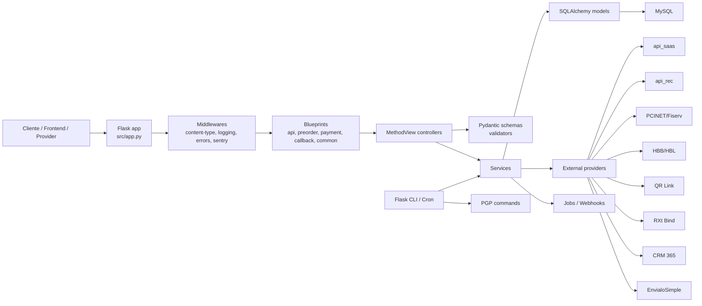
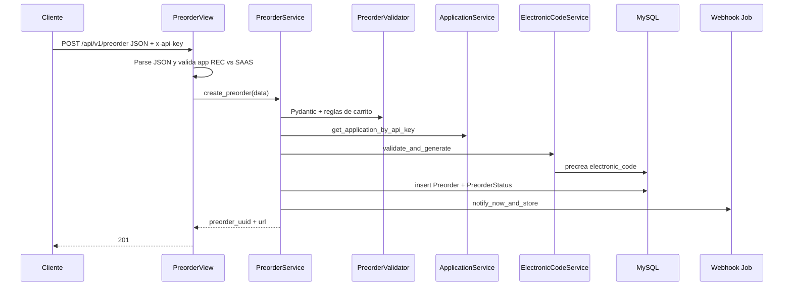
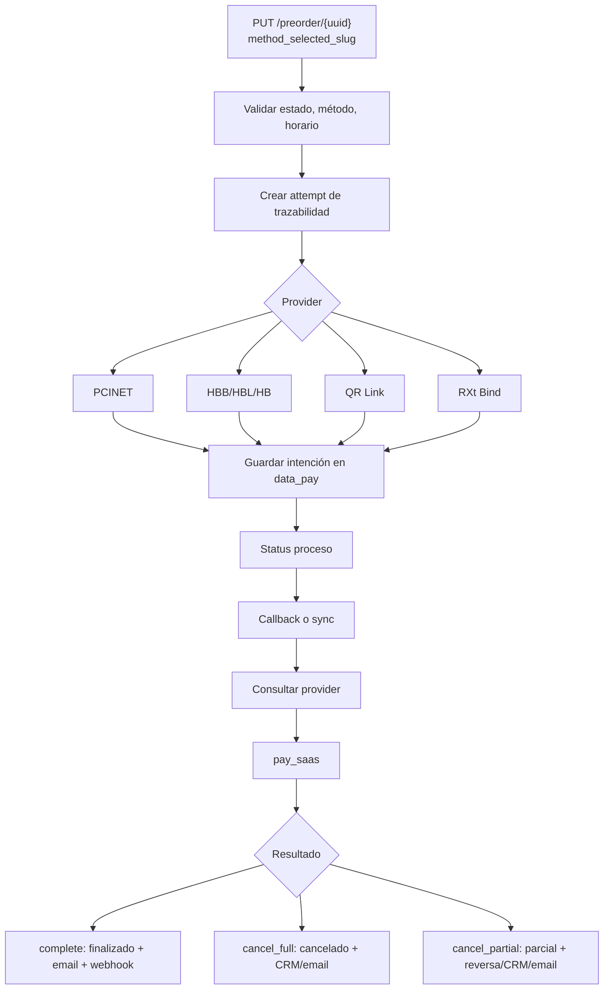
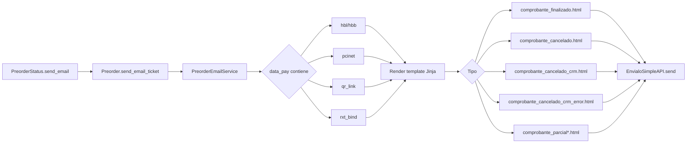
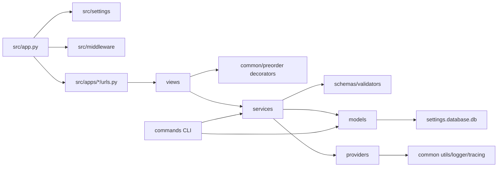

# Análisis Técnico - PayBack Microservice

## 1. Resumen ejecutivo

PayBack Microservice es una API backend Python/Flask. No se detectaron vistas frontend ni renderizado de UI para usuarios finales; los archivos HTML de `src/templates/` son plantillas de email usadas por `src/apps/preorder/services/email_service.py`.

Hechos verificados:

- Framework real: Flask con `MethodView`, `Blueprint` y Flask-SQLAlchemy (`src/app.py`, `src/settings/database.py`).
- Punto de entrada principal: `src/app.py:create_app()` para ejecución directa y `wsgi.py:application` para Apache/mod_wsgi.
- Patrón de inicialización: application factory (`create_app`) con registro explícito de blueprints y middlewares (`src/app.py`).
- Configuración: Pydantic Settings + `.env` + clases por ambiente (`src/settings/base.py`, `src/settings/__init__.py`, `src/settings/development.py`, `src/settings/staging.py`, `src/settings/production.py`, `src/settings/testing.py`).
- Base de datos: Flask-SQLAlchemy/SQLAlchemy contra MySQL; en testing usa SQLite in-memory (`src/settings/base.py`, `src/settings/database.py`).
- Endpoints detectados por lectura estática: 43 reglas HTTP incluyendo `/favicon.ico`; 42 corresponden a API/health.
- Modelos SQLAlchemy detectados: 15.
- No se detectaron migraciones Alembic/Flask-Migrate en el repositorio.

Riesgos destacados:

- Sentry parece no inicializarse aunque `ProductionSettings` lo habilita, porque `src/app.py` no carga `SENTRY` ni `PROXY` en `app.config`, mientras `src/middleware/sentry.py` lee esas claves desde `app.config`.
- Varias integraciones HTTP legacy usan `requests.request(..., timeout=None)` o no pasan timeout efectivo.
- Algunos endpoints privados de JSON/logs no tienen decoradores de API key en sus vistas.
- `PaySyncQrLink.post()` puede terminar sin `return` cuando el estado recurrente es `APROBADA`.
- Los emails de comprobante se renderizan con templates Jinja; el flujo parcial ya no construye HTML con f-strings.

## 2. Stack tecnológico

Stack verificado en `install/requirements.txt`:

| Área | Dependencias | Uso verificado |
|---|---|---|
| Web/API | Flask, Werkzeug, click | App Flask, `MethodView`, CLI commands (`src/app.py`, `src/apps/*/urls.py`). |
| DB | Flask-SQLAlchemy, SQLAlchemy, mysqlclient | ORM y URI MySQL (`src/settings/database.py`, `src/settings/base.py`). |
| Validación | pydantic[email], pydantic-settings | Settings y schemas (`src/settings/base.py`, `src/apps/preorder/schemas/preorder_schemas.py`). |
| PGP | python-gnupg | CLI de claves y cifrado de emails (`src/apps/pgp/commands/*.py`). |
| HTTP | requests, requests_ntlm | Providers externos y CRM con NTLM (`src/apps/preorder/providers/`). |
| Env | python-dotenv | Carga defensiva de `.env` (`src/settings/__init__.py`). |
| Fechas | python-dateutil, pytz | Utilidad local `zilean` y conciliación (`src/apps/common/utils/zilean/`, `src/apps/api/utils/conciliate_common.py`). |
| Observabilidad | sentry_sdk | Middleware Sentry (`src/middleware/sentry.py`). |

Stack de desarrollo en `install/requirements-dev.txt`: pytest, pytest-cov, pylint, black, isort, mypy, coverage, pyclean.

## 3. Estructura del proyecto

Mapa de carpetas relevantes:

| Ruta | Propósito |
|---|---|
| `src/app.py` | Application factory, inicialización Flask, logging, middlewares, DB y blueprints. |
| `wsgi.py` | Entrada WSGI para Apache/mod_wsgi. |
| `src/settings/` | Settings Pydantic por ambiente y `db = SQLAlchemy()`. |
| `src/middleware/` | Validación Content-Type, logging request/response, error handler, Sentry. |
| `src/apps/preorder/` | Núcleo de órdenes: views, services, schemas, validators, models, providers, commands. |
| `src/apps/payment/` | Sincronización/cancelación de pagos con proveedores. |
| `src/apps/callback/` | Callbacks entrantes de HBB, HBL, PCINET, QR Link y RXt Bind. |
| `src/apps/api/` | Endpoints de conciliación, centralizador y chatbot debts. |
| `src/apps/application/` | Aplicaciones cliente, API key y settings de medios de pago. |
| `src/apps/common/` | Helpers, logging, modelos comunes, comandos, health, endpoints privados. |
| `src/apps/company/` | Modelo y consulta de empresas. |
| `src/apps/channel/` | Modelos y servicios de canales; sin endpoints registrados. |
| `src/apps/pgp/` | Comandos CLI PGP/GPG. |
| `src/templates/` | Templates HTML de email, no vistas frontend. |
| `command/` | Wrappers shell/PowerShell para cron, CLI Flask y run local. |
| `install/` | Requirements, crontab y vhost Apache. |
| `docs/` | Documentación existente y ejemplos JSON. |
| `logs/`, `tmp/`, `conciliate/`, `pgp/` | Directorios runtime versionados solo con `.gitignore` o archivos de ejemplo. |

## 4. Punto de entrada e inicialización de la app

Entrada Flask:

- `src/app.py:create_app(config_override=None, settings=None)` crea `Flask(__name__)`.
- Obtiene settings con `get_settings()` (`src/app.py`, `src/settings/__init__.py`).
- Configura `VERSION`, `SECRET_KEY`, `SQLALCHEMY_DATABASE_URI`, `TESTING`, `DEBUG` y directorios runtime (`src/app.py`).
- Crea directorios `logs`, `conciliate`, `tmp`, `pgp` si faltan (`src/app.py`).
- Inicializa logging con `setup_logging()` (`src/apps/common/helpers/logger.py`).
- Llama `init_sentry(app)`, registra middlewares, inicializa `db.init_app(app)` y registra blueprints (`src/app.py`).
- Carga `PAYMENT_CONFIG` desde DB con `load_payment_config(db.session)` en app context, capturando excepciones para no impedir arranque (`src/app.py`).

Entradas de ejecución:

- Desarrollo/directo: `python src/app.py`, `app.run(host="0.0.0.0", port=5000, debug=app.config["DEBUG"])`.
- Flask CLI: `FLASK_APP=src/app:create_app` usado por `command/run.sh` y scripts cron.
- Apache/mod_wsgi: `wsgi.py` importa `create_app()` y expone `application`.
- Docker: `Dockerfile` y `docker-compose.yml` ejecutan `python src/app.py`.

Inferencia con evidencia: el despliegue productivo histórico parece Apache/mod_wsgi con TLS en vhost (`wsgi.py`, `install/vhost.conf`), aunque Docker también está preparado para ejecución local o alternativa.

## 5. Arquitectura backend

Arquitectura detectada:

- Capa HTTP: `src/apps/*/urls.py` define blueprints y rutas; `src/apps/*/views/*.py` usa `MethodView`.
- Capa de validación: Pydantic schemas en `schemas/` y validators de negocio en `validators/`.
- Capa de servicios: `services/` orquesta reglas, DB e integraciones.
- Capa ORM: `models/` con SQLAlchemy.
- Capa providers: clientes HTTP externos bajo `src/apps/preorder/providers/`.
- Helpers/transversales: logging, tracing, response wrapper, decorators, amount utilities en `src/apps/common/`.
- Jobs/CLI: comandos Click registrados en blueprints.

Responsabilidades principales por módulo:

| Módulo | Responsabilidad |
|---|---|
| `preorder` | Crear preorders, generar CPE, seleccionar método, consultar detalle, cerrar/expirar, centralizar. |
| `payment` | Sincronizar pagos PCINET/QR y cancelar QR Link. |
| `callback` | Procesar callbacks externos y cerrar pago con `PaymentClosureService`. |
| `api` | Reportes/conciliaciones y deuda REC para chatbot. |
| `application` | Consulta/validación de apps por API key y settings. |
| `common` | Health, logs privados, jobs, helpers y observabilidad. |
| `pgp` | Gestión de claves y cifrado mensual de emails. |
| `company`/`channel` | Catálogos de empresas/canales y relaciones con métodos. |

Acoplamientos fuertes observados:

- `Preorder` model contiene lógica de integración (`pay_saas`, `create_crm_case`, `send_email_ticket`) además de persistencia (`src/apps/preorder/models/preorder.py`). Esto acopla modelo ORM con providers, email y settings.
- Providers legacy (`api_saas.py`, `api_hbb.py`, `api_hbl.py`, `api_qr_link.py`, `api_pcinet.py`, `api_crm.py`) implementan patrones HTTP duplicados, mientras otros usan `BaseAPIClient`/`DemaciaHandler` (`api_envialosimple.py`, `api_rxt_bind.py`).
- Hay endpoints privados de inspección distribuidos entre `common` y `preorder` sin una política de seguridad uniforme visible.
- Los comandos CLI y algunos modelos hacen commits directos con `db.session`, mientras servicios nuevos aceptan `db_session`; esto mezcla unidades transaccionales.

## 6. API y endpoints

No se detectó Swagger/OpenAPI/Postman en el repositorio con el barrido de archivos. La documentación siguiente sale de `src/apps/*/urls.py` y vistas `MethodView`.

Convenciones comunes:

- Respuesta estándar: `{"code": int, "data": ..., "message": ...}` vía `make_response()` (`src/apps/common/utils/generic.py`).
- Para POST/PUT/PATCH no callback se exige `Content-Type: application/json` (`src/middleware/content_type.py`).
- Autenticación por header:
  - `x-api-key` validado contra `get_settings().x_api_key` en `src/apps/common/decorators.py`.
  - `siris-api-key` validado contra `get_settings().siris_api_key` en `src/apps/common/decorators.py`.

### Endpoints detectados

| Blueprint | Método | Path | Archivo | Controlador |
|---|---:|---|---|---|
| common | GET | `/` | `src/apps/common/urls.py` | `Alive.get` |
| common | GET | `/alive` | `src/apps/common/urls.py` | `Alive.get` |
| common | GET | `/health` | `src/apps/common/urls.py` | `Alive.get` |
| common | GET | `/api/v1/json/jobs` | `src/apps/common/urls.py` | `PrivateJsonJob.get` |
| common | GET | `/api/v1/json/application` | `src/apps/common/urls.py` | `PrivateApplication.get` |
| common | GET | `/api/v1/json/application/list` | `src/apps/common/urls.py` | `PrivateApplicationList.get` |
| common | GET | `/api/v1/webhooks` | `src/apps/common/urls.py` | `Notifications.get` |
| common | POST | `/api/v1/webhooks` | `src/apps/common/urls.py` | `Notifications.post` |
| api | GET | `/api/v1/centralizer` | `src/apps/api/urls.py` | `CentralizerGet.get` |
| api | GET | `/api/v1/centralizer/fiserv` | `src/apps/api/urls.py` | `FiservConciliate.get` |
| api | GET | `/api/v1/centralizer/fiserv/file` | `src/apps/api/urls.py` | `FiservConciliateFile.get` |
| api | GET | `/api/v1/centralizer/homebanking` | `src/apps/api/urls.py` | `HomebankingConciliate.get` |
| api | GET | `/api/v1/centralizer/homebanking/file` | `src/apps/api/urls.py` | `HomebankingConciliateFile.get` |
| api | GET | `/api/v1/centralizer/qr_link` | `src/apps/api/urls.py` | `QrReverseConciliate.get` |
| api | GET | `/api/v1/centralizer/qr_link/file` | `src/apps/api/urls.py` | `QrReverseConciliateFile.get` |
| api | GET | `/api/v1/centralizer/bind_rxt` | `src/apps/api/urls.py` | `BindRxtConciliate.get` |
| api | GET | `/api/v1/centralizer/bind_rxt/file` | `src/apps/api/urls.py` | `BindRxtConciliateFile.get` |
| api | GET | `/api/v1/preorder/status/<uuid>` | `src/apps/api/urls.py` | `PreorderStatusView.get` |
| api | GET | `/api/v1/centralizer/liq_bind_rxt` | `src/apps/api/urls.py` | `LiqBindRxt.get` |
| api | GET | `/api/v1/centralizer/liq_bind_rxt/file` | `src/apps/api/urls.py` | `LiqBindRxtFile.get` |
| api | POST | `/api/v1/chatbot/debts` | `src/apps/api/urls.py` | `ChatbotDebtsView.post` |
| application | GET | `/api/v1/get_api_key` | `src/apps/application/urls.py` | `GetApiKey.get` |
| application | GET | `/api/v1/application/<api_key>` | `src/apps/application/urls.py` | `ApplicationGet.get` |
| callback | POST | `/api/v1/callback/hbb/<cpe>` | `src/apps/callback/urls.py` | `HbbCallback.post` |
| callback | POST | `/api/v1/callback/hbl/<cpe>` | `src/apps/callback/urls.py` | `HblCallback.post` |
| callback | POST | `/api/v1/callback/pcinet/<cpe>` | `src/apps/callback/urls.py` | `PcinetCallback.post` |
| callback | POST | `/api/v1/callback/qr/link/<cpe>` | `src/apps/callback/urls.py` | `QrLinkCallback.post` |
| callback | POST | `/api/v1/callback/rxt/bind/<cpe>` | `src/apps/callback/urls.py` | `RxtBindCallback.post` |
| company | GET | `/api/v1/company` | `src/apps/company/urls.py` | `CompanyList.get` |
| payment | POST | `/api/v1/pay/sync/pcinet/<uuid>` | `src/apps/payment/urls.py` | `PaySyncPciNET.post` |
| payment | POST | `/api/v1/pay/sync/qrlink/<uuid>` | `src/apps/payment/urls.py` | `PaySyncQrLink.post` |
| payment | POST | `/api/v1/cancel/qrlink/<uuid>` | `src/apps/payment/urls.py` | `CancelationQrLink.post` |
| preorder | GET | `/api/v1/json/centralizer` | `src/apps/preorder/urls.py` | `PrivateCentralizer.get` |
| preorder | GET | `/api/v1/json/centralizer/details` | `src/apps/preorder/urls.py` | `PrivateCentralizerDetails.get` |
| preorder | GET | `/api/v1/json/preorder` | `src/apps/preorder/urls.py` | `PrivatePreorder.get` |
| preorder | POST | `/api/v1/preorder` | `src/apps/preorder/urls.py` | `PreorderView.post` |
| preorder | POST | `/api/v1/preorder/create` | `src/apps/preorder/urls.py` | `PreorderView.post` |
| preorder | POST | `/api/v1/preorder/chatbot` | `src/apps/preorder/urls.py` | `ChatbotView.post` |
| preorder | GET | `/api/v1/preorder/<preorder_uuid>` | `src/apps/preorder/urls.py` | `PreorderDetailView.get` |
| preorder | PUT | `/api/v1/preorder/<preorder_uuid>` | `src/apps/preorder/urls.py` | `PreorderDetailView.put` |
| preorder | GET | `/api/v1/preorder/update/<preorder_uuid>` | `src/apps/preorder/urls.py` | `PreorderDetailView.get` |
| preorder | PUT | `/api/v1/preorder/update/<preorder_uuid>` | `src/apps/preorder/urls.py` | `PreorderDetailView.put` |
| app | GET | `/favicon.ico` | `src/app.py` | `favicon` |

### Detalle por grupo

Preorder:

- `POST /api/v1/preorder` y `/api/v1/preorder/create`: requiere `x-api-key`; espera JSON nested (`api_key`, `payer`, `payments`, `meta`) o flat legacy. Valida con `PreorderValidator` y Pydantic (`src/apps/preorder/views/preorder_view.py`, `src/apps/preorder/validators/preorder_validator.py`, `src/apps/preorder/schemas/preorder_schemas.py`). Involucra `PreorderService`, `ApplicationService`, `ApplicationPayMethodService`, `ElectronicCodeService`, modelos `Preorder`, `PreorderStatus`, `Status`, e integración SAAS/REC según flujo. Errores controlados: JSON inválido, app REC en endpoint SAAS, validaciones de carrito, API key inválida, DB.
- `POST /api/v1/preorder/chatbot`: requiere `x-api-key`; flujo REC con `ChatbotCreateRequest`, `ChatbotService`, `RecAPI` y `ElectronicCodeService` (`src/apps/preorder/views/chatbot_view.py`, `src/apps/preorder/services/chatbot_service.py`).
- `GET /api/v1/preorder/<uuid>` y legacy `/preorder/update/<uuid>`: requiere `x-api-key` y decorator `preorder_exist`; devuelve preorder enriquecida con app, payMethods, status y ticket si aplica (`src/apps/preorder/views/preorder_detail.py`, `src/apps/preorder/services/preorder_service.py`).
- `PUT /api/v1/preorder/<uuid>` y legacy `/preorder/update/<uuid>`: requiere `x-api-key`; espera `method_selected_slug`, `data_petitioner` opcional, `url_redirect`/`url_proxy` según provider. Valida estado `instanciado`/`proceso`, ventana horaria, disponibilidad del método y routea a PCINET/HBB/HBL/HB/QR/RXt (`src/apps/preorder/services/preorder_service.py`).

Callbacks:

- HBB/HBL: `POST /api/v1/callback/hbb/<cpe>` y `/hbl/<cpe>` están exentos de Content-Type JSON y no tienen `x-api-key`; usan `cpe_exist`, consultan deuda provider, ejecutan SAAS y `PaymentClosureService` (`src/apps/callback/views/hbb_callback.py`, `src/apps/callback/views/hbl_callback.py`).
- PCINET: `POST /api/v1/callback/pcinet/<cpe>` sin `x-api-key`; usa token guardado en `data_pay`, espera `callback_delay`, consulta estado PCINET, procesa SAAS y cancelaciones (`src/apps/callback/views/pcinet_callback.py`).
- QR Link/RXt Bind: tienen `x_api_key_required` además de `cpe_exist`; consultan callback/estado o body, pagan SAAS y cancelan/refundan si falla (`src/apps/callback/views/qr_link_callback.py`, `src/apps/callback/views/rxt_bind_callback.py`).

Conciliación:

- Endpoints `/centralizer/*` devuelven JSON o CSV para Fiserv, Homebanking, QR reverse, Bind RXt y liquidación RXt. Usan query param `date` y utilidades `src/apps/api/utils/*`; controlan `ValueError` con 400 y `KeyError` con 500 (`src/apps/api/views/conciliate/*.py`).
- `GET /api/v1/centralizer` usa `siris-api-key`, acepta `from`/`to`, filtra `Centralizer.status == "Finalizado"` y join con `CentralizerDetails` (`src/apps/api/views/centralizer_get.py`).

Catálogos/privados:

- `GET /api/v1/company`: requiere `x-api-key`; filtros `uuid`, `name`, `slug`, `is_active`, `limit` (`src/apps/company/views/company_list.py`).
- `GET /api/v1/get_api_key`: requiere `x-api-key` y query `api_key`; valida app activa y devuelve ventana horaria global (`src/apps/application/views/get_api_key.py`).
- `GET /api/v1/application/<api_key>`: requiere `x-api-key`; devuelve `Application.to_dict()` si existe (`src/apps/application/views/application_get.py`).
- Endpoints `/api/v1/json/*` permiten consultar logs, jobs, preorders y centralizers; no todos tienen autenticación decoradora visible.

## 7. Configuración y variables de entorno

Carga de configuración:

- `src/settings/__init__.py` ejecuta `load_dotenv(PROJECT_ROOT / ".env", override=True)`.
- `get_settings()` selecciona clase por `FLASK_ENV`: development, testing, staging, production; default development.
- `SettingsConfigDict` usa `env_nested_delimiter="__"` y `extra="forbid"` (`src/settings/base.py`).
- `.env.example` documenta variables válidas.

Variables principales:

| Variable | Uso | Obligatoria | Riesgo si falta |
|---|---|---:|---|
| `FLASK_ENV` | Selección de settings (`src/settings/__init__.py`). | Sí para ambiente correcto | Default development, posible debug/config equivocada. |
| `LOG_LEVEL`, `LOG_FORMAT`, `PERSIST_LOG`, `LOG_FILE_PATH` | Logging (`src/settings/base.py`, `src/apps/common/helpers/logger.py`). | Opcional | Diagnóstico insuficiente o logs demasiado verbosos. |
| `UNSAFE_LOGGING` | Desactiva sanitización de secretos (`src/apps/common/utils/generic.py`). | Opcional | Si true en prod expone secretos. |
| `DB_USER`, `DB_PASS`, `DB_HOST`, `DB_NAME` | `database_url` MySQL (`src/settings/base.py`). | Sí fuera de unit tests | Fallo de conexión o URI inválida. |
| `X_API_KEY` | Decorator `x_api_key_required`. | Sí | Endpoints autenticados quedan inaccesibles o inseguros si valor débil. |
| `SIRIS_API_KEY` | Decorator `siris_api_key_required`. | Sí si se usa `/centralizer` | Endpoint SIRIS inaccesible o inseguro. |
| `FLASK_SECRET_KEY` | `app.config["SECRET_KEY"]`. | Sí | Riesgo en cookies/sesiones si vacío/débil. |
| `PGP_PASSWORD` | `PgpConfig.password`. | Solo si se requiere passphrase PGP | Funciones PGP con passphrase pueden fallar. |
| `API_ENVIALO_SIMPLE_SECRET` | Header email provider. | Sí si host activo | Arranque falla por validator. |
| `API_SAAS_SECRET` | Header SAAS. | Sí si host activo | Arranque falla o integración rota. |
| `API_REC_SECRET` | Header REC. | Sí si host activo | Arranque falla o chatbot REC roto. |
| `API_PCINET_SECRET` | Header PCINET. | Sí si host activo | Arranque falla o tarjetas rotas. |
| `API_HBB_SECRET`, `API_HBL_SECRET` | Headers homebanking. | Sí si host activo | Arranque falla o HB roto. |
| `API_QR_LINK_SECRET` | Header QR Link. | Sí si host activo | Arranque falla o QR roto. |
| `API_RXT_BIND_SECRET` | Header RXt Bind. | Sí si host activo | Arranque falla o transferencia rota. |
| `API_CRM_365_SECRET` | Mapeado pero `ApiCrmConfig` no tiene `secret`; no se inyecta por `hasattr`. | Pendiente | Variable documentada pero aparentemente no usada. |
| `API__CRM_365__USER_CRM`, `API__CRM_365__PASS_CRM` | NTLM CRM (`src/apps/preorder/providers/api_crm.py`). | Sí si CRM activo | CRM falla. |
| `PROXY__USE`, `PROXY__HTTP`, `PROXY__HTTPS` | Providers y Sentry proxy. | Opcional | Salida HTTP puede fallar en red corporativa. |
| `SENTRY__ENABLED`, `SENTRY__DSN`, `SENTRY__ENV` | Settings Sentry. | Opcional | Observabilidad Sentry inactiva. Actualmente hay riesgo de no propagarse a `app.config`. |
| `EMAIL__*`, `CRM__*`, `PCINET__*`, `QR__*`, `BIND__TIMEOUT`, `WEBHOOK__*`, `PREORDER__*`, `CALLBACK__BASE` | Config de negocio (`src/settings/base.py`). | Opcional con defaults | Defaults pueden no coincidir con ambiente real. |

Por ambiente:

- Development, testing, staging, production definen hosts de APIs externas y `callback.base` (`src/settings/development.py`, `src/settings/testing.py`, `src/settings/staging.py`, `src/settings/production.py`).
- Testing activa `testing_env=True`, `unit_testing=True` y `database_url = sqlite:///:memory:` (`src/settings/testing.py`, `src/settings/base.py`).
- Staging/production habilitan `SentryConfig(enabled=True)` en settings, pero ver riesgo en sección 20.

## 8. Base de datos y modelos

Uso de DB:

- `db = SQLAlchemy()` en `src/settings/database.py`.
- `db.init_app(app)` en `src/app.py`.
- URI MySQL: `URL.create(drivername="mysql", username=db_user, password=db_pass, host=db_host, database=db_name)` (`src/settings/base.py`).
- Testing usa SQLite in-memory si `unit_testing=True`.

No se detectaron migraciones. Inferencia: el esquema se maneja fuera del repositorio o por scripts/manual/DB existente. Esto debe confirmarse.

Modelos detectados:

| Modelo | Tabla | Archivo | Columnas/relaciones principales |
|---|---|---|---|
| `Application` | `applications` | `src/apps/application/models/application.py` | PK compuesta `application_uuid`, `company_uuid`; FK a `companies`; datos API key, entity, logo, callbacks, límites, installments, Kount; relaciones `company`, `preorders`, `settings`. |
| `ApplicationPayMethod` | `applications_pay_methods` | `src/apps/application/models/application_pay_methods.py` | PK compuesta `pay_method_uuid`, `application_uuid`; prioridad; FK a pay_methods/applications. |
| `ApplicationSettings` | `applications_settings` | `src/apps/application/models/application_settings.py` | PK compuesta `application_uuid`, `pay_method_uuid`; límites, horarios, `extra`; relación `pay_method`. |
| `Channel` | `channels` | `src/apps/channel/models/channel.py` | `channel_uuid`, name, slug, code, active, timestamps. |
| `ChannelPayMethod` | `channels_pay_methods` | `src/apps/channel/models/channel_pay_method.py` | PK compuesta `channel_uuid`, `pay_method_uuid`; relaciones `channel`, `pay_method`. |
| `Company` | `companies` | `src/apps/company/models/company.py` | `company_uuid`, name, slug, active, timestamps. |
| `PayMethod` | `pay_methods` | `src/apps/payment/models/pay_method.py` | `pay_method_uuid`, name, slug, logo, description, active, min/max amount/hour; relaciones `channel_pay_methods`, `application_settings`. |
| `Preorder` | `preorders` | `src/apps/preorder/models/preorder.py` | PK compuesta `preorder_uuid`, `application_uuid`; `data_pay` JSON, CPE, method slug, email, expiration, centralizer flag; relaciones `application`, `statuses`. |
| `PreorderStatus` | `preorder_status` | `src/apps/preorder/models/preorder_status.py` | PK compuesta `preorder_uuid`, `status_uuid`; relación `preorder`, `status`; métodos de status, email, CRM y webhook jobs. |
| `Status` | `status` | `src/apps/preorder/models/status.py` | `status_uuid`, name, slug, description, timestamps. |
| `Centralizer` | `centralizers` | `src/apps/preorder/models/centralizers.py` | UUID, FK preorder, CPE, entity, amount, method, datetime, transaction, status, raw JSON, timestamps. |
| `CentralizerDetails` | `centralizer_details` | `src/apps/preorder/models/centralizer_details.py` | PK compuesta `centralizer_details_uuid`, `centralizer_uuid`; SAAS transaction/amount/barcode/serial/datetime/error; relación `centralizer`. |
| `ElectronicCode` | `electronic_codes` | `src/apps/preorder/models/electronic_code.py` | Autoincrement `id`, CPE, preorder_uuid, total, due_date, engine, raw JSON, timestamps. |
| `JobsNotificationPay` | `jobs` | `src/apps/common/models/jobs.py` | `job_uuid`, job_type, action Text JSON, status, log, timestamps. |
| `Parameters` | `parameters` | `src/apps/common/models/parameters.py` | key/value/origin/type/user_change, timestamps. |
| `FiservTax` | `fiserv_tax` | `src/apps/common/models/fiserv.py` | Coeficientes, tasas, fechas, flags y fees para cuotas. |

Riesgos DB/performance:

- `PrivatePreorder.get()` ejecuta queries por cada preorder para notifications, centralizers y details, potencial N+1 (`src/apps/preorder/views/json/preorder.py`).
- `CentralizerDetails.to_dict()` llama `self.centralizer.to_dict()`, puede producir cargas extra si no se eager-loadea (`src/apps/preorder/models/centralizer_details.py`).
- `PreorderStatus.set_status()`, `Preorder.set_data_pay()` y jobs hacen commits dentro de modelos, mezclando persistencia y dominio (`src/apps/preorder/models/preorder_status.py`, `src/apps/preorder/models/preorder.py`).
- No hay constraints únicos explícitos para `slug`, `api_key`, `electronic_code` en modelos; puede existir en DB, pero no está declarado en ORM.
- `Application` y `Preorder` usan PK compuesta con UUID + FK, pero muchos lookups usan solo `application_uuid` o `preorder_uuid`; revisar índices reales en MySQL.

## 9. Validaciones y schemas

Pydantic:

- Settings: `Settings` y subconfig models en `src/settings/base.py`.
- Preorder request/response: `src/apps/preorder/schemas/preorder_schemas.py`.
- Centralizer: `src/apps/preorder/schemas/centralizer_schemas.py`.
- Catálogos: `src/apps/application/schemas/*.py`, `src/apps/channel/schemas/*.py`, `src/apps/payment/schemas/*.py`, `src/apps/company/schemas/company_schema.py`.

Validaciones principales:

- `PayerSchema`: email con `EmailStr`, DNI como `document_type="1"`, documento 7-11 dígitos, género enum 1/2/3, `extra="forbid"`.
- `PaymentSchema`: `amount` string con patrón `^\d+\.\d{2}$`, Decimal > 0, barcode no vacío, engine `api_saas|api_rec`.
- `PreorderCreateRequest`: `api_key` 32-64, `payments` min_length 1, `extra="forbid"`.
- `ChatbotCreateRequest`: soporta flatten `payer__*` y `ffcc__*`; `ffcc` obligatorio.
- `PreorderUpdateSchema`: `method_selected_slug` requerido, `data_petitioner` opcional, extra permitido para provider fields.
- `PreorderValidator`: valida tamaño máximo de carrito (`PREORDER__CART_MAX`), duplicado de barcode, total contra límites de app, disponibilidad de métodos por rango.
- `CentralizerCreateSchema`: valida UUID length, CPE/entity/method/status no vacíos, total > 0 y parsing de fechas.

Validaciones faltantes/inconsistentes:

- `ChatbotDebtsView.post()` accede `data["api_key"]` sin validar presencia; un payload sin esa clave puede disparar excepción global 500 en vez de 400/422 (`src/apps/api/views/chatbot_debts.py`).
- `PaySyncQrLink.post()` asume `request.get_json()` no nulo y luego puede no retornar respuesta si `is_recurrent=True` y estado `APROBADA` (`src/apps/payment/views/pay_sync_qr_link.py`).
- Endpoints privados JSON aceptan varios query params sin autenticación visible ni validación fuerte de `limit` en todos los casos (`src/apps/preorder/views/json/*.py`).
- `MetaSchema.url_redirect` solo valida tipo string, no URL; el comentario indica regla de negocio, pero seguridad de redirects debe confirmarse.

## 10. Integraciones externas

Integraciones detectadas:

| Servicio | Archivo | Endpoints externos/verificados | Auth | Timeout/retries | Manejo de errores |
|---|---|---|---|---|---|
| SAAS | `src/apps/preorder/providers/api_saas.py` | `/api/v1/getChannels`, `/api/v1/getIdentifiers`, `/api/v1/payIdentifiers`, `/api/v1/getTicket/{cpe}`, `/api/v1/getByCpe/{cpe}` | `x-api-key` | timeout default `None` si no se pasa; sin retry | Captura ConnectionError/Timeout/RequestException y retorna dict code 500. |
| REC | `src/apps/preorder/providers/api_rec.py` | `/api/v1/entities?code=`, `/api/v1/debt/{ente_id}` | `x-api-key` | `api.rec.timeout` default 30 | Captura ConnectionError/Timeout/RequestException con 503/504/502. |
| PCINET/Fiserv | `src/apps/preorder/providers/api_pcinet.py` | `/api/v1/orden`, `/api/v1/transactions/{token}`, `/api/v1/cancellation/{token}` | `x-api-key` | `timeout=None` hardcoded | Captura RequestException/Timeout; no timeout real. |
| HBB | `src/apps/preorder/providers/api_hbb.py` | `/api/v1/hbb/deudas`, `/api/v1/hbb/deudas/{cpe}` | `x-api-key` | timeout default `None` | Captura errores requests. |
| HBL | `src/apps/preorder/providers/api_hbl.py` | `/api/v1/hbl/deuda`, `/api/v1/hbl/aviso_pago/{cpe}` | `x-api-key` | timeout default `None` | Captura errores requests. |
| QR Link | `src/apps/preorder/providers/api_qr_link.py` | `/api/v1/qr/dinamic`, `/api/v1/qr/callback`, `/api/v1/qr/transaction/{operation_id}`, `/api/v1/qr/refund/{operation_id}` | `X-Api-Key`, trace headers | timeout default `None` | Captura errores requests. |
| RXt Bind | `src/apps/preorder/providers/api_rxt_bind.py` | `/api/v1/transaction`, `/api/v1/refund`, `/api/v1/callback`, `/api/v1/generate_liq` | `X-Api-Key` | `BIND__TIMEOUT`, Demacia default 10, retries 0 | Usa `BaseAPIClient`/`DemaciaHandler`. |
| EnvialoSimple | `src/apps/preorder/providers/api_envialosimple.py` | `/api/v1/send/message` | `client-secret-key` | Demacia default 10 | Usa `BaseAPIClient`/`DemaciaHandler`. |
| CRM 365 | `src/apps/preorder/providers/api_crm.py` | `/incidents`, luego GET a `OData-EntityId` | NTLM `HttpNtlmAuth` | timeout default `None`, retries manuales post-204 | Captura requests errors; `verify=False` por default. |
| Webhook cliente | `src/apps/preorder/providers/api_webhook.py` | URL callback configurada en application | Sin auth visible | timeout default 2.5 desde `notify_status` | Captura errores requests. |

Riesgos:

- HTTP sin timeout real en SAAS/HBB/HBL/QR/CRM y PCINET. PCINET fuerza `timeout=None`.
- CRM usa `verify=False` por default, lo que desactiva validación TLS.
- `WebhookAPI.notify_status()` hace bypass si la URL contiene `.provincianet.com.ar`, retornando OK sin enviar request; debe confirmarse si es una regla intencional.
- Logging debug de requests/responses puede incluir datos sensibles si `LOG_LEVEL=DEBUG` o `UNSAFE_LOGGING=true`.

## 11. PGP / GPG

Uso de `python-gnupg`:

- `src/apps/pgp/commands/manage_keys.py`: comandos `list`, `check`, `delete`, `import`, `export`, `generate`.
- `src/apps/pgp/commands/encrypt_emails.py`: genera CSV mensual de emails por entity_code, importa claves, cifra archivo y lo guarda en `conciliate/`.
- `src/apps/pgp/helpers/utils.py`: helper legacy para cargar claves públicas por email; usa `print()`.
- Documentación existente: `docs/PGP_MODULE.md`.

Flujo de cifrado de emails:

1. `encrypt_emails --entity_code X` obtiene emails de preorders del mes anterior (`get_records()`).
2. Escribe CSV en `tmp/email_{entity}_{YYMM}.csv`.
3. Crea keyring temporal en `tmp/gpg_{entity}_{timestamp}` con permisos `0700`.
4. Importa clave pública del servidor `pgp/netpagos/public.asc`.
5. Importa y valida clave pública cliente `pgp/{entity_code}.asc`: existencia, una sola fingerprint, no expirada, no revocada, capacidad de cifrado.
6. Cifra CSV hacia `conciliate/*.csv.pgp` con `always_trust=True`, sin firma.
7. Borra keyring temporal con `shutil.rmtree()`.

Riesgos:

- El CSV claro queda en `tmp/` después de cifrar; no se elimina en `encrypt_emails.py`.
- `always_trust=True` evita validación de confianza Web-of-Trust; compensado parcialmente por fingerprint exacta del archivo importado.
- No se firma el archivo cifrado; el propio mensaje indica "sin firma".
- `manage_keys delete --passphrase` permite passphrase por argumento CLI, potencial exposición en history/process list.
- `src/apps/pgp/helpers/utils.py` usa `print()` y selecciona por UID/email; parece helper legacy menos robusto que `encrypt_emails.load_public_key`.

## 12. Emails y plantillas HTML

Templates:

| Template | Uso | Variables principales |
|---|---|---|
| `src/templates/comprobante_finalizado.html` | Pago exitoso con o sin carrito. | `email_logo`, `email_body_ok`, aliases `image_header/image_body`, `first_name`, `last_name`, flags, `service`, `front_ticket`, `installment`, `has_cart`, `payment_summary`. |
| `src/templates/comprobante_cancelado.html` | Reversa/devolución. | `email_logo`, `email_body_error`, aliases, `first_name`, `last_name`, flags, `fiserv`, `reversal`, `service`, `payment_summary`. |
| `src/templates/comprobante_cancelado_crm.html` | Error con caso CRM. | `image_header`, `image_body`, `first_name`, `last_name`, `crm`. |
| `src/templates/comprobante_cancelado_crm_error.html` | Error sin caso CRM. | `image_header`, `image_body`, `first_name`, `last_name`. |
| `src/templates/comprobante_parcial.html` | Pago parcial con devolución procesada. | `email_logo`, `email_body_warning`, aliases, `front_ticket`, `first_name`, `last_name`, `successful`, `failed`, `refund_status`, `refund_msg`, `amount_info`, `payment_summary`. |
| `src/templates/comprobante_parcial_crm.html` | Pago parcial con caso CRM creado. | Variables de parcial más `crm`. |
| `src/templates/comprobante_parcial_crm_error.html` | Pago parcial sin devolución ni caso CRM creado. | Variables de parcial. |

Flujo:

- `Preorder.send_email_ticket()` instancia `PreorderEmailService` (`src/apps/preorder/models/preorder.py`).
- `PreorderEmailService.send_ticket_email()` detecta provider por claves en `data_pay`: `hbl`, `hbb`, `pcinet`, `qr_link`, `rxt_bind`.
- Renderiza templates HTML de email con Flask `render_template()`.
- Envía contenido HTML mediante `EnvialoSimpleAPI.send()` a `/api/v1/send/message`.
- Todos los templates usan CSS inline y estructura basada en tablas para compatibilidad con clientes de correo.
- Assets requeridos en contexto: `email_logo`, `email_body_ok`, `email_body_error`, `email_body_warning`; se mantienen aliases compatibles `image_header`/`image_body`.
- Los links de comprobante enviados por email deben incluir `noredir=1`; `src/apps/preorder/utils/email_links.py` agrega el parámetro sin duplicarlo.
- Los layouts comparten `_comprobante_base.html` y `_comprobante_partial_details.html`; no son templates seleccionables por el flujo.

Mitigaciones aplicadas:

- `comprobante_finalizado.html` no renderiza el texto legacy del ticket SAAS; el comprobante completo se consulta desde el link de descarga.
- El flujo parcial fue migrado desde HTML con f-strings a templates Jinja con escape automático para datos dinámicos.
- Los logs de envío de email en `email_service.py` y `api_envialosimple.py` enmascaran el destinatario.

## 13. Logging, errores y observabilidad

Logging:

- `setup_logging()` configura root logger a stdout y opcional archivo rotativo diario (`src/apps/common/helpers/logger.py`).
- Formatos: text y JSON.
- `CorrelationIDFilter` inyecta `correlation_id`; middleware agrega `X-Request-ID` y `X-Correlation-ID`.
- Request logging excluye health, `/api/v1/json/` y favicon (`src/middleware/logging.py`).
- Comandos CLI usan `setup_command_logging()` con logs aislados.

Errores:

- `error_handler_middleware()` registra handlers 400/401/403/404/405/422/429/500 y catch-all (`src/middleware/error_handler.py`).
- Excepciones de dominio `PreorderException` devuelven estructura propia con `code_url` según `x-client-type`.
- En debug se loguea traceback, pero no se expone en respuesta HTTP.

Sentry:

- `init_sentry(app)` está implementado con Flask, Logging, SQLAlchemy y Stdlib integrations (`src/middleware/sentry.py`).
- Sanitiza eventos con `make_before_send()` y `EventScrubber`.
- Config esperada: `app.config["SENTRY"]` y `app.config["PROXY"]`.
- Riesgo verificado: `src/app.py` llama `init_sentry(app)` pero no setea `app.config["SENTRY"]` ni `app.config["PROXY"]`; por lo tanto `sentry_config = {}` y retorna sin inicializar aunque settings lo habiliten.

Logs con potencial exposición:

- Providers loguean payloads completos en debug: SAAS identifiers, QR data, PCINET intention, RXT transfer, email destinatario.
- `PaySyncPciNET.post()` loguea `request.get_json()` en debug.
- `PaymentClosure` y callbacks loguean respuestas de providers; revisar si incluyen documentos, emails, tokens o datos de tarjeta.

## 14. Seguridad

Controles presentes:

- API key estática por header `x-api-key` y `siris-api-key`.
- Content-Type JSON obligatorio en métodos mutantes salvo callbacks externos.
- Sanitización de logs/Demacia/Sentry por `SENSITIVE_KEYS`, excepto si `UNSAFE_LOGGING=true`.
- Path traversal mitigado en endpoints de logs mediante allowlist `ALLOWED_LOG_NAMES`, regex de filename y `abspath` (`src/apps/common/views/json/application_json_view.py`).
- Tracebacks no se devuelven al cliente aunque debug esté activo (`src/middleware/error_handler.py`).

Riesgos concretos:

- Sentry no se inicializa por falta de `app.config["SENTRY"]`; pérdida de observabilidad de errores en prod (`src/app.py`, `src/middleware/sentry.py`).
- Autenticación estática compartida: `x_api_key_required` compara un único secreto global, no API keys por aplicación/cliente (`src/apps/common/decorators.py`). Además, varios payloads llevan `api_key` de aplicación, distinto del header global.
- Endpoints privados `/api/v1/json/*` no muestran decorador de API key en `PrivateJsonJob`, `PrivateApplication`, `PrivateApplicationList`, `PrivateCentralizer`, `PrivateCentralizerDetails`, `PrivatePreorder`.
- HBB/HBL/PCINET callbacks no requieren `x-api-key`; dependen de CPE existente. Puede ser intencional por constraints de provider, pero debe confirmarse.
- No se detectó configuración CORS; si se expone vía frontend/browser, falta política explícita.
- No se detectó rate limiting.
- CRM usa `verify=False` por default (`src/apps/preorder/providers/api_crm.py`).
- Timeouts ausentes pueden agotar workers WSGI bajo problemas de red.
- Riesgo de HTML injection en comprobantes mitigado: el texto legacy del ticket SAAS no se renderiza y el flujo parcial no construye HTML con f-strings.
- `.env.example` incluye valores placeholder `seguridad`; no son secretos reales, pero deben evitarse en ambientes reales.

## 15. Dependencias

Dependencias usadas:

- `Flask`, `Werkzeug`, `click`: usados.
- `Flask-SQLAlchemy`, `SQLAlchemy`, `mysqlclient`: usados por ORM/MySQL.
- `pydantic[email]`, `pydantic-settings`: usados por settings/schemas; `email` extra requerido por `EmailStr`.
- `python-gnupg`: usado por PGP.
- `requests`, `requests_ntlm`: usados por providers y CRM.
- `python-dotenv`: usado en settings.
- `python-dateutil`, `pytz`: usados en `src/apps/common/utils/zilean/` y conciliación.
- `sentry_sdk`: usado por middleware/error handler.

Posibles dependencias no declaradas:

- No se detectaron imports externos no declarados relevantes en `src/`. `zilean` es paquete local bajo `src/apps/common/utils/zilean`; `src/apps/common/utils/zilean/tests.py` importa `from zilean import Zilean`, que podría fallar si se ejecuta fuera de ese paquete.

Riesgos de compatibilidad:

- README menciona Flask 3.1.0, requirements fija Flask 3.1.3.
- `pydantic` v2 está usado correctamente con `field_validator`/`model_validator`; código antiguo con `class Config` convive en algunos schemas, soportado pero conviene unificar.
- `Flask-SQLAlchemy==3.1.1` + SQLAlchemy 2.x requiere patrones compatibles; se ven usos legacy `.query`, aún soportados por Flask-SQLAlchemy.

## 16. Ejecución local y despliegue

Evidencia de ejecución:

- Docker: `Dockerfile`, `docker-compose.yml`.
- Apache/mod_wsgi: `wsgi.py`, `install/vhost.conf`.
- CLI/local: `command/run.sh`, `command/run.ps1`.
- Cron: `install/crontab.txt` y scripts `command/0001_*.sh` a `0013_*.sh`.

Comandos verificados por archivos:

```bash
python3.11 -m venv .venv
source .venv/bin/activate
pip install --upgrade pip
pip install -r install/requirements.txt
export FLASK_APP=src/app:create_app
export FLASK_ENV=development
flask run --host 0.0.0.0 --port 5000
```

Docker:

```bash
docker compose up --build
```

Inferido: requiere `.env` válido con DB y secrets. `docker-compose.yml` monta `.env`, `logs`, `conciliate`, `tmp` y `pgp`.

Despliegue Apache:

- `install/vhost.conf` configura TLS, `WSGIScriptAlias / /home/payment/pay_back/wsgi.py`, `WSGIDaemonProcess pay_back ... python-home=/home/payment/pay_back/venv`.
- `wsgi.py` contiene ejemplo similar con `.venv`.
- Pendiente: confirmar si el venv real es `venv` o `.venv`, porque hay diferencia entre `install/vhost.conf` y `wsgi.py`/scripts.

Cron:

- Notificaciones cada minuto.
- Cierre de pending/expired diario.
- Conciliaciones Fiserv, Homebanking, QR reverse, Bind RXt y liquidación.
- PGP check mensual y cifrado mensual de emails comentado.

## 17. Testing

Evidencia:

- `pytest.ini` apunta a `tests`, pero no se detectó carpeta `tests/`.
- `src/settings/testing.py` configura testing con SQLite in-memory.
- `src/apps/common/utils/zilean/tests.py` usa `unittest`, pero está dentro de `src/` y no coincide con `pytest.ini`.

Conclusión: no hay suite de tests funcional visible para endpoints, servicios, DB o providers.

Tests recomendados:

- Unitarios de schemas/validators: `PreorderValidator`, `PreorderCreateRequest`, `ChatbotCreateRequest`, `CentralizerCreateSchema`.
- Unitarios de `Amount`, `make_response`, sanitización de logs y decorators.
- Servicios con DB in-memory: `PreorderService.create_preorder`, `update_preorder`, `ChatbotService`.
- Endpoints Flask con test client: auth, Content-Type, errores JSON, happy paths mockeados.
- Providers mockeados con responses: SAAS, REC, PCINET, HBB/HBL, QR, RXt, CRM, EnvialoSimple.
- Templates email: render seguro, datos mínimos, casos éxito/error/reversa/parcial.
- CLI commands con `CliRunner` y DB mock/in-memory.

## 18. Flujos funcionales principales

### Crear preorder SAAS

Trigger: `POST /api/v1/preorder` o `/preorder/create`.

Flujo verificado:

1. `PreorderView.post()` valida JSON y header `x-api-key`.
2. Si la app es REC, rechaza y exige `/chatbot`.
3. `PreorderService.create_preorder()` valida request con Pydantic.
4. Busca aplicación por `api_key`, valida `is_saas`.
5. Obtiene métodos activos y settings.
6. Valida carrito: tamaño, amounts, barcodes, límites y disponibilidad.
7. Genera UUID y CPE con `ElectronicCodeService`.
8. Persiste `Preorder` + `PreorderStatus(instanciado)` en una transacción.
9. Crea job/webhook inmediato de notificación.
10. Responde `201` con `preorder_uuid` y URL frontend.

### Crear preorder REC/chatbot

Trigger: `POST /api/v1/preorder/chatbot`.

1. `ChatbotView.post()` valida JSON y header.
2. `ChatbotService` valida `ChatbotCreateRequest`.
3. Busca app y valida `is_rec`.
4. Resuelve entidad REC con `RecAPI.search_entity_by_code`.
5. Genera CPE/deuda con `ElectronicCodeService.validate_and_generate_rec`.
6. Persiste preorder/status y dispara notificación.
7. Responde `201` con UUID y URL frontend.

### Selección de método de pago

Trigger: `PUT /api/v1/preorder/<uuid>`.

1. Decorators validan `x-api-key` y existencia/status.
2. `PreorderService.update_preorder()` valida schema.
3. Verifica estado `instanciado` o `proceso`.
4. Busca configuración del método en app settings.
5. Valida ventana horaria y disponibilidad para el carrito.
6. Actualiza payer si no está locked.
7. Crea payment attempt en `_tracing`.
8. Routea a provider según `PAYMENT_CONFIG`: PCINET, HBB, HBL/HB, QR Link, RXt Bind.
9. Persiste `data_pay`, `method_selected_slug`; si provider ok, pasa status a `proceso`.
10. Responde datos de método y provider.

### Callback/cierre de pago

Trigger: callbacks `/api/v1/callback/*/<cpe>` o sync endpoints `/pay/sync/*/<uuid>`.

1. Decorator carga `PreorderStatus` por CPE/UUID.
2. Provider callback consulta estado/deuda/token/operation.
3. Ejecuta `preorder.pay_saas()` para pago final en SAAS.
4. `PaymentClosureService` completa, cancela total o parcial.
5. Actualiza `data_pay`, status, centralización posterior y notificaciones/email/CRM según caso.

### Conciliación y centralizador

Trigger: CLI cron y endpoints `/api/v1/centralizer/*`.

1. Queries de preorders/status por fecha y method slugs.
2. Extracción de campos por provider (`src/apps/api/utils/*.py`).
3. Devuelve JSON o genera CSV en `conciliate/`.
4. `to_centralizer` CLI crea registros `Centralizer` y `CentralizerDetails`.

### Emails

Trigger: `PreorderStatus.send_email()` o `Preorder.send_email_ticket()`, típicamente durante cierre.

1. `PreorderEmailService` lee `data_pay`.
2. Determina provider.
3. Renderiza template éxito/error/reversa/parcial.
4. Envía por EnvialoSimple.

## 19. Diagramas Mermaid

### Arquitectura general



### Request a preorder



### Flujo de pago/callback



### Emails



### Dependencias internas



## 20. Riesgos detectados

Críticos:

- Sentry probablemente deshabilitado por wiring incompleto: `init_sentry()` lee `app.config["SENTRY"]`, pero `src/app.py` no lo setea antes de llamar (`src/app.py`, `src/middleware/sentry.py`).
- Requests sin timeout real en providers críticos; PCINET fuerza `timeout=None`. Puede colgar workers WSGI y afectar disponibilidad.
- Endpoints privados de logs/preorders/centralizers sin autenticación visible; riesgo de exposición de datos operativos y personales.

Medios:

- `PaySyncQrLink.post()` no retorna respuesta para flujo recurrente aprobado.
- HTML injection en comprobantes mitigado: ticket SAAS fuera del HTML de email y flujo parcial renderizado por templates.
- `ChatbotDebtsView` puede lanzar KeyError si falta `api_key`.
- No hay migraciones versionadas del esquema.
- No hay tests funcionales visibles.
- Commits en modelos/servicios mezclan transacciones y complican rollback.
- CRM con `verify=False`.
- Logging de datos personales en debug.

Bajos:

- README desactualizado respecto de versions y `config.py`.
- `GetChannels` existe pero no está registrado en `application/urls.py`.
- `PayMethodsList` existe pero no está registrado en `payment/urls.py`.
- `src/apps/pgp/helpers/utils.py` parece helper legacy con `print()`.
- Diferencia entre `venv` y `.venv` en scripts/vhost.

## 21. Recomendaciones

Quick wins:

- Pasar `SENTRY`, `PROXY` desde settings a `app.config` antes de `init_sentry(app)`.
- Agregar timeouts por default a todos los providers legacy y eliminar `timeout=None` hardcoded.
- Corregir `PaySyncQrLink.post()` para retornar respuesta en estado `APROBADA`.
- Validar presencia de `api_key` en `ChatbotDebtsView`.
- Aplicar `x_api_key_required` o un mecanismo equivalente a endpoints `/api/v1/json/*`.
- Reducir logs de payloads sensibles o usar sanitización antes de loguear.

Refactors recomendados:

- Mover `pay_saas`, `create_crm_case` y `send_email_ticket` fuera del modelo `Preorder`.
- Unificar providers HTTP sobre `BaseAPIClient`/`DemaciaHandler`.
- Centralizar transacciones en servicios y evitar commits desde modelos.
- Agregar repository/query helpers para endpoints privados con eager loading.
- Versionar esquema con Alembic/Flask-Migrate.

Mejoras de documentación:

- Agregar OpenAPI o colección Postman.
- Documentar payloads reales por endpoint con ejemplos de `docs/examples/`.
- Documentar estados de `status.slug` y transiciones permitidas.
- Documentar `PAYMENT_CONFIG` cargado desde DB y estructura esperada.
- Actualizar README con `.env`, Pydantic Settings y Docker/Apache reales.

Mejoras de seguridad:

- Autenticación por cliente/aplicación o JWT/mTLS para callbacks internos cuando sea viable.
- Rate limiting en endpoints públicos/callbacks.
- Validación URL para redirects/callbacks o allowlist por app.
- Mantener el ticket SAAS fuera del HTML de email y evitar reintroducir `safe`.
- Evitar passphrases PGP por CLI args.
- Confirmar TLS verify para CRM y providers.

Mejoras de performance:

- Optimizar `PrivatePreorder.get()` con eager loading/batch queries.
- Agregar índices reales para `preorder_uuid`, `electronic_code`, `created_at`, `status`, `method`, `job_type/status`.
- Revisar queries de conciliación y rango de fechas.

Mejoras de observabilidad:

- Activar Sentry correctamente por ambiente.
- Agregar métricas: latencia providers, tasa de errores por provider, jobs pendientes, callbacks duplicados.
- Estandarizar logs con campos `uuid`, `method`, `provider`, `attempt_cid`.
- Alertas para cron failures y jobs webhook acumulados.

## 22. Pendientes de confirmar

- Esquema real de MySQL: índices, constraints únicos y migraciones fuera del repo.
- Valores reales de `.env` por ambiente sin exponer secretos.
- Si endpoints `/api/v1/json/*` están protegidos por red/VPN/proxy externo.
- Si callbacks HBB/HBL/PCINET no soportan auth header por limitación del provider.
- Si `API_CRM_365_SECRET` debe existir o es variable obsoleta.
- Si `PAYMENT_CONFIG` se administra únicamente desde DB y cuál es su contrato.
- Si Docker se usa en deploy o solo local.
- Si el venv productivo es `venv` o `.venv`.
- Política de retención de `tmp/*.csv` PGP claros.

## 23. Glosario técnico

| Término | Significado en este proyecto |
|---|---|
| Preorder | Orden/preorden de pago creada antes de elegir o completar medio de pago. |
| CPE | Código de Pago Electrónico, guardado como `electronic_code`. |
| SAAS | Servicio externo para validar/pagar identificadores y tickets. |
| REC | Motor alternativo para chatbot/deudas. |
| Centralizer | Registro interno para consolidar pagos finalizados y conciliación. |
| Provider | Integración externa de pago: PCINET, HBB, HBL, QR Link, RXt Bind. |
| Attempt | Intento de pago trazado en `data_pay["_tracing"]`. |
| CRM | CRM 365 para casos de reclamo/seguimiento. |
| EnvialoSimple | Servicio externo de email transaccional. |
| PGP/GPG | Cifrado de archivos mensuales de emails. |

## 24. Anexo: mapa de archivos relevantes

Archivos núcleo:

- `src/app.py`: factory Flask.
- `wsgi.py`: WSGI Apache.
- `src/settings/base.py`: settings, variables, database URL.
- `src/settings/__init__.py`: carga `.env` y selección de ambiente.
- `src/settings/database.py`: instancia SQLAlchemy.
- `src/middleware/*.py`: middlewares transversales.

Rutas HTTP:

- `src/apps/api/urls.py`
- `src/apps/application/urls.py`
- `src/apps/callback/urls.py`
- `src/apps/channel/urls.py`
- `src/apps/common/urls.py`
- `src/apps/company/urls.py`
- `src/apps/payment/urls.py`
- `src/apps/pgp/urls.py`
- `src/apps/preorder/urls.py`

Modelos:

- `src/apps/application/models/*.py`
- `src/apps/channel/models/*.py`
- `src/apps/common/models/*.py`
- `src/apps/company/models/company.py`
- `src/apps/payment/models/pay_method.py`
- `src/apps/preorder/models/*.py`

Servicios principales:

- `src/apps/preorder/services/preorder_service.py`
- `src/apps/preorder/services/chatbot_service.py`
- `src/apps/preorder/services/electronic_code_service.py`
- `src/apps/preorder/services/email_service.py`
- `src/apps/callback/services/payment_closure.py`
- `src/apps/application/services/*.py`
- `src/apps/preorder/services/{pcinet,hbb,hbl,hb,qrlink,rxt,saas,centralizer}_service.py`

Providers externos:

- `src/apps/preorder/providers/api_saas.py`
- `src/apps/preorder/providers/api_rec.py`
- `src/apps/preorder/providers/api_pcinet.py`
- `src/apps/preorder/providers/api_hbb.py`
- `src/apps/preorder/providers/api_hbl.py`
- `src/apps/preorder/providers/api_qr_link.py`
- `src/apps/preorder/providers/api_rxt_bind.py`
- `src/apps/preorder/providers/api_crm.py`
- `src/apps/preorder/providers/api_envialosimple.py`
- `src/apps/preorder/providers/api_webhook.py`

Operación:

- `Dockerfile`
- `docker-compose.yml`
- `install/requirements.txt`
- `install/requirements-dev.txt`
- `install/crontab.txt`
- `install/vhost.conf`
- `command/*.sh`

Próximos pasos accionables:

1. Validar con el equipo si los endpoints privados `/api/v1/json/*` están protegidos por infraestructura; si no, agregar autenticación.
2. Corregir wiring de Sentry y verificar evento de prueba por ambiente.
3. Establecer timeouts/retries homogéneos en providers externos.
4. Crear suite mínima de tests para preorders, callbacks y providers mockeados.
5. Documentar OpenAPI con payloads reales y estados de negocio.
